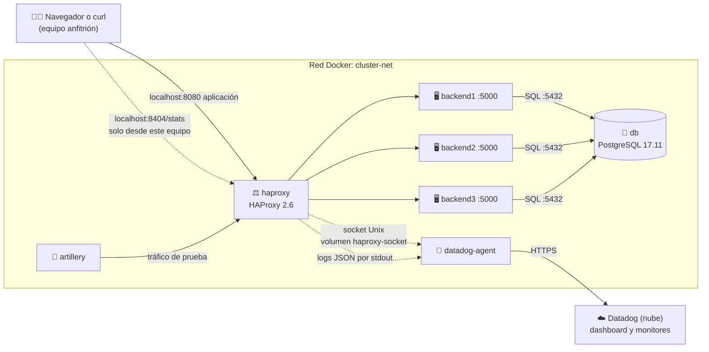

<div align="center">

# Monitoreo de clúster HAProxy con Datadog

**Proyecto 8 · Servicios Telemáticos · Ingeniería Informática**
**Universidad Autónoma de Occidente (UAO) · 2026-2**


</div>

---

> [!TIP]
> **¿Primera vez y solo quieres verlo funcionando?** Ve directo al [despliegue rápido (sección 4)](#4-despliegue-rápido): paso a paso para Windows y macOS, sin instalar nada más que Docker y Git.

## Índice

1. [Descripción y arquitectura](#1-descripción-y-arquitectura)
2. [Requisitos previos](#2-requisitos-previos)
3. [Estructura del repositorio](#3-estructura-del-repositorio)
4. [Despliegue rápido](#4-despliegue-rápido)
5. [HAProxy](#5-haproxy)
6. [Backends](#6-backends)
7. [Datadog Agent y cuenta](#7-datadog-agent-y-cuenta)
8. [Dashboard y monitores](#8-dashboard-y-monitores)
9. [Pruebas de carga](#9-pruebas-de-carga)
10. [Pruebas de punta a punta y simulación de caída](#10-pruebas-de-punta-a-punta-y-simulación-de-caída)
11. [Solución de problemas](#11-solución-de-problemas)

---

## Integrantes

| Código | Nombre | Rol en el proyecto |
|:---:|---|---|
| 2236320 | Manuel Betancurt Pérez | Infraestructura y HAProxy |
| 2235481 | Esteban Torres Yela | Backends y métricas |
| 2235593 | Jhon Alexander Galvis Galeano | Datadog Agent e ingesta de logs |
| 2236708 | Alan Yesid Basante Portilla | Dashboard y monitores en Datadog |
| 2235256 | Juan José Hurtado Espinosa | Pruebas de carga con Artillery |
| 2236364 | Sharon Zuray Abella Díaz | Integración Docker, pruebas de punta a punta y documentación |

## Avance por parte

| Parte | Responsable | Estado |
|---|---|:---:|
| Infraestructura y HAProxy | Manuel | ✅ Listo |
| Backends | Esteban |  ✅ Listo  |
| Datadog Agent | Jhon | ✅ Listo |
| Dashboard y monitores | Alan | ✅ Listo |
| Pruebas de carga | Juan José | ✅ Listo |
| Integración, E2E y documentación | Sharon | ✅ Listo |

<sub>Leyenda: ✅ Listo · 🚧 En curso · ⏳ Pendiente. Cada responsable actualiza su fila. Evidencias: carga en `docs/evidencias/carga-jj-20261114/` ([sección 9](#9-pruebas-de-carga)); integración y pruebas de punta a punta en `docs/evidencias/pruebas/` ([sección 10](#10-pruebas-de-punta-a-punta-y-simulación-de-caída)).</sub>

---

## 1. Descripción y arquitectura

<sub>👤 Responsable: Manuel Betancurt · Sharon Abella deja el diagrama final</sub>

El proyecto es la **Taquilla Sucursal**, una página para reservar sillas en teatros y escenarios de Cali, que corre en **tres backends** detrás del balanceador **HAProxy**. Todo se monitorea con **Datadog** y se prueba con carga generada por **Artillery**.

- Todo corre en **contenedores Docker** (programas empaquetados con todo lo que necesitan) orquestados con **Docker Compose**: en el equipo solo hay que instalar Docker.
- HAProxy (balanceador de carga: reparte las peticiones entre los backends) detecta si un backend se cae y deja de enviarle tráfico.

| Componente | Qué hace | Imagen |
|---|---|---|
| `haproxy` | Recibe todo el tráfico en el puerto 8080 y lo reparte entre los backends | `haproxy:2.6` (oficial) |
| `backend1` · `backend2` · `backend3` | La Taquilla: páginas web y API, con Flask + Gunicorn (la aplicación en Python y el servidor que la atiende con varios procesos) | `haproxy-telematicos-backend:2.0.0` (propia, [sección 6](#6-backends)) |
| `db` | Base de datos PostgreSQL con eventos, sillas, usuarios y reservas | `postgres:17.11` (oficial) |
| `datadog-agent` | Recoge métricas y logs y los envía a Datadog | `registry.datadoghq.com/agent:7.85.1` |
| `artillery` | Genera carga de prueba contra HAProxy; solo corre cuando se lanza una prueba (perfil `tools`) | `artilleryio/artillery:2.0.34` (oficial, [secciones 9](#9-pruebas-de-carga) y [10](#10-pruebas-de-punta-a-punta-y-simulación-de-caída)) |



**Recorrido de una petición:**
1. El navegador (o Artillery) llama a `http://localhost:8080`.
2. HAProxy escoge un backend **sano** y le pasa la petición.
3. El backend reconoce la sesión por su cookie (cualquiera de los tres puede) y consulta o reserva en PostgreSQL (`db`).
4. El backend responde; HAProxy devuelve la respuesta y escribe **una línea de log en JSON**.
5. El Datadog Agent lee los logs y las métricas y los envía a Datadog.

---

## 2. Requisitos previos

<sub>👤 Responsable: Sharon Abella · versión inicial: Manuel Betancurt</sub>

| Herramienta | Para qué | Cómo comprobar que está instalada |
|---|---|---|
| **Docker** con **Compose v2** ([Docker Desktop](https://docs.docker.com/desktop/) en Windows/macOS, [Docker Engine](https://docs.docker.com/engine/install/) en Linux) | Correr todos los servicios | `docker compose version` |
| **Git** | Descargar el proyecto | `git --version` |
| **Cuenta de Datadog** | Ver métricas, logs y alertas | Ver [sección 7](#7-datadog-agent-y-cuenta) |

---

## 3. Estructura del repositorio

<sub>👤 Responsable: Manuel Betancurt · cada integrante agrega aquí sus archivos (solo agregar líneas)</sub>

```text
.
├── docker-compose.yml       # Orquestación de todos los servicios (un bloque por dueño)
├── .env.example             # Plantilla de variables (copiar como .env)
├── .gitignore               # Archivos que Git no sube (incluye .env)
├── .gitattributes           # Fuerza finales de línea LF
├── .gitleaks.toml           # Gitleaks: ignora los hashes de integridad de las campañas de Artillery
├── README.md
├── .github/
│   └── workflows/
│       └── backends-ci.yml  # CI de los backends: pruebas y construcción de la imagen en cada PR
├── haproxy/
│   └── haproxy.cfg          # Configuración de HAProxy (montada de solo lectura)
├── backends/                # Código y Dockerfile de los backends
│   ├── app.py              # Aplicación Flask instrumentada con Prometheus y logs JSON
│   ├── gunicorn.conf.py    # Configuración de servidor de producción WSGI
│   ├── requirements.txt    # Dependencias fijas del backend (Flask, prometheus-client, gunicorn)
│   ├── requirements-dev.txt # Dependencias solo para pruebas (pytest); no entran a la imagen
│   ├── .dockerignore       # Archivos que no se copian a la imagen (pruebas y cachés)
│   ├── tests/              # Pruebas automáticas con pytest
│   └── Dockerfile          # Imagen Python 3.14-slim, usuario no root y healthcheck nativo
├── datadog/
│   ├── datadog.yaml         # Configuración general del Agent, logs y etiquetas
│   ├── conf.d/
│   │   ├── haproxy.d/
│   │   │   └── conf.yaml    # Métricas y service checks de HAProxy por socket Unix (cada 5 s)
│   │   └── http_check.d/
│   │       └── conf.yaml    # Cliente misterioso: pide /api/events por HAProxy cada 15 s
│   ├── dashboards/          # Dashboard exportado en JSON
│   └── monitors/            # Monitores exportados en JSON
├── db/
│   └── init/                # Se ejecutan una sola vez, al crear el volumen pg-data
│       ├── 01_schema.sql    # Tablas: users, events, seats y reservations
│       ├── 02_seed.sql      # Eventos, sillas y usuarios de prueba
│       └── 03_datadog_user.sh # Usuario datadog de solo lectura para el Agent
├── artillery/
│   ├── smoke-datadog.yml    # Prueba corta de la integración Artillery con Datadog (40 peticiones)
│   ├── workers.yml          # Rampa de 2 a 12 usuarios por segundo para comparar workers
│   ├── workers.sh           # Recrea los backends con 1, 2 o 4 workers y corre la rampa
│   ├── errores.yml          # Errores controlados 401, 403, 404 y 500 (7 min)
│   ├── falla.yml            # Carga constante para la prueba de caída de un backend
│   ├── falla.sh             # Detiene y vuelve a iniciar un backend durante la carga
│   ├── preparar_corrida.sh  # Verifica el estado y reinicia las sillas de prueba
│   └── analizar_datadog.py  # Informe de métricas de Datadog por corrida (antes, durante, después)
└── docs/
    ├── diagramas/           # Diagramas de arquitectura
    ├── presentacion/        # Presentación final (presentacion-proyecto8-final.pptx)
    └── evidencias/          # Capturas de las pruebas, una subcarpeta por parte
```

| Carpeta o archivo | Dueño |
|---|---|
| `haproxy/` | Manuel Betancurt |
| `backends/` | Esteban Torres |
| `datadog/` (excepto `dashboards/` y `monitors/`) | Jhon Galvis |
| `datadog/dashboards/` · `datadog/monitors/` | Alan Basante |
| `artillery/` | Juan José Hurtado |
| `docker-compose.yml` (integración) · `docs/diagramas/` | Sharon Abella (cada bloque de servicio lo edita su dueño) |

---


## 4. Despliegue rápido

<sub>👤 Responsable: Sharon Abella · versión inicial: Manuel Betancurt</sub>

Guía paso a paso para poner el proyecto en marcha en un computador propio, **sin instalar nada más que Docker y Git**. Cada paso tiene un solo comando y dice qué **debes ver**. Los comandos son de **PowerShell** (Windows). En macOS se usa la app **Terminal**; cuando el comando cambia, la versión de macOS aparece justo debajo.

> [!IMPORTANT]
> El archivo `.env` guarda las claves. Nunca se sube a GitHub, no se envía por chat y no se muestra en pantalla al grabar o tomar capturas.

### 4.1 Requisitos

| Qué | Windows | macOS |
|---|---|---|
| Sistema | Windows 10 de 64 bits, versión 22H2 (compilación 19045), o Windows 11 de 64 bits, versión 23H2 (compilación 22631) o más nueva | La versión actual de macOS o una de las dos anteriores, en Mac con chip Apple o Intel |
| Memoria RAM | Mínimo 8 GB (lo pide Docker Desktop) | Mínimo 4 GB (lo pide Docker Desktop); con 4 GB el proyecto completo puede quedarse corto, porque cada backend puede usar hasta 384 MB y además corren PostgreSQL, el Agent y Artillery |
| Docker | [Docker Desktop](https://docs.docker.com/desktop/setup/install/windows-install/) con WSL 2 (el subsistema de Linux de Windows), versión 2.1.5 o más nueva, y la virtualización activada en la BIOS/UEFI | [Docker Desktop](https://docs.docker.com/desktop/setup/install/mac-install/) |
| Git | [Git for Windows](https://git-scm.com/download/win): trae Git y **Git Bash** (la terminal que corre los scripts `.sh` de la [sección 10](#10-pruebas-de-punta-a-punta-y-simulación-de-caída)) | Git: se instala con `xcode-select --install`; la Terminal ya trae Bash |
| Datadog | Cuenta de prueba gratis ([4.2](#42-cuenta-de-datadog-y-api-key)) | Igual |

- **Windows Home:** la página de Docker nombra las ediciones Enterprise, Pro y Education y aclara que Home y Education solo corren contenedores Linux. Este proyecto solo usa contenedores Linux; esta guía se armó en Windows 11 Home con Docker Desktop 4.97.0 (Docker Compose v5.6.1).
- **Linux (en una línea):** instala [Docker Engine](https://docs.docker.com/engine/install/) con el complemento Compose y Git desde el gestor de paquetes; los comandos son los mismos de macOS.
- Requisitos de Docker Desktop consultados en docs.docker.com el **16 de noviembre de 2026**.

Antes de seguir, abre **Docker Desktop** y espera a que diga que está corriendo (la ballena del menú deja de moverse).

1. Comprobar Docker y Compose:
   ```powershell
   docker compose version
   ```
   Debes ver: `Docker Compose version v2...` o más nueva. Si sale un error de conexión, Docker Desktop todavía no ha terminado de abrir.
2. Comprobar Git:
   ```powershell
   git --version
   ```
   Debes ver: `git version 2...`.
3. Solo en Windows, comprobar Git Bash (se usa en la sección 10, no en esta guía):
   ```powershell
   & "C:\Program Files\Git\bin\bash.exe" --version
   ```
   Debes ver: `GNU bash, version ...`.

### 4.2 Cuenta de Datadog y API key

1. Crea una cuenta de prueba gratis en <https://www.datadoghq.com/> (botón de prueba gratis). Dura 14 días; la del grupo vence el 20 de noviembre de 2026 ([7.1](#71-cuenta-y-variables-de-entorno)).
2. Al entrar, mira la dirección del navegador para saber tu **sitio** (va en `DD_SITE`):

   | Si la dirección empieza por | `DD_SITE` es |
   |---|---|
   | `app.datadoghq.com` | `datadoghq.com` |
   | `us3.datadoghq.com` | `us3.datadoghq.com` |
   | `us5.datadoghq.com` | `us5.datadoghq.com` |
   | `app.datadoghq.eu` | `datadoghq.eu` |
   | `ap1.datadoghq.com` | `ap1.datadoghq.com` |

3. Saca la **API key** (la clave con la que el Agent envía datos a tu cuenta): menú de tu usuario (abajo a la izquierda) → **Organization Settings → API Keys**. Copia la que viene creada o crea una con **New Key**.
   Debes ver: una clave larga de letras y números. Guárdala solo en `.env` (paso 4.3).
4. La **Application Key** es opcional: solo la usa `analizar_datadog.py` ([10.9](#109-analizar-una-corrida-con-las-métricas-de-datadog)). Se crea en **Organization Settings → Application Keys**.

### 4.3 Descargar el proyecto y crear `.env`

1. Descargar el proyecto:
   ```powershell
   git clone https://github.com/MBeta032/Monitoreo-de-Cluster-HAProxy-con-Datadog.git
   ```
   Debes ver: `Cloning into 'Monitoreo-de-Cluster-HAProxy-con-Datadog'...` y `done`.
2. Entrar a la carpeta (todos los comandos siguientes se corren desde aquí):
   ```powershell
   cd Monitoreo-de-Cluster-HAProxy-con-Datadog
   ```
3. Crear `.env` a partir de la plantilla:
   ```powershell
   Copy-Item .env.example .env
   ```
   En macOS: `cp .env.example .env`. Debes ver: nada (sin mensaje es que funcionó).
4. Generar la clave de sesión (`SECRET_KEY`). Python corre **dentro** de un contenedor, no hay que instalarlo:
   ```powershell
   docker run --rm python:3.14-slim python -c "import secrets; print(secrets.token_hex(32))"
   ```
   Debes ver: 64 letras y números. Cópialos.
5. Generar una contraseña. Corre el comando **dos veces**: una para `POSTGRES_PASSWORD` y otra para `DD_POSTGRES_PASSWORD`:
   ```powershell
   docker run --rm python:3.14-slim python -c "import secrets; print(secrets.token_hex(16))"
   ```
   Debes ver: 32 letras y números (cumple la regla "solo letras y números").
6. Abrir `.env` para llenarlo:
   ```powershell
   notepad .env
   ```
   En macOS: `open -e .env`. Llena estas variables, sin espacios alrededor del `=`, y guarda:

   | Variable | ¿Obligatoria? | Qué poner |
   |---|:---:|---|
   | `DD_API_KEY` | Sí | La API key del paso 4.2 |
   | `DD_SITE` | Sí | El sitio del paso 4.2, por ejemplo `datadoghq.com` |
   | `POSTGRES_PASSWORD` | Sí | La primera contraseña del paso 5 |
   | `DD_POSTGRES_PASSWORD` | Sí | La segunda contraseña del paso 5 |
   | `SECRET_KEY` | Sí | Las 64 letras y números del paso 4 ([por qué](#63-sesión-en-3-backends)) |
   | `DD_APP_KEY` | No | Solo para `analizar_datadog.py` ([10.9](#109-analizar-una-corrida-con-las-métricas-de-datadog)) |
   | `JJ_EMAIL` · `JJ_PASSWORD` | Sí, para Artillery | Ya vienen llenas con la cuenta de prueba `demo@taquilla.test` / `Taquilla2026!` ([6.1](#61-qué-hace)); déjalas así. Las necesitan `normal.yml`, `pico.yml` y `pico-datadog.yml`: sin ellas, todos los usuarios virtuales fallan con `JJ_CREDENCIALES_AUSENTES`. Si tu `.env` es anterior, agrégale estas dos líneas |
   | `POSTGRES_DB` · `POSTGRES_USER` · `BACKEND1_WORKERS` a `BACKEND3_WORKERS` · `JJ_EVENT_ID` | No | Déjalas como vienen |

7. Comprobar que no falta ninguna variable obligatoria (no muestra los valores):
   ```powershell
   docker compose config --quiet
   ```
   Debes ver: nada. Si falta una, sale `Define <VARIABLE> en el archivo .env (ver .env.example)`: llénala y repite el paso.

> [!NOTE]
> Las contraseñas de PostgreSQL solo se aplican la primera vez que se crea la base (volumen `pg-data`). Si las cambias después, hay que volver a los datos iniciales ([4.8](#48-apagar-todo)).

### 4.4 Levantar y comprobar que funcionó

1. Construir y levantar todo:
   ```powershell
   docker compose up -d --build
   ```
   Debes ver: la primera vez descarga imágenes y construye los backends (unos minutos); al final, líneas `Container ... Started` o `Healthy`.
2. Revisar el estado:
   ```powershell
   docker compose ps
   ```
   Debes ver: `db`, `backend1`, `backend2`, `backend3` y `datadog-agent` en `(healthy)`, y `haproxy` en `Up` (la imagen de HAProxy no trae chequeo de salud; su estado se ve en el paso 5). El Agent puede mostrar `(health: starting)` durante el primer minuto: repite el comando.
3. Abrir <http://localhost:8080> en el navegador e iniciar sesión con `demo@taquilla.test` / `Taquilla2026!`.
   Debes ver: la cartelera, tu nombre arriba y "Atendido por backendX" en el pie.
4. Ver qué backend atiende cada petición. Corre este comando **6 veces**:
   ```powershell
   curl.exe -s http://localhost:8080/api/info
   ```
   En macOS: `curl -s http://localhost:8080/api/info`. Debes ver: van saliendo `backend1`, `backend2` y `backend3` por turnos.
5. Abrir <http://localhost:8404/stats> (solo funciona desde este mismo equipo).
   Debes ver: `backend1`, `backend2` y `backend3` en verde (`UP`).
6. Comprobar que el Agent entra a tu cuenta de Datadog:
   ```powershell
   docker compose exec -T datadog-agent agent status | Select-String "API Key"
   ```
   En macOS: `docker compose exec -T datadog-agent agent status | grep "API Key"`. Debes ver: `API Key valid`.
7. En Datadog, abrir **Logs** y buscar `service:haproxy`.
   Debes ver: después de 1 o 2 minutos, las líneas JSON de HAProxy con `status_code`, `server` y `total_ms`.

| Dirección | Qué es |
|---|---|
| <http://localhost:8080> | La Taquilla (la aplicación) |
| <http://localhost:8080/api/info> | Qué backend respondió |
| <http://localhost:8404/stats> | Tablero de estadísticas de HAProxy (solo desde este equipo) |
| <https://app.datadoghq.com> | Datadog (cambia según tu `DD_SITE`) |
| [Enlace público del dashboard del grupo](https://p.datadoghq.com/sb/95a7b1a2-d9f8-11f1-b57e-baea63f7b3d6-ccacbd422eed735a402e91352d62c6ba) | Se ve sin cuenta, pero muestra los datos de la cuenta del grupo, no los tuyos |

### 4.5 Importar el dashboard y los monitores a tu cuenta

En la cuenta del grupo ya están creados; ahí se actualizan como dice [8.4](#84-cómo-importar-en-datadog). En una cuenta nueva:

1. Crea primero el Team `haproxy-telematicos` con tu correo (pasos "Team para los avisos" de [8.4](#84-cómo-importar-en-datadog)). Los monitores avisan a `@team-haproxy-telematicos`.
2. Dashboard: en Datadog, **Dashboards → New Dashboard**, ponle cualquier nombre, y en el engranaje **Configure → Import dashboard JSON** escoge el archivo `datadog/dashboards/haproxy_cluster_dashboard.json`.
   Debes ver: "Cluster HAProxy - Monitoreo y Rendimiento" con 7 grupos y el filtro `backend` arriba.
3. Copiar el primer monitor al portapapeles:
   ```powershell
   Get-Content datadog/monitors/backend_down_monitor.json -Raw | Set-Clipboard
   ```
   En macOS: `pbcopy < datadog/monitors/backend_down_monitor.json`.
4. En Datadog, **Monitors → New Monitor → Import from JSON**, pegar y crear.
   Debes ver: el monitor "[HAProxy] Caída de servidor backend detectada".
5. Repetir los pasos 3 y 4 con `high_error_rate_monitor.json` y `reservation_unavailable_monitor.json`.
   Debes ver: en **Monitors → Manage Monitors**, los 3 monitores (los explica la [guía de alertas](#82-guía-de-alertas)).

### 4.6 Una prueba corta con Artillery (en contenedor)

1. Lanzar 40 peticiones en 20 s. Artillery corre en su propio contenedor, no se instala. En Windows usa PowerShell (en Git Bash las rutas se convierten mal):
   ```powershell
   docker run --rm --network cluster-net -v "${PWD}/artillery:/scripts:ro" artilleryio/artillery:2.0.34 run /scripts/smoke-datadog.yml
   ```
   Debes ver: en el resumen final, `http.requests` y `http.codes.200` en 40, y `vusers.failed` en 0.
2. En Datadog, **Event Management → All Events**, después de 1 o 2 minutos.
   Debes ver: los eventos de inicio y fin de "Artillery smoke-datadog". En **Metrics → Explorer**, `artillery.http.requests` con `test:smoke-datadog` suma 40.

Los escenarios largos (errores, caída, workers, concurrencia) están en la [sección 10](#10-pruebas-de-punta-a-punta-y-simulación-de-caída).

### 4.7 Apagar y prender un backend

1. Apagar `backend2`:
   ```powershell
   docker compose stop backend2
   ```
   Debes ver: `Container backend2 Stopped`.
2. Recargar <http://localhost:8404/stats>.
   Debes ver: `backend2` en rojo (`DOWN`) a los ~5 s. La Taquilla sigue funcionando y `curl.exe -s http://localhost:8080/api/info` solo responde `backend1` y `backend3`.
3. Mirar Datadog.
   Debes ver: en el dashboard, grupo "1. Estado", `backend2` en rojo; el monitor "[HAProxy] Caída de servidor backend detectada" pasa a `[Triggered]` unos **60 s** después de apagarlo (medido, [10.10](#1010-resultados-medidos)) y llega un correo al Team.
4. Prender `backend2`:
   ```powershell
   docker compose start backend2
   ```
   Debes ver: `backend2` en verde en <http://localhost:8404/stats> a los ~4 s, y el monitor en `[Recovered]` unos 60 s después.

### 4.8 Apagar todo

1. Apagar y borrar los contenedores (los datos de la base se conservan en el volumen `pg-data`):
   ```powershell
   docker compose down
   ```
   Debes ver: líneas `Container ... Removed`. Para volver a prender: `docker compose up -d`.

Otras situaciones:
- **Volver a los datos iniciales** (borra las reservas y las cuentas nuevas): `docker compose rm -s -f db`, luego `docker volume rm pg-data` y `docker compose up -d`.
- **Después de recrear los backends** (por ejemplo con `--build` o `workers.sh`), ejecutar `docker compose restart haproxy`: HAProxy guarda la dirección de cada backend al arrancar.

### 4.9 Si algo falla

| Lo que ves | Qué hacer |
|---|---|
| `docker` no se reconoce como comando | Cerrar y abrir la terminal ([sección 11](#11-solución-de-problemas)) |
| Error de conexión con Docker | Abrir Docker Desktop y esperar a que diga que está corriendo |
| `Define <VARIABLE> en el archivo .env` | Llenar esa variable ([4.3](#43-descargar-el-proyecto-y-crear-env), paso 6) |
| `port is already allocated` (8080 o 8404) | Otro programa usa ese puerto: cerrarlo y repetir `docker compose up -d` |
| `datadog-agent` en `Exited` o `Restarting`, o no sale `API Key valid` | `DD_API_KEY` o `DD_SITE` mal escritos ([sección 11](#11-solución-de-problemas)) |
| Un backend en `(unhealthy)` o en `DOWN` | [Sección 11](#11-solución-de-problemas) |
| Las métricas de Artillery no llegan a Datadog | [Sección 11](#11-solución-de-problemas) y [7.10](#710-dogstatsd-métricas-de-artillery) |
| Un script `.sh` dice `\r: command not found` | [Sección 11](#11-solución-de-problemas) |

Para cualquier otro mensaje, búscalo en la [sección 11 · Solución de problemas](#11-solución-de-problemas).

---

## 5. HAProxy

<sub>👤 Responsable: Manuel Betancurt</sub>

### 5.1 Contrato de integración

> [!WARNING]
> Estos nombres los usan **todas** las partes del proyecto. **No se cambian sin avisar antes al grupo.**

| Elemento | Valor |
|---|---|
| Servicios en Compose | `haproxy` · `backend1` · `backend2` · `backend3` · `datadog-agent` · `artillery` (el nombre del contenedor es igual al del servicio) |
| Red de Docker | `cluster-net` |
| Aplicación (frontend `fe_web`) | puerto `8080`, publicado en el equipo anfitrión |
| Tablero de estadísticas | puerto `8404`, ruta `/stats`, publicado **solo en `127.0.0.1`** del anfitrión |
| Socket de estadísticas | `/var/lib/haproxy/admin.sock`, en el volumen `haproxy-socket` |
| Backends | puerto interno `5000` · rutas `/`, `/health`, `/metrics`, `/error` |
| Grupo de backends en HAProxy | `be_app` |
| Logs | una línea JSON por petición, por la salida estándar del contenedor (15 campos, ver 5.5) |
| Tags en Datadog | `env:lab` · `project:haproxy-telematicos` |

### 5.2 Puertos

| Puerto | Dónde | Para qué |
|:---:|---|---|
| **8080** | `http://localhost:8080` | Entrada de la aplicación: todo el tráfico pasa por aquí |
| **8404** | `http://localhost:8404/stats` | Tablero de estadísticas. Solo se abre desde el equipo donde corre Docker |
| **5000** | Solo dentro de `cluster-net` | Puerto de cada backend; no se publica al equipo anfitrión |

> [!NOTE]
> HAProxy usa el 8080 y no el 80 porque la imagen oficial, desde la versión 2.4, se ejecuta con un usuario sin privilegios (`haproxy`), que no puede abrir puertos menores a 1024.

### 5.3 Tablero de estadísticas

- **Dirección:** <http://localhost:8404/stats>. Se recarga solo cada 5 segundos.
- **Qué muestra:** por cada backend, si está `UP` (verde) o `DOWN` (rojo), sesiones, bytes y códigos de respuesta. La columna `LastChk` muestra el resultado del último health check (`L7OK/200` significa que respondió `200`).
- **Acceso:** el puerto solo se publica en `127.0.0.1`, así que otros equipos de la red no lo alcanzan. El tablero **no escribe en el log**, para que sus recargas no cuenten como tráfico.
- **Relación con Datadog:** el tablero y el socket entregan los mismos datos. El tablero muestra solo el instante actual; Datadog guarda el historial y envía alertas.

### 5.4 Socket de estadísticas (para el Datadog Agent)

| Parámetro | Valor | Por qué |
|---|---|---|
| Ruta | `/var/lib/haproxy/admin.sock` | La carpeta ya pertenece al usuario `haproxy` en la imagen; `/var/run/haproxy` no existe y Docker la crearía como root, impidiendo que HAProxy cree el socket |
| Permisos | `mode 660` | Solo el dueño y el grupo pueden abrirlo (no `666`) |
| Nivel | `level user` | Solo lectura de estadísticas: el socket no permite cambiar nada |
| Dueño y grupo | `haproxy` (uid 99, gid 99) | Es el usuario con el que corre HAProxy en la imagen |

**Para Jhon (servicio `datadog-agent`):**
- Montar el volumen `haproxy-socket` en el Agent, en la misma ruta: `/var/lib/haproxy`.
- Agregar `group_add: ["99"]` al servicio, para que el proceso del Agent pertenezca al grupo del socket.
- En `haproxy.d/conf.yaml`, usar `url: unix:///var/lib/haproxy/admin.sock`. Según la documentación de Datadog, la integración por socket es el modo antiguo (deprecated): para usarla hay que poner `use_openmetrics` y `use_prometheus` en `false`.
- Si el Agent no logra leer con `level user`, subir a `level operator` en `haproxy.cfg` y avisar al grupo.

<details>
<summary>Comprobar el socket sin el Agent</summary>

Un usuario común (no root) con el grupo 99 debe poder leer; sin el grupo, no:
```bash
# Sin el grupo: debe responder "Permission denied"
docker run --rm -v haproxy-socket:/var/lib/haproxy --user 1000 --entrypoint sh alpine/socat -c 'echo show info | socat - UNIX-CONNECT:/var/lib/haproxy/admin.sock'

# Con el grupo 99: lista el estado de los backends (deben salir en UP)
docker run --rm -v haproxy-socket:/var/lib/haproxy --user 1000 --group-add 99 --entrypoint sh alpine/socat -c 'echo show stat | socat - UNIX-CONNECT:/var/lib/haproxy/admin.sock | cut -d, -f1,2,18'
```

</details>

### 5.5 Contrato de logs (JSON)

HAProxy escribe **una línea JSON por petición** en la salida estándar del contenedor (`docker compose logs haproxy`) y el Datadog Agent la lee de ahí. Los tiempos son **números sin comillas, en milisegundos**.

| Campo | Tipo | Qué significa | Ejemplo |
|---|:---:|---|---|
| `timestamp` | número | Milisegundos desde 1970 (UTC). Es el momento en que se escribe el log, es decir, el final de la petición | `1793511346523` |
| `client_ip` | texto | IP de quien hizo la petición | `"172.18.0.1"` |
| `frontend` | texto | Por dónde entró la petición | `"fe_web"` |
| `backend` | texto | Grupo de servidores que la atendió | `"be_app"` |
| `server` | texto | Servidor que respondió (`<NOSRV>` si ninguno) | `"backend2"` |
| `method` | texto | Método HTTP (primeros 32 bytes) | `"GET"` |
| `path` | texto | Ruta pedida, sin parámetros (primeros 512 bytes) | `"/health"` |
| `status_code` | número | Código de respuesta HTTP | `200` |
| `bytes` | número | Bytes enviados al cliente | `299` |
| `queue_ms` | número | Tiempo esperando en cola dentro de HAProxy (`Tw`) | `0` |
| `connect_ms` | número | Tiempo en conectarse al backend (`Tc`) | `1` |
| `response_ms` | número | Tiempo que tardó el backend en empezar a responder (`Tr`) | `4` |
| `total_ms` | número | Tiempo total activo de la petición (`Ta`) | `6` |
| `termination_state` | texto | Cómo terminó la petición. Extra al contrato original | `"--"` |
| `retries` | texto | Reintentos de conexión. Extra al contrato original | `"0"` |

> [!NOTE]
> - Si `queue_ms`, `connect_ms` o `response_ms` valen `-1`, esa etapa no ocurrió (por ejemplo, no se pudo conectar con el backend). Al calcular latencias hay que **excluir esos valores**.
> - `termination_state`: `--` es normal; `sC` significa que el backend no logró conectar a tiempo.
> - `retries`: `"0"` es normal; `"+1"` indica una petición que HAProxy pasó a **otro** servidor (`redispatch`). Va como texto porque `+1` no es un número válido en JSON.
> - La barra de la ruta sale escapada (`\/`): es JSON válido y Datadog la lee como `/`.

<details>
<summary>Ejemplo de una línea de log</summary>

```json
{"timestamp":1793511346523,"client_ip":"172.18.0.1","frontend":"fe_web","backend":"be_app","server":"backend1","method":"GET","path":"\/","status_code":200,"bytes":299,"queue_ms":0,"connect_ms":2,"response_ms":4,"total_ms":6,"termination_state":"--","retries":"0"}
```

</details>

<details>
<summary>Por qué <code>path</code> y <code>method</code> están acotados</summary>

Son datos que controla quien hace la petición. Se **escapan** (para que una comilla en la dirección no pueda romper ni falsificar el JSON) y se **recortan** (512 y 32 bytes) para que cada línea tenga un tamaño máximo conocido: ni se corta a la mitad ni permite llenar el disco con direcciones larguísimas. El límite del mensaje de log es de 4096 bytes (`len 4096`), y HAProxy rechaza con `400` las peticiones demasiado grandes, que igual generan una línea válida.

</details>

### 5.6 Parámetros del balanceador

| Parámetro | Valor | Qué hace |
|---|---|---|
| Algoritmo | `roundrobin` | Reparte por turnos. Los 3 backends son iguales y las peticiones cortas, así que no se justifica `leastconn` |
| Health check | `GET /health`, espera `200` | HAProxy lo pregunta a cada backend |
| `inter` | `1s` | Cada cuánto revisa cada backend (y el tiempo máximo que espera el chequeo) |
| `fall` | `3` | Fallos seguidos para marcar un backend como `DOWN` |
| `rise` | `2` | Chequeos buenos seguidos para volver a `UP` |
| `option redispatch 1` | activo | Si no logra conectar con un backend, reintenta en otro desde el primer reintento |
| `timeout connect` | `2s` | Espera para conectar con un backend |
| `timeout client` / `timeout server` | `30s` | Inactividad máxima del cliente y del backend |

### 5.7 Comportamiento ante la caída de un backend (medido)

Medido con `docker stop backend1` y tráfico constante, con los backends temporales (con los reales puede variar):

| Medida | Resultado |
|---|---|
| Tiempo en marcar el backend como `DOWN` | ≈ 6 s |
| Tiempo en volver a `UP` al encenderlo | ≈ 2,3 s |
| Peticiones con error | 0 de 60 |
| Peticiones afectadas | Las que le tocaban al backend caído en esos segundos: tardan ≈ 2 s y se responden desde otro backend |

Para el monitor de "backend DOWN": no puede dar señal antes de unos 6 segundos desde la caída.

### 5.8 Backends temporales

Mientras se integran los backends reales ([sección 6](#6-backends)), el `docker-compose.yml` usa la imagen [`traefik/whoami`](https://github.com/traefik/whoami), que responde con el nombre del contenedor que atendió la petición y permite **ver el reparto de carga**. Cumplen el contrato: nombres `backend1` a `backend3`, puerto `5000` (variable `WHOAMI_PORT_NUMBER`) y responden `200` en `/health`. No tienen `/metrics` ni `/error`: esas rutas las implementan los backends reales.

---

## 6. Backends

<sub>👤 Responsable: Esteban Torres</sub>

Los backends son la **Taquilla Sucursal**: una aplicación web en Python (Flask 3.1.0 con Gunicorn 23.0.0) donde se reservan sillas, sin pagos. Los tres contenedores usan la misma imagen, `haproxy-telematicos-backend:2.0.0`, y comparten la base de datos `db`.

### 6.1 Qué hace

- Flujo: Cartelera → Zona → Silla → Iniciar sesión → Confirmar → Listo → Mis reservas.

| Evento del seed (datos iniciales, `db/init/02_seed.sql`) | Lugar | Sillas |
|---|---|---|
| Concierto Caña y Clave (venta flash) | Teatro al Aire Libre Los Cristales | 2.000 en 4 zonas: Platea, Gradería Central, Izquierda y Derecha |
| Obra: El Cuentero del Pacífico | Teatro Municipal Enrique Buenaventura | 100 |
| Noche de jazz | Teatro Jorge Isaacs | 100 |
| Cuentos de medianoche | Teatrino del Teatro Municipal | 40, ya reservadas (sale AGOTADO) |

- Usuarios **solo para pruebas**: `demo@taquilla.test` y `prueba001@taquilla.test` a `prueba200@taquilla.test`, todos con la contraseña `Taquilla2026!`.

### 6.2 Rutas

| Página (la arma Flask) | Método | Sesión | Qué hace |
|---|:---:|:---:|---|
| `/` | GET | No | Cartelera |
| `/events/<id>` | GET | No | Plano de zonas; con `?section=<zona>`, las sillas de esa zona |
| `/events/<id>/confirm?seat=<id>` | GET · POST | Sí (si no, va a `/login`) | Resumen · reserva (303 a la pantalla Listo, o 409 si alguien la tomó antes) |
| `/reservations` · `/reservations/<id>` | GET | Sí | Mis reservas · pantalla Listo (404 si la reserva es de otro) |
| `/login` · `/register` · `/logout` | GET y POST | — | Cuentas (los formularios llevan token CSRF) |
| `/health` · `/metrics` · `/error` | GET | No | Salud (200), métricas y error forzado (500) |

| API en JSON (contrato para Artillery; 503 si la base no responde) | Método | Sesión | `X-CSRF-Token` | Respuestas |
|---|:---:|:---:|:---:|---|
| `/api/info` | GET | No | No | 200 con `instance` |
| `/api/events` · `/api/events/<id>` | GET | No | No | 200 · 404 |
| `/api/events/<id>/seats` (opcional `?section=<zona>`) | GET | No | No | 200 · 404 |
| `/api/login` (JSON con `email` y `password`) | POST | No | No | 200 con el usuario y el **`csrf_token`** · 400 · 401 |
| `/api/events/<id>/seats/<seat_id>/reserve` | POST | Sí | Sí | 201 con el código (`TS-000045`) · 401 · 403 · 404 · 409 |
| `/api/reservations` | GET | Sí | No | 200 · 401 |
| `/api/logout` | POST | Sí | Sí | 200 · 403 |

- Para Artillery: `POST /api/login` una sola vez por usuario virtual (guarda la cookie y el `csrf_token`) y luego `POST .../reserve` con el encabezado `X-CSRF-Token`. Conviene golpear la API y no las páginas (una zona del concierto pesa unos 94 KB).

```powershell
Set-Content login.json '{"email":"prueba001@taquilla.test","password":"Taquilla2026!"}'
$login = curl.exe -s -c cookies.txt -H "Content-Type: application/json" --data-binary "@login.json" http://localhost:8080/api/login | ConvertFrom-Json
curl.exe -s -b cookies.txt -X POST -H "X-CSRF-Token: $($login.csrf_token)" http://localhost:8080/api/events/1/seats/12/reserve
```
Debes ver: `{"code":"TS-...","section":"Platea",...}`. Si repites el último comando, la respuesta es 409 (silla ya reservada).

### 6.3 Sesión en 3 backends

- La sesión es una **cookie firmada** (un dato que guarda el navegador y que el backend comprueba que nadie cambió). Solo lleva el id del usuario y el token CSRF, y no vive en la memoria de ningún backend.
- Los 3 backends usan la **misma `SECRET_KEY`** (la clave que firma la cookie), así que cualquiera reconoce la sesión que creó otro. Demo: inicia sesión, recarga varias veces y mira que cambia "Atendido por backendX" sin perder la sesión.
- Cada formulario y cada POST de la API llevan un **token CSRF** (un código de la sesión que una página de otro sitio no puede conocer); si falta o no coincide, la respuesta es 403. La cookie dura 2 horas, con HttpOnly y SameSite=Lax (en producción, con HTTPS, también Secure).

### 6.4 Base de datos

- Servicio `db` (PostgreSQL 17.11), solo dentro de `cluster-net`, con el volumen `pg-data` (guarda los datos aunque se borre el contenedor; para volver a los datos iniciales, ver la [sección 4](#4-despliegue-rápido)). El esquema y el seed (`db/init/`) se cargan la primera vez.
- **Reserva atómica** (todo o nada): dos consultas en una sola transacción. Un `UPDATE` aparta la silla solo si sigue libre y un `INSERT` crea la reserva; si algo falla, no se guarda ninguna de las dos. Dos personas no pueden apartar la misma silla: probado con 30 a la vez, una recibe 201 y las demás 409.
- Si la base no responde: la API da 503 en JSON, las páginas muestran "Servicio no disponible", y queda una línea de log `ERROR`.
- Conexiones: cada worker abre una por hilo (4). Con 4 workers por backend: 4 × 4 × 3 = 48, por debajo del máximo de 100 de PostgreSQL.

### 6.5 Métricas y logs

- `http_requests_total` (contador; labels `method`, `handler`, `status`) y `http_request_duration_seconds` (histograma; labels `method`, `handler`), en `/metrics`.
- `handler` es la ruta de Flask y no la URL escrita (por ejemplo `/api/events/<int:event_id>/seats/<int:seat_id>/reserve`); si ninguna coincide, vale `unmatched`. `/health` y `/metrics` no se cuentan.
- Cada petición deja una línea JSON en el log: `5xx` → `ERROR`, `4xx` → `WARNING`, el resto `INFO`. Nunca se escriben contraseñas ni tokens.
- Modo multiproceso (prometheus-client suma lo de todos los workers de Gunicorn): cada worker escribe en `/tmp/prometheus_multiproc`, y esa carpeta se vacía cada vez que arranca Gunicorn.

### 6.6 Escenarios de workers

El número de workers (procesos de Gunicorn) de cada backend se cambia en `.env`; si no se define, cada uno usa 2. Cada worker atiende con 4 hilos.

| Escenario | `BACKEND1_WORKERS` | `BACKEND2_WORKERS` | `BACKEND3_WORKERS` |
|---|:---:|:---:|:---:|
| Normal | 2 | 2 | 2 |
| Pocos workers | 1 | 1 | 1 |
| Muchos workers | 4 | 4 | 4 |
| Desigual | 1 | 2 | 4 |

```powershell
docker compose up -d backend1 backend2 backend3
docker compose restart haproxy
```
Debes ver: `Recreated` en los backends cuyo valor cambió. Con `docker top backend1` se ve un proceso maestro más uno por worker.

### 6.7 Límites

- Cada backend tiene 1 CPU y 384 MB de memoria (medido: unos 85 MB con 2 workers).
- Cada inicio de sesión gasta unos 300 ms de CPU (hash pbkdf2 con 600.000 iteraciones; no se usa scrypt porque pide 32 MB por login). Por eso, en Artillery cada usuario virtual inicia sesión una sola vez.

### 6.8 Pruebas

```powershell
cd backends
python -m pip install -r requirements.txt -r requirements-dev.txt
python -m pytest -v
```
Debes ver: `34 passed, 37 skipped` (las pruebas que usan base de datos se saltan sin `TEST_DATABASE_URL`).

Con una base de prueba (PostgreSQL temporal en el puerto 5433; esperar unos segundos después del `docker run`):
```powershell
docker run -d --name boleteria-test-db -e POSTGRES_HOST_AUTH_METHOD=trust -e POSTGRES_DB=boleteria_test -p 127.0.0.1:5433:5432 postgres:17.11
$env:TEST_DATABASE_URL = "postgresql://postgres@127.0.0.1:5433/boleteria_test"
python -m pytest -v
docker rm -f boleteria-test-db
```
Debes ver: `71 passed`. Se usa `127.0.0.1` y no `localhost`: en Windows, `localhost` intenta primero IPv6 y la conexión se queda colgada.

- CI: GitHub Actions corre las 71 pruebas con un PostgreSQL 17.11 y construye la imagen en cada Pull Request que cambie `backends/` o `db/`.

---

## 7. Datadog Agent y cuenta

<sub>👤 Responsable: Jhon Galvis</sub>

El **Datadog Agent** (un programa que corre junto a los demás contenedores) recoge métricas, logs y chequeos de HAProxy, los backends y PostgreSQL, y los envía a Datadog. Allí se ven en dashboards y disparan monitores.

### 7.1 Cuenta y variables de entorno

- Cuenta en la región US1 (`datadoghq.com`), con la **prueba gratuita de 14 días** que empezó el 6 de noviembre y **vence el 20 de noviembre** (el 12 de noviembre, Plan & Usage mostraba "8 days left"). La entrega es el **martes 17 de noviembre**.
- La API key (la clave con la que el Agent envía datos a la cuenta) se saca de **Organization Settings → API Keys**.
- Variables del `.env` (nunca se sube a GitHub):

| Variable | Para qué |
|---|---|
| `DD_API_KEY` | Clave de la organización |
| `DD_SITE` | `datadoghq.com` |
| `DD_POSTGRES_PASSWORD` | Contraseña del usuario `datadog` de PostgreSQL ([ver 7.7](#77-postgresql)); obligatoria, solo letras y números |
| `DD_APP_KEY` | Application Key de Datadog (Organization Settings → Application Keys). Es opcional: solo la usa `analizar_datadog.py` para **consultar** métricas, no hace falta para levantar el clúster. Debe ser de la misma cuenta y región que `DD_API_KEY` |

### 7.2 Configuración del Agent

- Servicio `datadog-agent` (Agent 7.85.1) en `cluster-net`, con `restart: unless-stopped` (se vuelve a levantar solo si se cae).
- `datadog/datadog.yaml` activa los logs y pone las etiquetas `env:lab` y `project:haproxy-telematicos` a todo lo que se envía.
- El Agent lee el socket de Docker para ver los contenedores y sus etiquetas (**Autodiscovery**: el Agent arma los checks a partir de etiquetas puestas en cada contenedor). También comparte el volumen `haproxy-socket` (grupo 99) para leer las estadísticas de HAProxy.

| Check (integración de Datadog) | Qué vigila | Dónde está la configuración | Frecuencia |
|---|---|---|---|
| `haproxy` | Estado y tráfico de HAProxy y de cada backend | `datadog/conf.d/haproxy.d/conf.yaml` | Cada 5 s |
| `openmetrics` (× 3) | `/metrics` de cada backend | Etiquetas de `backend1` a `backend3` en el compose | Cada 15 s |
| `http_check` | El cliente misterioso ([7.6](#76-cliente-misterioso-http_check)) | `datadog/conf.d/http_check.d/conf.yaml` | Cada 15 s |
| `postgres` | PostgreSQL ([7.7](#77-postgresql)) | Etiqueta del servicio `db` en el compose | Cada 15 s |
| `dogstatsd` | Recibe las métricas y eventos que publica Artillery ([10.5](#105-artillery-con-datadog)) | Variable `DD_DOGSTATSD_NON_LOCAL_TRAFFIC` del servicio `datadog-agent` | Mientras corre una prueba |

### 7.3 Integración con HAProxy

- Lee el socket Unix `/var/lib/haproxy/admin.sock` con la versión heredada de la integración (`use_openmetrics: false`), que da el service check `haproxy.backend_up` (el que usa el monitor de backend caído).
- Lee la planilla cada **5 s** (`min_collection_interval: 5`; por defecto son 15). Medido: HAProxy marca un backend `DOWN` unos 4 s después de detenerlo y el Agent lo recoge en su siguiente lectura, así que la caída se ve en Datadog en **unos 5 a 10 s**.
- `collect_aggregates_only: both`: envía las métricas del grupo `be_app` (`backend:backend`) **y** las de cada servidor (`backend:backend1` a `backend3`). La fila del grupo es la suma de los servidores, así que los totales filtran `backend:backend` y las vistas por servidor excluyen esa fila (`!backend:backend`); si no, se cuenta doble.
- Cada lectura envía 166 métricas (antes 94, solo del grupo) y 4 service checks (uno por backend y uno general).

### 7.4 Métricas de los backends (OpenMetrics por Autodiscovery)

- Cada backend tiene la etiqueta `com.datadoghq.ad.checks` en el compose, con su `/metrics`, el namespace `backend` y la etiqueta `backend:backendN`. Ya no existe `datadog/conf.d/openmetrics.d/`.
- Formato (Agent 7.36 o más nuevo): el JSON va entre **comillas simples** para que YAML lo deje como texto:
  `com.datadoghq.ad.checks: '{"openmetrics": {"instances": [{"openmetrics_endpoint": "http://backend1:5000/metrics", ...}]}}'`
- Las métricas tienen los **mismos nombres y etiquetas** que antes: `backend.http_requests.count` y `backend.http_request_duration_seconds.{sum,count,bucket}`, con `backend`, `endpoint`, `handler`, `method` y `status`. Autodiscovery agrega etiquetas del contenedor (`image_name`, `short_image`, ...), que no cambian ninguna consulta.
- El primer intento de Jhon con etiquetas no quedó en el historial de Git, así que la causa más probable (no confirmada) fue el formato del JSON. Los logs por etiquetas sí funcionaban, o sea que el Agent ya leía las etiquetas.

### 7.5 Recolección de logs

- Solo se recogen los contenedores que tienen la etiqueta `com.datadoghq.ad.logs`: `haproxy`, `backend1` a `backend3` (source `python`) y `db` (source `postgresql`).
- HAProxy, la app y Gunicorn escriben **JSON con su nivel real** (`INFO`, `WARNING`, `ERROR`), así que Datadog clasifica bien cada línea.
- Los logs de HAProxy llegan con atributos separados (`backend`, `server`, `status_code`, `response_ms`, `total_ms`). Con `@total_ms` se creó la medida **HAProxy Total Latency** (en milisegundos) para ver percentiles.

### 7.6 Cliente misterioso (http_check)

Cada 15 s el Agent pide la cartelera como lo haría un usuario, aunque no haya tráfico. Sirve para detectar "la base cayó y el semáforo sigue verde": HAProxy revisa `/health`, que no usa la base, así que sigue viendo los backends sanos.

- Pide `http://haproxy:8080/api/events` (pasa por HAProxy, un backend y PostgreSQL), espera hasta 10 s y solo acepta un `200`.
- En Datadog: métricas `network.http.response_time` y `network.http.can_connect`, y service check `http.can_connect`, con la etiqueta `instance:taquilla_api_events`.
- Con la base caída, el check queda CRITICAL con el mensaje `Expected 200, got 503` (el backend espera 5 s al pool y responde 503). Al volver la base, tarda unos 15 a 30 s en pasar a OK, mientras los backends se reconectan.
- Estas peticiones aparecen en las métricas y logs de HAProxy y de los backends (unas 4 por minuto). Los logs no guardan el User-Agent (el navegador o programa que pide), así que se filtran por ruta e IP del Agent:
  - Logs de HAProxy: `service:haproxy @path:"/api/events" @client_ip:<IP del Agent>`. La IP se ve con `docker inspect -f "{{range .NetworkSettings.Networks}}{{.IPAddress}}{{end}}" datadog-agent`.
  - Métricas de los backends: el `handler:/api/events` incluye estas peticiones.

### 7.7 PostgreSQL

- Usuario **`datadog` de solo lectura** (rol `pg_monitor`), creado por `db/init/03_datadog_user.sh` con la contraseña `DD_POSTGRES_PASSWORD`. Ese script solo corre al crear `pg-data`: si la base ya existía, hay que recrear el volumen ([sección 4](#4-despliegue-rápido)).
- El check va en la etiqueta del servicio `db` con `"password": "%%env_DD_POSTGRES_PASSWORD%%"`: el Agent la reemplaza con **su propia** variable de entorno, así que la contraseña no queda en ningún archivo del repo.
- `relations` con las tablas `seats` y `reservations` activa las métricas por tabla y la de bloqueos.
- `log_min_duration_statement=250`: toda consulta que tarde más de 250 ms queda en el log de `db` (`service:db` en Log Explorer).

| Métrica | Qué dice en la venta flash |
|---|---|
| `postgresql.connections` | Conexiones abiertas (con 4 workers por backend llegan a 48) |
| `postgresql.percent_usage_connections` | Fracción del máximo de 100 conexiones en uso |
| `postgresql.commits` · `postgresql.rollbacks` | Transacciones confirmadas y deshechas por segundo |
| `postgresql.locks` | Bloqueos activos, por tabla y tipo (por ejemplo en `seats`) |
| `postgresql.deadlocks.count` | Bloqueos mutuos (deberían quedarse en 0) |

### 7.8 Eventos y pruebas de disponibilidad

- Los eventos de Docker (contenedor detenido, iniciado) llegan a **Event Management → All Events**.
- Prueba hecha por Jhon: con `docker compose stop backend2`, el service check `haproxy.backend_up` pasó a `CRITICAL` con `backend:backend2`, y HAProxy siguió atendiendo con `backend1` y `backend3`. Con `docker compose start backend2` volvió a OK.

### 7.9 Comandos de verificación

```powershell
docker compose exec -T datadog-agent agent status
```
Debes ver: `API Key valid` y los checks `haproxy`, `http_check`, `openmetrics` y `postgres` sin errores.

```powershell
docker compose exec -T datadog-agent agent configcheck
```
Debes ver: `haproxy` y `http_check` desde archivo (`Configuration provider: file`), y `postgres` y tres `openmetrics` desde contenedores (`Configuration source: container:docker://...`).

```powershell
docker compose exec -T datadog-agent agent check haproxy
docker compose exec -T datadog-agent agent check http_check
docker compose exec -T datadog-agent agent check postgres
docker compose exec -T datadog-agent agent check openmetrics
```
Debes ver: los service checks en `"status": 0` (OK). `agent check openmetrics` a veces corre solo las instancias que encuentra a tiempo; para una en particular: `--instance-filter '.openmetrics_endpoint == "http://backend2:5000/metrics"'`.

Simulacro de base caída:
```powershell
docker compose stop db
docker compose exec -T datadog-agent agent check http_check
docker compose start db
```
Debes ver: con la base apagada, `http.can_connect` en `"status": 2` con `Expected 200, got 503`, y la página <http://localhost:8080> mostrando "Servicio no disponible".

En Datadog: **Metrics Explorer** (`postgresql.connections`, `network.http.response_time`, `backend.http_requests.count`) y **Log Explorer** (`service:db`, `service:haproxy`).

### 7.10 DogStatsD (métricas de Artillery)

DogStatsD es el protocolo con el que un programa envía métricas al Agent por UDP (puerto 8125). Por defecto el Agent solo acepta esos paquetes del **propio contenedor**; Artillery corre en otro, así que el servicio `datadog-agent` define `DD_DOGSTATSD_NON_LOCAL_TRAFFIC: "true"`. El puerto 8125 **no se publica** en el equipo anfitrión: solo lo ven los contenedores de `cluster-net`.

```powershell
docker compose exec -T datadog-agent agent status | Select-String "Metric Packets"
docker run --rm --network cluster-net alpine sh -c "for i in 1 2 3 4 5; do echo 'prueba:1|c' | nc -u -w1 datadog-agent 8125; done"
docker compose exec -T datadog-agent agent status | Select-String "Metric Packets"
```
Debes ver: `Metric Packets` sube en 5. Sin la variable no sube (medido: 0 de 5 paquetes).

---

## 8. Dashboard y monitores

<sub>👤 Responsable: Alan Basante</sub>

El dashboard muestra en una sola página cómo está la Taquilla (estado, tráfico, tiempos, errores, base de datos) y los monitores (reglas que vigilan una métrica y avisan por correo) alertan cuando algo falla. Todo está versionado en JSON en el repo y se importa a Datadog.

- **Dashboard:** "Cluster HAProxy - Monitoreo y Rendimiento", id `nne-fkp-w5z`. [Enlace público](https://p.datadoghq.com/sb/95a7b1a2-d9f8-11f1-b57e-baea63f7b3d6-ccacbd422eed735a402e91352d62c6ba) (se ve sin cuenta de Datadog).
- El dashboard anterior (`t7r-zhp-rsx`) era de tipo `free` y Datadog no permite convertirlo a `ordered` al importar; por eso se creó uno nuevo y el viejo quedó archivado.
- Archivos: [`datadog/dashboards/haproxy_cluster_dashboard.json`](datadog/dashboards/haproxy_cluster_dashboard.json) y la carpeta [`datadog/monitors/`](datadog/monitors/).

### 8.1 Qué muestra el dashboard

Arriba hay un filtro `backend` (variable de plantilla: escoge `backend1`, `backend2`, `backend3` o todos). Cada grupo trae una nota corta que lo explica.

| Grupo | Qué muestra |
|---|---|
| 1. Estado | Semáforo de cada backend y del grupo `be_app` (`haproxy.backend_up`), luz del cliente misterioso ([7.6](#76-cliente-misterioso-http_check)) y tasa de error 5xx: verde < 2 %, amarillo ≥ 2 %, rojo ≥ 5 % |
| 2. Tráfico | Peticiones por segundo en HAProxy (solo `fe_web`, sin la página de estadísticas) y por backend |
| 3. Tiempo de espera | Promedio y máximo; p50, p95 y p99 desde los logs de HAProxy (`@total_ms`); tiempo promedio por trámite (`handler`), por ejemplo `/api/login` contra reservar |
| 4. Errores en el tiempo | % de 5xx con líneas en 2 % y 5 %; 4xx con el 409 (silla ya reservada) aparte |
| 5. Saturación | CPU (núcleos) y memoria (MB) de cada backend, con el límite de 1 CPU y 384 MB |
| 6. Reparto de HAProxy | Peticiones, conexiones activas y cola por servidor (para comparar algoritmos de balanceo) |
| 7. Base de datos | % de conexiones, commits por segundo, bloqueos por tabla, sillas reservadas por segundo y lista de consultas lentas (`service:db`) |

- **Sin contar doble:** HAProxy envía una fila por servidor y una del grupo, que es la suma ([7.3](#73-integración-con-haproxy)). Las gráficas por servidor excluyen la fila del grupo (`!backend:backend`).
- **Tasa de error:** respuestas 5xx por segundo ÷ peticiones por segundo × 100, las dos sacadas de contadores de HAProxy (no de la foto del último segundo, que con poco tráfico casi siempre da 0).

### 8.2 Guía de alertas

Los 3 monitores avisan a `@team-haproxy-telematicos`: un Team de Datadog con un canal de correo. Los correos están en Datadog, no en el repo. Cada mensaje dice qué pasó, qué pieza falló, el primer paso a revisar y el enlace al dashboard.

| Monitor (id) | Qué vigila | Cuándo suena | Qué hacer primero |
|---|---|---|---|
| Caída de servidor backend (`342430447`) | `haproxy.backend_up` de cada backend | 2 lecturas seguidas en CRITICAL (se recupera con 1 OK) | `docker compose ps <backend>` y `docker compose logs <backend> --tail 50` |
| Tasa elevada de errores 5xx (`342430701`) | % de 5xx del grupo `be_app` | Promedio de 5 min > 2 % (aviso) o > 5 % (alerta) | Grupo "Errores" del dashboard y Log Explorer `service:haproxy @status_code:>=500`; si todo es 503, revisar `db` |
| No se puede reservar (`344613789`) | `http.can_connect` del cliente misterioso | 2 chequeos seguidos fallidos (se recupera con 1 OK) | `docker compose ps db` y `docker compose logs db --tail 50` |

Por qué esos valores:
- **2 lecturas seguidas** en la caída: el Agent lee HAProxy cada 5 s; con 1 sola lectura podría sonar por una lectura mala aislada (por ejemplo, mientras el Agent se reinicia).
- **5 minutos y 2 % / 5 %** en la tasa de error: la ventana suaviza los picos de un segundo. `evaluation_delay: 60` (espera 60 s antes de evaluar) evita calcular con el último minuto todavía incompleto. Sin tráfico no hay datos y no avisa.
- **2 chequeos seguidos** en "No se puede reservar": unos 30 s sin poder ver la cartelera; uno solo puede ser un pico pasajero.

### 8.3 Tiempos de detección

| Falla | Se ve en el dashboard | Suena el monitor |
|---|---|---|
| Se cae un backend | 5 a 10 s (medido: HAProxy lo marca caído a los ~4 s y el Agent lee cada 5 s) | **Medido: 60 s** desde la orden de detener `backend1` hasta `[Triggered]`, y 60 s desde la orden de iniciarlo hasta `[Recovered]` ([10.10](#1010-resultados-medidos)). Las 2 lecturas toman 10 a 15 s; el resto lo pone Datadog al evaluar el monitor (no se midió por separado) |
| Se cae la base de datos | 15 a 30 s (el cliente misterioso pide cada 15 s y el backend tarda 5 s en dar el 503) | 30 a 45 s para tener 2 fallas, más la evaluación de Datadog |
| Muchos errores 5xx | En el siguiente envío del Agent (~15 s) | De 1 a 6 min: promedio de 5 min más 60 s de espera (más rápido cuanto más alto el %) |

Al volver la base de datos, el cliente misterioso tarda unos 15 a 30 s en pasar a OK, mientras los backends se reconectan.

### 8.4 Cómo importar en Datadog

**Dashboard** (sobre el existente, para no cambiar el enlace público):
1. Abrir el dashboard `nne-fkp-w5z` (<https://app.datadoghq.com/dashboard/nne-fkp-w5z>).
2. **Configure → Import dashboard JSON** y cargar `datadog/dashboards/haproxy_cluster_dashboard.json`.

Debes ver: los 7 grupos, el filtro `backend` arriba y la misma URL. Nunca se importa en un dashboard nuevo: el enlace público cambiaría.

**Team para los avisos** (una sola vez):
1. Opcional: invitar a los integrantes como usuarios de Datadog (**Organization Settings → Users → Invite Users**); el canal de correo del Team basta para recibir los avisos.
2. En <https://app.datadoghq.com/teams>: **New Team**, nombre `HAProxy Telemáticos`, handle `haproxy-telematicos` y los integrantes como miembros.
3. En el Team: **engranaje (Settings) → Notifications → Add channel → Email** con los correos, y **Save**.

**Monitores** (al editar no hay opción para pegar JSON; solo al crear uno nuevo):
1. Para conservar el id, los existentes se editan en la interfaz: en **Monitors → Manage Monitors**, buscar el id (`342430447` o `342430701`) y **Edit**. Copiar del JSON del repo el alcance (scope), las condiciones (fallas seguidas y umbrales), el **Evaluation delay** en **Advanced options** y el mensaje; luego **Save and Publish**. Archivos: [`backend_down_monitor.json`](datadog/monitors/backend_down_monitor.json) y [`high_error_rate_monitor.json`](datadog/monitors/high_error_rate_monitor.json).
2. Con **Export Monitor** se compara que lo guardado quedó igual al archivo del repo.
3. Un monitor nuevo se crea con **Monitors → New Monitor → Import from JSON**. Así se creó `344613789` desde [`reservation_unavailable_monitor.json`](datadog/monitors/reservation_unavailable_monitor.json).

Debes ver: en **Test Notifications** de cada monitor, el correo llega al Team.

Monitores de ejemplo que se borraron a mano (no son del proyecto): los 7 de infraestructura que trae Datadog (CPU, disco, red, memoria y carga, con destinatarios de ejemplo como `@slack-infra` o `@pagerduty-...`), "Replication delay" de PostgreSQL (no hay réplicas) y el de conexiones de PostgreSQL (el pool es fijo: máximo 48 de 100 conexiones; ya se ve en el dashboard).

### 8.5 Evidencias para el informe

Las capturas **sí se guardan en el repo**, una carpeta por prueba: `docs/evidencias/pruebas/NN-<prueba>/capturas/` (ya están `01-integracion-datadog`, `02-errores`, `03-falla` y `04-experimentos`). Las de la entrega final van en `docs/evidencias/pruebas/05-entrega/capturas/`. Ninguna captura puede mostrar claves ni correos personales completos.

Capturas mínimas para el informe:
1. **Dashboard con tráfico:** vista completa durante una prueba de Artillery, con peticiones por segundo y percentiles subiendo.
2. **Alerta activa:** el monitor de caída en `[Triggered]` y el correo recibido al apagar un backend. En `docs/evidencias/pruebas/03-falla/capturas/` ya están el correo de caída (`correo-caida-backend.jpeg`) y el semáforo del dashboard con `backend2` en `CRIT` (`datadog-caida-backend2.jpeg`).

---

## 9. Pruebas de carga

Responsable: Juan José Hurtado.

Los escenarios de Artillery y el ejecutor están adaptados a la taquilla con sesión, CSRF y PostgreSQL. La campaña cubre intensidad, patrones, duración y comparación Round Robin/LeastConn; conserva las pruebas anteriores como históricas.

Consulta la [guía completa de ejecución y entrega](docs/cierre-jj-hoy.md). La ejecución real de la nueva campaña y su correlación con Datadog deben verificarse mediante sus manifiestos e informes; disponer de los scripts no equivale a haber completado esos ensayos.

## 10. Pruebas de punta a punta y simulación de caída

<sub>👤 Responsable: Sharon Abella</sub>

### 10.1 Antes de empezar (30 minutos antes)

Antes de ejecutar las pruebas, verifica que el entorno esté disponible y que las herramientas de monitoreo estén preparadas.

| # | Comprobación | Comando o lugar | Debe verse |
|:-:|---|---|---|
| 1 | Cuenta de Datadog vigente | Plan & Usage ([7.1](#71-cuenta-y-variables-de-entorno)) | La prueba vence el 20 de noviembre |
| 2 | Todo sano | `docker compose ps` | `db`, los tres backends, HAProxy y Agent en estado saludable; los 6 servicios arriba |
| 3 | Sistema listo | `bash artillery/preparar_corrida.sh verificar` | 3 backends `UP` y 2.000 sillas libres |
| 4 | HAProxy ve los 3 backends | <http://localhost:8404/stats> | `backend1` a `backend3` en verde |
| 5 | Correo del equipo | Bandeja del Team `haproxy-telematicos` ([8.4](#84-cómo-importar-en-datadog)) | Bandeja abierta |
| 6 | Pestañas listas | Dashboard (`nne-fkp-w5z`, rango "Past 15 minutes"), Logs con `service:haproxy`, Event Management y Monitors | Cada una cargada |
| 7 | Terminales | Terminal 1 (carga) y Terminal 2 (caída), con letra grande y en la carpeta del repositorio | Comandos escritos y sin ejecutar |

### 10.2 Verificación de la infraestructura

Antes de generar carga, comprueba que los componentes principales estén funcionando y que HAProxy pueda comunicarse con los tres backends.

**1. Revisar los contenedores**

```bash
docker compose ps
```

Verifica que estén activos PostgreSQL (`db`), los tres backends, HAProxy y Datadog Agent. Los servicios deben aparecer en estado saludable cuando tengan configurado un health check.

**2. Comprobar la disponibilidad de los backends**

```bash
bash artillery/preparar_corrida.sh verificar
```

El resultado debe indicar que los tres backends están disponibles (`UP`) y que el sistema cumple las condiciones iniciales para las pruebas.

**3. Consultar el estado de HAProxy**

Abre <http://localhost:8404/stats> y comprueba que `backend1`, `backend2` y `backend3` aparezcan en verde (`UP`).

**4. Comprobar Datadog**

En Datadog, revisa el dashboard de HAProxy y los monitores configurados. También puedes consultar los contenedores para verificar que el Agent esté activo:

```bash
docker compose ps datadog-agent
```

No se debe iniciar una prueba de carga si alguno de los backends está caído, HAProxy no lo reconoce como disponible o el Agent no está funcionando.

### 10.3 Validación de la integración Artillery–Datadog

Antes de ejecutar escenarios más largos, se utiliza una prueba pequeña para comprobar que Artillery puede generar tráfico y enviar sus métricas a Datadog.

El archivo `artillery/smoke-datadog.yml` realiza una prueba de 20 segundos, con una tasa de 2 peticiones por segundo al endpoint `/api/info`.

**Ejecutar la prueba**

```powershell
docker run --rm --network cluster-net -v "${PWD}/artillery:/scripts:ro" artilleryio/artillery:2.0.34 run /scripts/smoke-datadog.yml
```

**Resultados esperados**

- El reporte de Artillery debe mostrar 40 peticiones.
- En Datadog, la métrica `artillery.http.requests{test:smoke-datadog}` debe acumular 40.
- En Event Management → All Events deben aparecer los eventos "Started" y "Finished".

Esta comprobación permite verificar que la comunicación entre Artillery, DogStatsD y Datadog funciona antes de comenzar las pruebas principales.

### 10.4 Criterios generales para ejecutar las pruebas

Para que los resultados puedan compararse y analizarse correctamente, todas las corridas deben seguir unas condiciones comunes.

**Identificación de cada corrida**

Cada escenario debe utilizar una etiqueta que permita distinguir sus métricas en Datadog mediante el tag `test:<nombre>`. Por ejemplo:

- `test:smoke-datadog`
- `test:falla`
- `test:pausas-1a3`
- `test:concurrencia_misma_silla`
- `test:concurrencia_distribuida`

**Registro de horarios**

Se deben conservar las horas de inicio y finalización que aparecen en el reporte de Artillery o en los eventos "Started" y "Finished" de Datadog. Estos horarios se utilizan posteriormente para consultar las métricas correspondientes a cada corrida.

**Zona horaria**

El análisis de Datadog utiliza horas UTC. Colombia tiene una diferencia de cinco horas respecto a UTC (UTC-5), por lo que se debe tener presente esta diferencia al consultar eventos y comparar los horarios de ejecución.

**Condiciones de ejecución**

- Verificar el estado de los servicios antes de iniciar.
- Ejecutar una prueba a la vez, evitando que otras cargas interfieran con los resultados.
- No detener manualmente los contenedores durante una prueba, excepto cuando el escenario lo requiera.
- Registrar el reporte de Artillery y conservar los archivos generados por el análisis de Datadog.
- Esperar entre uno y dos minutos después de una corrida para permitir que las métricas más recientes lleguen a Datadog.

Estas condiciones ayudan a mantener un registro ordenado y facilitan la comparación entre escenarios.

### 10.5 Artillery con Datadog

Las pruebas de Artillery publican sus métricas y dos eventos (inicio y fin de cada corrida) en Datadog, para visualizarlas en la misma línea de tiempo que HAProxy, los backends y PostgreSQL.

**Cómo funciona.** El plugin `publish-metrics` de Artillery con `type: datadog` y **sin** `apiKey` envía las métricas al Datadog Agent por DogStatsD. De esta manera, la API key no necesita estar dentro del contenedor de Artillery. Cada corrida lleva la etiqueta `test:<escenario>`. El Agent debe aceptar tráfico de otros contenedores ([7.10](#710-dogstatsd-métricas-de-artillery)).

Configuración utilizada en los escenarios:

```yaml
config:
  plugins:
    publish-metrics:
      - type: datadog
        host: datadog-agent
        port: 8125
        prefix: "artillery."
        tags:
          - "test:<escenario>"
        event:
          title: "Artillery <escenario>"
          priority: normal
          tags:
            - "test:<escenario>"
```

**Métricas recopiladas**

| Qué mide | Métrica en Datadog |
|---|---|
| Peticiones totales y por segundo | `artillery.http.requests` · `artillery.http.request_rate` |
| Latencia | `artillery.http.response_time.{p50,p95,p99,max}` |
| Respuestas por código | `artillery.http.codes.<código>` |
| Usuarios virtuales | `artillery.vusers.{created,completed,failed}` |

> [!NOTE]
> Artillery crea además métricas por URL (`artillery.plugins.metrics_by_endpoint.*`). Si la URL lleva un identificador que cambia (por ejemplo, la silla), se genera una métrica distinta por cada identificador. En los escenarios se utiliza un `name` fijo para cada petición y el plugin se configura con `useOnlyRequestNames: true`.

### 10.6 Preparar cada corrida

El script `artillery/preparar_corrida.sh` permite dejar el sistema en condiciones controladas antes de ejecutar las pruebas, para evitar que los resultados de una corrida afecten a la siguiente.

| Comando | Qué hace |
|---|---|
| `verificar` | Solo lee. Comprueba que `db`, los backends, `haproxy` y `datadog-agent` estén sanos, que HAProxy vea los tres backends en `UP` y que el evento de venta flash tenga 2.000 sillas libres. |
| `reiniciar` | Realiza las mismas comprobaciones, elimina las reservas de prueba, devuelve esas sillas a `available` y vuelve a contar su disponibilidad. |

**Qué no hace:** no borra volúmenes (`pg-data`) ni usuarios, y no modifica "Cuentos de medianoche" (40 reservas del seed: el evento queda agotado a propósito). La eliminación de reservas y la liberación de sillas se realizan en una sola transacción: si algo falla, no se aplica ningún cambio. El script también se niega a ejecutarse si detecta un contenedor de Artillery activo.

**Ejecutar en Windows (Git Bash):**

```powershell
& "C:\Program Files\Git\bin\bash.exe" artillery/preparar_corrida.sh verificar
& "C:\Program Files\Git\bin\bash.exe" artillery/preparar_corrida.sh reiniciar
```

**Ejecutar en Linux o macOS:**

```bash
bash artillery/preparar_corrida.sh verificar
bash artillery/preparar_corrida.sh reiniciar
```

**Medido:** cuando una silla está reservada, `verificar` falla porque encuentra 1.999 sillas libres, por debajo del mínimo de 2.000. Al ejecutar `reiniciar`, la silla vuelve a estar disponible y el evento agotado conserva sus 40 reservas.

### 10.7 Escenario de errores controlados

El archivo `artillery/errores.yml` genera durante 7 minutos tráfico con respuestas 200, 401, 403, 404 y 500. Un 10 % de las peticiones se dirige al endpoint `/error`. El escenario no reserva sillas, por lo que no necesita reiniciar los datos.

Esta prueba permite comprobar el funcionamiento del monitor de errores 5xx ([8.2](#82-guía-de-alertas)).

**Ejecutar:**

```powershell
docker run --rm --network cluster-net -v "${PWD}/artillery:/scripts:ro" artilleryio/artillery:2.0.34 run /scripts/errores.yml
```

**Resultados esperados:** el reporte debe mostrar 2.100 usuarios virtuales completados y 0 fallidos, además de respuestas 200, 401, 403, 404 y 500. La tasa de respuestas 5xx debe estar entre el 9 % y el 10 %, superando el umbral de alerta del 5 %.

**Medido:** el aviso (> 2 %) llegó 1 min 46 s después de iniciar y la alerta (> 5 %) a los 2 min 46 s. La recuperación llegó 5 min 43 s después de terminar. Esto ocurre porque el monitor promedia los últimos 5 minutos y espera 60 segundos antes de evaluar (`evaluation_delay`); por tanto, se recupera cuando los datos con errores salen de esa ventana.

Los resultados detallados están en el apartado [10.10](#1010-resultados-medidos).

### 10.8 Simulación de caída de un backend

Esta prueba comprueba que HAProxy continúa distribuyendo las peticiones entre los backends disponibles cuando uno deja de funcionar y que Datadog genera las alertas correspondientes.

Se contemplan dos formas de ejecución: automática, mediante un script que controla los tiempos de caída y recuperación, y manual, para realizar una demostración en vivo.

**Antes de empezar**

1. Comprueba que el entorno esté sano: `bash artillery/preparar_corrida.sh verificar` (en Windows, mediante Git Bash).
2. Abre el dashboard de Datadog (sección [8](#8-dashboard-y-monitores)) con el rango "Past 15 minutes" y el tablero de HAProxy en <http://localhost:8404/stats>.
3. Comprueba que tu correo esté incluido en el canal del Team `haproxy-telematicos` ([8.4](#84-cómo-importar-en-datadog)).

**Forma automática (aproximadamente 6 minutos y medio)**

En Windows:

```powershell
& "C:\Program Files\Git\bin\bash.exe" artillery/falla.sh
```

En Linux o macOS:

```bash
bash artillery/falla.sh
```

Para seleccionar otro backend:

```bash
BACKEND=backend2 bash artillery/falla.sh
```

El script inicia una carga constante de solo lectura, detiene el backend en el minuto 2, lo inicia en el minuto 4 y al final imprime la línea de tiempo en UTC y el reparto de peticiones. Si se interrumpe la ejecución, el script deja el backend encendido.

**Forma manual (carga con Artillery en una terminal y caída en otra)**

```powershell
# Terminal 1: iniciar la carga
docker run --rm --network cluster-net -v "${PWD}/artillery:/scripts:ro" artilleryio/artillery:2.0.34 run /scripts/falla.yml

# Terminal 2: a los 2 minutos, apagar un backend; a los 4, encenderlo
docker stop backend1
docker start backend1
```

**Qué debes ver**

| Dónde | Al apagar el backend | Al encenderlo |
|---|---|---|
| Tablero de HAProxy (8404) | `backend1` en rojo (`DOWN`) a los 5 o 6 s | Vuelve a verde (`UP`) en 4 a 9 s |
| Dashboard, grupo "Estado" | El indicador de `backend1` en rojo en 5 a 10 s | Vuelve a verde |
| Dashboard, grupo "Tráfico" | Las peticiones de `backend1` caen a 0 y las de los otros dos suben | Se reparten en tercios otra vez |
| Correo | `[CRÍTICO] ... marcó backend1 como caído`, aproximadamente 60 s después de la orden | `[RECUPERADO]`, aproximadamente 60 s después de iniciarlo |

Si el correo no llega, revisa la carpeta de spam y comprueba la configuración del Team ([8.4](#84-cómo-importar-en-datadog)).

**Medido:** con 20 y 30 peticiones por segundo, el 99,98 % de las respuestas fue 200. Hubo un 502 por corrida y alguna petición de hasta 2 segundos, porque `timeout connect` está configurado en 2 segundos y HAProxy tarda entre 5 y 6 segundos en sacar al backend del reparto.

**Si algo queda apagado:** `docker compose up -d` vuelve a levantar los servicios. Si HAProxy no marca el backend como `UP` al recuperarse, reinicia HAProxy:

```bash
docker compose restart haproxy
```

Consulta también la [sección 4](#4-despliegue-rápido).

### 10.9 Analizar una corrida con las métricas de Datadog

El script `artillery/analizar_datadog.py` consulta las métricas de una corrida en Datadog y las compara en tres momentos: **antes**, **durante** y **después**. Genera un resumen en la consola, una página HTML con gráficas y archivos CSV y JSON. Se ejecuta en un contenedor de Python, por lo que no requiere instalar dependencias en el equipo.

**Requisitos:** las variables `DD_API_KEY`, `DD_APP_KEY` y `DD_SITE` deben estar configuradas en `.env` ([7.1](#71-cuenta-y-variables-de-entorno)). El script solo lee estas tres variables y no las escribe en los reportes.

**Ejemplo de ejecución:**

```powershell
docker run --rm -v "${PWD}:/app" -w /app python:3.14-slim python artillery/analizar_datadog.py --inicio 20:12:07 --fin 20:18:11 --falla-desde 20:14:07 --falla-hasta 20:16:07 --dia 2026-11-15 --test falla --titulo caida-backend1
```

**Parámetros**

| Parámetro | Qué hace |
|---|---|
| `--inicio` · `--fin` | Inicio y fin de la carga, en **UTC** (`HH:MM:SS` o `AAAA-MM-DDTHH:MM:SS`). `falla.sh` imprime estas horas; también están en los eventos "Started" y "Finished" de Datadog. |
| `--falla-desde` · `--falla-hasta` | Opcionales. Definen la fase «Durante» dentro de la corrida (la caída). Sin ellos, «Antes» y «Después» corresponden a los minutos previos y posteriores a la carga. |
| `--test` | Etiqueta `test:<nombre>` de Artillery. Permite agregar las métricas de Artillery de esa corrida. |
| `--margen` | Segundos antes y después de la carga (por defecto, 180). |
| `--dia` | Fecha UTC para las horas sin fecha (por defecto, hoy). |
| `--titulo` | Nombre de la corrida que aparece en los archivos generados. |

**Archivos generados en `reportes_datadog/`**

- `*.html`: página con una gráfica por métrica y las fases sombreadas.
- `*_fases.csv`: promedio, mínimo y máximo por fase.
- `*_series.csv`: todos los puntos recopilados.
- `*.json`: resumen de los resultados.

**Qué incluye:** tráfico, distribución, errores, latencia, CPU y memoria de los backends, PostgreSQL y Artillery. También calcula tres indicadores: el reparto de peticiones entre backends (%), las respuestas 5xx sobre las peticiones de HAProxy (%) y la duración media de las peticiones en la aplicación. Además, lista los eventos de la ventana (inicio y fin de Artillery, Docker y alertas de los monitores) con la hora UTC y la hora de Cali.

**Cómo leer los resultados**

- Un asterisco (`*`) marca una fase con menos de la mitad de muestras que otras series. El valor puede no ser representativo, por ejemplo, cuando el contenedor estaba detenido.
- «Sin datos» no siempre significa que exista un error: `artillery.http.codes.404` solo aparece si hubo respuestas 404.
- Las métricas más recientes pueden tardar uno o dos minutos en llegar a Datadog. Si analizas justo al terminar, vuelve a ejecutar el análisis después de esperar.
- La API de consulta de Datadog tiene un límite de peticiones por hora; el script realiza aproximadamente 33 por corrida.

### 10.10 Resultados medidos

En este apartado se reúnen los resultados obtenidos en las pruebas de errores controlados y caída de un backend.

**Errores controlados** (`errores.yml`, 7 minutos, 5 usuarios virtuales por segundo)

| Indicador | Resultado |
|---|---|
| Peticiones · usuarios virtuales completados · fallidos | 2.293 · 2.100 · 0 |
| Respuestas 200 · 401 · 403 · 404 · 500 | 1.678 · 113 · 110 · 179 · 213 |
| Tasa de 5xx | 9,3 % (Artillery) · 9,2 % (HAProxy) |
| Reparto de peticiones entre backends | 33 / 33 / 33 % |
| Duración media en la aplicación | 50 a 57 ms (3 a 5 ms antes de la prueba) |
| CPU por backend · memoria | ≈ 0,12 núcleos de 1 · ≈ 101 MB de 384 |

**Eventos del monitor de 5xx**

| Evento | Hora (UTC) | Tiempo |
|---|:---:|---|
| Inicio de la corrida | 17:39:35 | |
| `[Warn]` > 2 % | 17:41:21 | 1 min 46 s tras el inicio |
| `[Triggered]` > 5 % | 17:42:21 | 2 min 46 s tras el inicio |
| Fin de la corrida | 17:46:38 | |
| `[Recovered]` | 17:52:21 | 5 min 43 s tras el fin |

**Caída de `backend1`** (`falla.sh`, 20 peticiones por segundo; en la fase «Antes», el calentamiento de 30 segundos promedia 17 req/s y no 20).

| Evento | Hora (UTC) | Tiempo |
|---|:---:|---|
| Orden de detener `backend1` | 20:14:07 | |
| El contenedor termina (evento de Docker) | 20:14:10 | 3 s |
| HAProxy lo marca `DOWN` | 20:14:12 | 5 s tras la orden |
| `[Triggered]` en Datadog | 20:15:07 | 60 s tras la orden |
| Orden de iniciar `backend1` | 20:16:07 | |
| HAProxy lo marca `UP` | 20:16:11 | 4 s tras la orden |
| `[Recovered]` en Datadog | 20:17:07 | 60 s tras la orden |

**Comparación de métricas**

| Indicador | Antes | Durante | Después |
|---|:---:|:---:|:---:|
| Reparto de peticiones `backend1` · `backend2` · `backend3` (%) | 33 · 33 · 33 | 1 · 49 · 49 | 31 · 34 · 34 |
| Conexiones a PostgreSQL (% del máximo) | 25 | 17 | 25 |
| Latencia p95 de Artillery (ms) | 9,3 | 175,7 | 7,9 |

Con `backend1` caído, el servicio no se interrumpió: 6.974 de 6.975 respuestas fueron 200 y hubo un 502. Las conexiones a PostgreSQL bajaron de 25 % a 17 % porque un backend con 2 workers de 4 hilos tiene 8 conexiones, y volvieron a subir cuando se recuperó. El p95 de la fase «Durante» aumentó porque un intervalo de 10 segundos llegó aproximadamente a 2.019 ms. Esto es coherente con `timeout connect 2s` de HAProxy (README, 5.6), aunque no se comprobó que esa fuera la causa directa.

### 10.11 Pruebas de pausas entre solicitudes

Se comparan tres escenarios con la misma cantidad de usuarios virtuales y peticiones, pero con diferentes pausas entre las solicitudes: sin pausas, pausas aleatorias de 1 a 3 segundos y pausas de 5 segundos. El objetivo es observar cómo cambia el ritmo de solicitudes cuando los usuarios permanecen más tiempo entre una acción y otra.

**Resultados de Artillery**

| Indicador | Sin pausas | Pausas de 1 a 3 s | Pausas de 5 s |
|---|---:|---:|---:|
| Peticiones totales | 10.140 | 10.140 | 10.140 |
| Usuarios virtuales completados | 780 | 780 | 780 |
| Usuarios virtuales fallidos | 0 | 0 | 0 |
| Respuestas HTTP 200 | 10.140 | 10.140 | 10.140 |
| Solicitudes por segundo | 21 | 18 | 16 |
| Latencia media (ms) | 59,1 | 76,2 | 81,4 |
| Latencia p50 (ms) | 6 | 7 | 7 |
| Latencia p95 (ms) | 383,8 | 539,2 | 539,2 |
| Latencia p99 (ms) | 854,2 | 1.274,3 | 1.274,3 |

En los tres escenarios se completaron las 10.140 peticiones sin errores y todos los usuarios virtuales finalizaron correctamente. La diferencia principal estuvo en el ritmo de solicitudes: sin pausas se alcanzaron 21 solicitudes por segundo; con pausas de 1 a 3 segundos, 18; y con pausas de 5 segundos, 16.

Las pausas representan el tiempo que el usuario virtual espera antes de continuar con la siguiente acción. Por eso, afectan el ritmo de generación de tráfico y la duración de las sesiones, pero no deben interpretarse como tiempo de respuesta del servidor.

**Distribución de las peticiones**

En cada escenario se realizaron 3.120 consultas de cartelera, 3.120 consultas de eventos, 780 inicios de sesión y 3.120 consultas de sillas por zona. Esto permite comparar los escenarios manteniendo la misma cantidad y distribución de operaciones.

**Conclusión**

Los resultados muestran que, al aumentar el tiempo de espera entre solicitudes, disminuye la cantidad de peticiones generadas por segundo. Sin embargo, los tres escenarios completaron la carga sin respuestas distintas de HTTP 200 ni usuarios virtuales fallidos. La latencia global también incluye los tiempos de inicio de sesión, por lo que no debe atribuirse directamente a las pausas configuradas.

### 10.12 Pruebas de concurrencia en reservas

Se realizaron dos pruebas para comprobar el comportamiento de las reservas cuando varias solicitudes llegan al mismo tiempo:

- **Misma silla:** 50 solicitudes intentan reservar simultáneamente la silla 2051.
- **Sillas diferentes:** 50 solicitudes intentan reservar 50 sillas distintas, identificadas en el archivo `sillas.csv`.

Ambos escenarios utilizan una sesión autenticada compartida para generar las solicitudes. Por tanto, representan 50 intentos concurrentes de reserva realizados con la misma sesión, no 50 usuarios diferentes.

**Ejecución**

Desde Git Bash, se ejecuta cada escenario con:

```bash
ESCENARIO=concurrente.yml bash artillery/concurrencia/concurrencia.sh
```

```bash
ESCENARIO=distribuida.yml bash artillery/concurrencia/concurrencia.sh
```

El script comprueba las condiciones iniciales, ejecuta Artillery y muestra el estado de los backends y de las sillas al finalizar. La prueba de sillas diferentes requiere que los identificadores del archivo `sillas.csv` estén disponibles antes de ejecutarla.

**Resultados de Artillery**

| Indicador | Misma silla | Sillas diferentes |
|---|---:|---:|
| Solicitudes | 50 | 50 |
| Respuestas HTTP 201 | 1 | 50 |
| Respuestas HTTP 409 | 49 | 0 |
| Usuarios virtuales completados | 50 | 50 |
| Usuarios virtuales fallidos | 0 | 0 |
| Solicitudes por segundo | 50 | 50 |
| Latencia media (ms) | 15,3 | 14,8 |
| Latencia p50 (ms) | 7,9 | 7,9 |
| Latencia p95 (ms) | 44,3 | 61 |
| Latencia p99 (ms) | 56,3 | 74,4 |
| Latencia máxima (ms) | 76 | 77 |

**Comportamiento al reservar la misma silla**

De los 50 intentos concurrentes, uno obtuvo una respuesta HTTP 201 y los otros 49 recibieron HTTP 409, que indica que la silla ya no estaba disponible. Esto demuestra que no se permitió completar más de una reserva para el mismo asiento.

**Comportamiento al reservar sillas diferentes**

Las 50 solicitudes obtuvieron HTTP 201. Esto indica que el sistema pudo procesar correctamente las reservas concurrentes cuando cada solicitud correspondía a una silla distinta.

**Resultados observados en Datadog**

En ambas pruebas, los tres backends permanecieron disponibles y recibieron una proporción equilibrada del tráfico, cercana a un tercio por backend. No se observaron respuestas 5xx ni acumulación de solicitudes en las colas de HAProxy.

El uso de CPU y memoria se mantuvo bajo durante las dos pruebas. Las conexiones a PostgreSQL permanecieron alrededor del 25 % de su máximo configurado. El análisis no registró datos de métricas de bloqueos de tablas; esto no permite concluir que no se hayan producido bloqueos breves a nivel de filas.

**Conclusión**

Las pruebas muestran que el sistema maneja correctamente los intentos concurrentes de reserva: impide que varias solicitudes reserven la misma silla y permite reservar simultáneamente sillas diferentes. Además, durante las ejecuciones los tres backends se mantuvieron disponibles, el tráfico se distribuyó de forma equilibrada y no se registraron errores 5xx.

### 10.13 Comparación de workers de Gunicorn

Compara 1, 2 y 4 workers por backend con la misma carga. El archivo `artillery/workers.yml` aumenta progresivamente de 2 a 12 usuarios virtuales por segundo durante 6 minutos. Cada usuario inicia sesión una vez y realiza 4 consultas de solo lectura, por lo que no modifica los datos.

El script `artillery/workers.sh` recrea los backends con el número de workers indicado, reinicia HAProxy ([sección 4](#4-despliegue-rápido)) y lanza la rampa. No modifica `.env`: pasa `BACKEND1_WORKERS`, `BACKEND2_WORKERS` y `BACKEND3_WORKERS` solo durante la ejecución.

**Ejecutar en Windows:**

```powershell
& "C:\Program Files\Git\bin\bash.exe" artillery/workers.sh 2
& "C:\Program Files\Git\bin\bash.exe" artillery/workers.sh 1
& "C:\Program Files\Git\bin\bash.exe" artillery/workers.sh 4
& "C:\Program Files\Git\bin\bash.exe" artillery/workers.sh 2 repeticion
& "C:\Program Files\Git\bin\bash.exe" artillery/workers.sh restaurar
```

**Ejecutar en Linux o macOS:**

```bash
bash artillery/workers.sh 2
```

Al terminar, el script imprime el comando de [`analizar_datadog.py`](#109-analizar-una-corrida-con-las-métricas-de-datadog) con las horas de la corrida. El análisis divide la rampa en tres tercios de 2 minutos (Baja ≈ 3,7, Media ≈ 7 y Alta ≈ 10,3 usuarios por segundo). Se repite la configuración de 2 workers para medir cuánto varía una corrida respecto a otra.

**Límites del experimento:** todo se ejecuta en un solo equipo. Los backends comparten CPU con Artillery, PostgreSQL y el Agent, y cada backend tiene un límite de 1 CPU y 384 MB de memoria. Se realiza una corrida por configuración, excepto para 2 workers, que se repite.

**Resultados:** las corridas de 1, 2 y 4 workers ya se hicieron; los resultados y su análisis están en el [Registro de pruebas, apartado 5.3](docs/evidencias/pruebas/Registro-de-pruebas.md#53-experimentos-con-diferentes-cantidades-de-workers-de-gunicorn) y los reportes de Artillery en `docs/evidencias/pruebas/04-experimentos/resultados/` (`1worker.txt`, `2workers.txt`, `2workersRE.txt`, `4workers.txt`).

### 10.14 Revisión de secretos antes de entregar

Comprueba que ninguna clave real haya quedado en el historial de Git, en cualquiera de las ramas. El procedimiento no imprime los valores de las claves.

**Ejecutar en PowerShell:**

```powershell
foreach ($n in 'DD_API_KEY','DD_APP_KEY','POSTGRES_PASSWORD','DD_POSTGRES_PASSWORD','SECRET_KEY') {
  $linea = Get-Content .env | Where-Object { $_ -match "^$n=" } | Select-Object -First 1
  $v = if ($linea) { ($linea -replace "^$n=", '').Trim().Trim('"').Trim("'") } else { '' }
  if ($v.Length -lt 8) { "${n}: vacío, corto o ausente en .env"; continue }
  $hits = git rev-list --all | ForEach-Object { git grep -l -F -e $v $_ 2>$null }
  if ($hits) { "${n}: ENCONTRADA -> " + (($hits | Select-Object -First 5) -join ', ') } else { "${n}: no aparece en ningún commit" }
}

docker run --rm -v "${PWD}:/repo" zricethezav/gitleaks:latest detect --source /repo --log-opts="--all" --redact
```

**Resultado esperado:** `no aparece en ningún commit` y `no leaks found`. Una clave de menos de 8 caracteres no se puede buscar en el historial mediante este procedimiento.

Si una clave aparece, hay que **revocarla** en Datadog y crear otra; no se debe reescribir el historial para ocultar que estuvo expuesta.

El archivo `.gitleaks.toml` exime únicamente los hashes SHA-256 de integridad que guardan los `manifest.json` e `inicio.json` de las campañas de Artillery. La excepción se aplica por línea y no por tipo de valor: una clave real de 64 caracteres hexadecimales (como `SECRET_KEY`) se seguiría detectando.

> **📄 Registro detallado de pruebas:** Para consultar el desarrollo de las pruebas, los resultados completos y las evidencias obtenidas, revisa el documento [Registro de pruebas](docs/evidencias/pruebas/Registro-de-pruebas.md).

## 11. Solución de problemas

<sub>👤 Todos · solo agregar bloques</sub>

Haz clic en el mensaje de error para ver su causa y su solución. Para agregar uno, copia un bloque `<details>` completo al final de esta lista.

<details>
<summary><code>docker</code> no se reconoce como comando (Windows)</summary>

- **Causa:** la terminal se abrió antes de instalar Docker y no conoce su ruta.
- **Solución:** cerrar todas las terminales y abrir una nueva; si persiste, cerrar sesión en Windows.
- <sub>Agregado por: Manuel</sub>

</details>

<details>
<summary>Un archivo de configuración falla dentro del contenedor con caracteres raros al final de las líneas</summary>

- **Causa:** finales de línea CRLF de Windows.
- **Solución:** el repo fuerza LF con `.gitattributes`; en VS Code, configurar `Files: Eol` en `\n`.
- <sub>Agregado por: Manuel</sub>

</details>

<details>
<summary><code>warning: You appear to have cloned an empty repository</code></summary>

- **Causa:** se clonó el repo antes del primer commit.
- **Solución:** es normal; no requiere acción.
- <sub>Agregado por: Manuel</sub>

</details>

<details>
<summary>En PowerShell, <code>curl</code> no se comporta como se espera</summary>

- **Causa:** `curl` es un alias de otro comando de PowerShell.
- **Solución:** escribir `curl.exe`.
- <sub>Agregado por: Manuel</sub>

</details>

<details>
<summary>HAProxy no arranca: <code>cannot bind UNIX socket (Permission denied)</code></summary>

- **Causa:** el volumen del socket quedó a nombre de root, y HAProxy corre como usuario sin privilegios.
- **Solución:** el socket va en `/var/lib/haproxy`, que ya es del usuario `haproxy`. Si el volumen es viejo, recrearlo: `docker compose down -v` y volver a levantar.
- <sub>Agregado por: Manuel</sub>

</details>

<details>
<summary><code>haproxy -c</code> dice <code>Missing LF on last line</code></summary>

- **Causa:** el archivo de configuración no termina con un salto de línea.
- **Solución:** agregar una línea vacía al final. En VS Code, activar `Files: Insert Final Newline`.
- <sub>Agregado por: Manuel</sub>

</details>

<details>
<summary><code>haproxy -c</code> dice <code>could not resolve address 'backend1'</code></summary>

- **Causa:** se validó desde un contenedor suelto, que no está en la red de los backends.
- **Solución:** prender los backends (`docker compose up -d`) y validar con `--network cluster-net`.
- <sub>Agregado por: Manuel</sub>

</details>

<details>
<summary><code>log-format expects only one argument</code></summary>

- **Causa:** el `log-format` quedó partido en varias líneas, o con otra directiva pegada al final.
- **Solución:** debe ser una sola línea entre comillas simples, y `default_backend` en la línea siguiente.
- <sub>Agregado por: Manuel</sub>

</details>

<details>
<summary>El tablero <code>localhost:8404</code> no abre desde otro equipo</summary>

- **Causa:** el puerto solo se publica en `127.0.0.1` a propósito.
- **Solución:** abrirlo desde el equipo donde corre Docker.
- <sub>Agregado por: Manuel</sub>

</details>

<details>
<summary>Backends en estado (unhealthy) o HAProxy muestra servidores en DOWN</summary>

- **Causa:** la aplicación Python falló al iniciar dentro del contenedor, la respuesta de `/health` superó el tiempo límite del healthcheck (`timeout`), o el servidor Gunicorn no quedó escuchando en el puerto interno 5000.
- **Solución:**
  1. Verificar los registros del backend para identificar fallos de sintaxis o de inicio en Python:
     ```bash
     docker compose logs backend1
     ```
  2. Ejecutar la verificación manual del endpoint de salud mediante Python nativo dentro del contenedor:
     ```bash
     docker exec backend1 python -c "import urllib.request; print(urllib.request.urlopen('http://localhost:5000/health').getcode())"
     ```
  3. Si la respuesta es `200`, confirmar que los contenedores compartan la red `cluster-net` y reconstruir las imágenes con:
     ```bash
     docker compose up -d --build
     ```
- <sub>Agregado por: Esteban</sub>

</details>

<details>
<summary>Comando <code>curl</code> no encontrado dentro del contenedor al verificar métricas</summary>

- **Causa:** se intentó ejecutar `docker exec backend1 curl ...` dentro de la instancia, pero la imagen base `python:3.14-slim` no incluye herramientas de red adicionales para mantener el contenedor liviano y seguro.
- **Solución:**
  1. Utilizar el módulo nativo de Python `urllib.request` para consultar los endpoints internamente desde la terminal:
     ```bash
     docker exec backend1 python -c "import urllib.request; print(urllib.request.urlopen('http://localhost:5000/metrics').read().decode('utf-8'))"
     ```
  2. Alternativamente, realizar las consultas desde el equipo anfitrión ingresando desde el navegador a `http://localhost:8080/metrics`.
- <sub>Agregado por: Esteban</sub>

</details>

<details>
<summary>Logs del backend salen en texto plano en lugar de JSON estructurado</summary>

- **Causa:** el archivo `backends/gunicorn.conf.py` tenía configurado `accesslog = '-'`, provocando que Gunicorn emitiera registros de acceso predeterminados en formato de texto plano (estilo Nginx/Apache) por `stdout`, ocultando los logs JSON estructurados generados por Flask en `app.py` e incluyendo peticiones operativas como `/health`.
- **Solución:**
  1. Editar `backends/gunicorn.conf.py` y cambiar la opción a `accesslog = None` para que solo la aplicación gestione la salida estándar.
  2. Reconstruir y desplegar los contenedores:
     ```bash
     docker compose up -d --build
     ```
  3. Generar tráfico y verificar que la salida contenga únicamente el objeto JSON esperado:
     ```bash
     docker logs backend1 --tail 5
     ```
- <sub>Agregado por: Esteban</sub>

</details>


<details>
<summary>OpenMetrics no aparece en Datadog Agent</summary>

- **Causa probable (no confirmada):** el formato del JSON en las etiquetas de Autodiscovery. El intento no quedó en el historial de Git; los logs por etiquetas sí funcionaban.
- **Solución temporal:** se usó un archivo montado, `datadog/conf.d/openmetrics.d/conf.yaml`.
- **Solución actual:** funciona por etiquetas `com.datadoghq.ad.checks` en los backends, con el JSON entre comillas simples, y el archivo se quitó ([ver 7.4](#74-métricas-de-los-backends-openmetrics-por-autodiscovery)). Se comprueba con `agent configcheck -v`.
- <sub>Agregado por: Jhon · actualizado por: Manuel</sub>

</details>

<details>
<summary>HAProxy recopila métricas, pero no genera service checks</summary>

- **Causa:** las opciones `enable_service_check` y `collect_status_metrics` estaban desactivadas por defecto.
- **Solución:** se habilitaron ambas opciones en `datadog/conf.d/haproxy.d/conf.yaml`. Con esto se obtuvieron cuatro service checks `haproxy.backend_up` y las métricas de disponibilidad.
- <sub>Agregado por: Jhon</sub>

</details>

<details>
<summary>Datadog muestra "The log file tailer could not be made, falling back to socket"</summary>

- **Causa:** el Agent no pudo acceder directamente al archivo de logs del contenedor y utilizó el socket Docker.
- **Solución:** se verificó mediante `agent status` que los cuatro servicios tenían estado OK y enviaban registros. No fue necesario modificar la configuración.
- <sub>Agregado por: Jhon</sub>

</details>

<details>
<summary>Datadog clasifica mensajes INFO y NOTICE como Error</summary>

- **Causa probable:** los mensajes de arranque de HAProxy y Gunicorn se escriben en `stderr`, que Datadog puede clasificar como Error.
- **Solución:** se comprobó que eran mensajes informativos y no errores HTTP. Para consultar fallos reales se recomienda utilizar el atributo `status_code` de los logs JSON.
- **Resuelto en la fase 1:** Gunicorn y la app escriben JSON por `stdout` con su nivel real ([ver 7.5](#75-recolección-de-logs)).
- <sub>Agregado por: Jhon</sub>

</details>

<details>
<summary>OpenMetrics muestra contadores incompletos o cero muestras</summary>

- **Causa probable:** Gunicorn utiliza dos workers que mantienen sus contadores de Prometheus de forma independiente.
- **Solución pendiente:** se propuso al responsable de los backends utilizar un worker con cuatro threads o configurar Prometheus en modo multiproceso. El Agent ya recopila métricas de los tres servidores, pero falta validar su exactitud después de este ajuste.
- **Resuelto en la fase 1:** prometheus-client en modo multiproceso; `/metrics` suma los contadores de todos los workers ([ver 6.5](#65-métricas-y-logs)).
- <sub>Agregado por: Jhon</sub>

</details>

<details>
<summary><code>datadog-agent</code> en <code>Exited (1)</code> o reiniciándose (<code>Restarting</code>)</summary>

- **Causa:** casi siempre falta `DD_API_KEY` o `DD_SITE` en `.env`, o la clave no es válida.
- **Cómo verlo:** `docker compose logs datadog-agent --tail 20`.
- **Solución:** llenar las dos variables en `.env` ([ver 7.1](#71-cuenta-y-variables-de-entorno)) y ejecutar `docker compose up -d datadog-agent`. Debes ver `API Key valid` en `docker compose exec -T datadog-agent agent status`.
- <sub>Agregado por: Manuel</sub>

</details>
<details>
<summary>Las métricas de Artillery no llegan a Datadog (<code>Metric Packets</code> no sube)</summary>

- **Causa:** el Agent solo acepta paquetes DogStatsD del propio contenedor, y Artillery corre en otro.
- **Solución:** el servicio `datadog-agent` debe tener `DD_DOGSTATSD_NON_LOCAL_TRAFFIC: "true"` ([7.10](#710-dogstatsd-métricas-de-artillery)). Se comprueba con `docker compose exec -T datadog-agent agent status | Select-String "Metric Packets"` antes y después de una prueba: el número debe subir.
- <sub>Agregado por: Sharon</sub>

</details>

<details>
<summary><code>analizar_datadog.py</code> responde <code>HTTP 403</code></summary>

- **Causa:** `DD_APP_KEY` falta, es de otra cuenta o `DD_SITE` no corresponde a la región de la cuenta.
- **Solución:** crear la Application Key en Organization Settings → Application Keys, con la misma cuenta que la API key, y ponerla en `.env` ([7.1](#71-cuenta-y-variables-de-entorno)).
- <sub>Agregado por: Sharon</sub>

</details>

<details>
<summary>Un script <code>.sh</code> falla con <code>\r: command not found</code></summary>

- **Causa:** el archivo tiene saltos de línea de Windows (CRLF).
- **Solución:** en VS Code, cambiar `CRLF` por `LF` en la barra de abajo. Se comprueba con `git ls-files --eol artillery/falla.sh`: debe decir `i/lf w/lf`.
- <sub>Agregado por: Sharon</sub>

</details>

<details>
<summary><code>psql</code> dice <code>syntax error at or near "du"</code> al usar <code>\du</code> desde PowerShell</summary>

- **Causa:** PowerShell se come la barra invertida al pasar el comando a Docker.
- **Solución:** enviar el SQL por la entrada estándar en vez de usar comandos con barra: `"SELECT rolname FROM pg_roles;" | docker compose exec -T db sh -c 'psql -U "$POSTGRES_USER" -d "$POSTGRES_DB"'`.
- <sub>Agregado por: Sharon</sub>

</details>