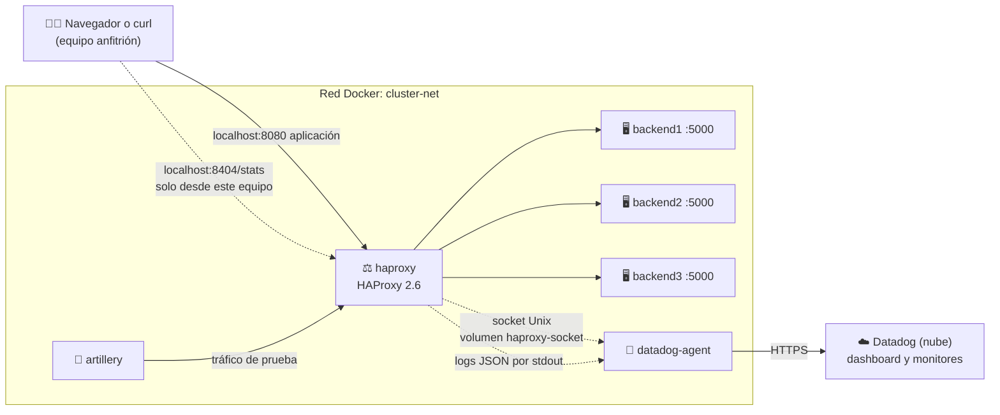

<div align="center">

# Monitoreo de clúster HAProxy con Datadog

**Proyecto 8 · Servicios Telemáticos · Ingeniería Informática**
**Universidad Autónoma de Occidente (UAO) · 2026-2**


</div>

---

## Índice

1. [Descripción y arquitectura](#1-descripción-y-arquitectura)
2. [Requisitos previos](#2-requisitos-previos)
3. [Estructura del repositorio](#3-estructura-del-repositorio)
4. [Despliegue rápido](#4-despliegue-rápido)
5. [HAProxy](#5-haproxy)
6. [Backends](#6-backends)
7. [Datadog Agent y cuenta](#7-datadog-agent-y-cuenta)
8. [Dashboard y monitores](#8-dashboard-y-monitores)
9. [Pruebas de carga](#9-pruebas-de-carga)
10. [Pruebas de punta a punta y simulación de caída](#10-pruebas-de-punta-a-punta-y-simulación-de-caída)
11. [Solución de problemas](#11-solución-de-problemas)

> [!TIP]
> **¿Solo quieres ponerlo en marcha?** Revisa los [requisitos](#2-requisitos-previos) y sigue el [despliegue rápido](#4-despliegue-rápido).

---

## Integrantes

| Código | Nombre | Rol en el proyecto |
|:---:|---|---|
| 2236320 | Manuel Betancurt Pérez | Infraestructura y HAProxy |
| 2235481 | Esteban Torres Yela | Backends y métricas |
| 2235593 | Jhon Alexander Galvis Galeano | Datadog Agent e ingesta de logs |
| 2236708 | Alan Yesid Basante Portilla | Dashboard y monitores en Datadog |
| 2235256 | Juan José Hurtado Espinosa | Pruebas de carga con Artillery |
| 2236364 | Sharon Zuray Abella Díaz | Integración Docker, pruebas de punta a punta y documentación |

## Avance por parte

| Parte | Responsable | Estado |
|---|---|:---:|
| Infraestructura y HAProxy | Manuel | ✅ Listo |
| Backends | Esteban | ⏳ Pendiente |
| Datadog Agent | Jhon | ⏳ Pendiente |
| Dashboard y monitores | Alan | ⏳ Pendiente |
| Pruebas de carga | Juan José | ⏳ Pendiente |
| Integración, E2E y documentación | Sharon | ⏳ Pendiente |

<sub>Leyenda: ✅ Listo · 🚧 En curso · ⏳ Pendiente. Cada responsable actualiza su fila.</sub>

---

## 1. Descripción y arquitectura

<sub>👤 Responsable: Manuel Betancurt · Sharon Abella deja el diagrama final</sub>

El proyecto monta un **clúster de tres servidores web** (backends) detrás de un **balanceador de carga HAProxy 2.6**. HAProxy recibe todas las peticiones de los usuarios y las reparte entre los tres backends; si uno se cae, lo detecta y deja de enviarle tráfico.

El **Datadog Agent** recoge las métricas de HAProxy (por su socket de estadísticas), sus logs y los de los backends, y los envía a **Datadog**, donde se ven en un dashboard y se configuran alertas. **Artillery** genera tráfico de prueba (normal, pico y errores) para observar cómo reacciona el sistema.

Todo corre en **contenedores Docker** orquestados con **Docker Compose**: no hay que instalar nada de esto en el equipo, solo Docker.

| Componente | Qué hace | Imagen |
|---|---|---|
| `haproxy` | Balanceador de carga: recibe el tráfico en el puerto 8080 y lo reparte | `haproxy:2.6` (oficial) |
| `backend1` · `backend2` · `backend3` | Servidores web que atienden las peticiones | Temporal: `traefik/whoami` ([ver 5.8](#58-backends-temporales)) |
| `datadog-agent` | Recoge métricas y logs y los envía a Datadog | `datadog/agent:7` |
| `artillery` | Genera carga de prueba contra HAProxy | Por definir ([sección 9](#9-pruebas-de-carga)) |



**Recorrido de una petición:**
1. El usuario (o Artillery) llama al puerto **8080**.
2. HAProxy escoge un backend **sano** y le pasa la petición.
3. El backend responde y HAProxy le devuelve la respuesta al usuario.
4. HAProxy escribe **una línea de log en JSON** con los datos de esa petición.
5. El Datadog Agent lee ese log, consulta las métricas por el **socket** y envía todo a Datadog.

---

## 2. Requisitos previos

<sub>👤 Responsable: Sharon Abella · versión inicial: Manuel Betancurt</sub>

| Herramienta | Para qué | Cómo comprobar que está instalada |
|---|---|---|
| **Docker** con **Compose v2** ([Docker Desktop](https://docs.docker.com/desktop/) en Windows/macOS, [Docker Engine](https://docs.docker.com/engine/install/) en Linux) | Correr todos los servicios | `docker compose version` |
| **Git** | Descargar el proyecto | `git --version` |
| **Cuenta de Datadog** | Ver métricas, logs y alertas | Ver [sección 7](#7-datadog-agent-y-cuenta) |

---

## 3. Estructura del repositorio

<sub>👤 Responsable: Manuel Betancurt · cada integrante agrega aquí sus archivos (solo agregar líneas)</sub>

```
.
├── docker-compose.yml       # Orquestación de todos los servicios (un bloque por dueño)
├── .env.example             # Plantilla de variables (copiar como .env)
├── .gitignore               # Archivos que Git no sube (incluye .env)
├── .gitattributes           # Fuerza finales de línea LF
├── README.md
├── haproxy/
│   └── haproxy.cfg          # Configuración de HAProxy (montada de solo lectura)
├── backends/                # Código y Dockerfile de los backends
├── datadog/
│   ├── conf.d/haproxy.d/    # Integración HAProxy del Agent (conf.yaml)
│   ├── dashboards/          # Dashboard exportado en JSON
│   └── monitors/            # Monitores exportados en JSON
├── artillery/               # Escenarios de carga
└── docs/
    ├── diagramas/           # Diagramas de arquitectura
    └── evidencias/          # Capturas de las pruebas, una subcarpeta por parte
```

| Carpeta o archivo | Dueño |
|---|---|
| `haproxy/` | Manuel Betancurt |
| `backends/` | Esteban Torres |
| `datadog/` (excepto `dashboards/` y `monitors/`) | Jhon Galvis |
| `datadog/dashboards/` · `datadog/monitors/` | Alan Basante |
| `artillery/` | Juan José Hurtado |
| `docker-compose.yml` (integración) · `docs/diagramas/` | Sharon Abella (cada bloque de servicio lo edita su dueño) |

---

## 4. Despliegue rápido

<sub>👤 Responsable: Sharon Abella · versión inicial: Manuel Betancurt</sub>

Los comandos se escriben en una terminal: **PowerShell** en Windows, **Terminal** en macOS o Linux.

**1. Descargar el proyecto y entrar a la carpeta**
```bash
git clone https://github.com/MBeta032/Monitoreo-de-Cluster-HAProxy-con-Datadog.git
cd Monitoreo-de-Cluster-HAProxy-con-Datadog
```

**2. Crear el archivo de variables** a partir de la plantilla y llenarlo ([ver sección 7](#7-datadog-agent-y-cuenta)). Solo es necesario cuando el Datadog Agent esté incluido; HAProxy y los backends arrancan sin él.
```bash
cp .env.example .env              # en PowerShell: Copy-Item .env.example .env
```

**3. Levantar todos los servicios** en segundo plano
```bash
docker compose up -d
```

**4. Verificar** que todos los contenedores estén en estado `Up`
```bash
docker compose ps
```

Para apagar todo: `docker compose down`

<details>
<summary>Comprobar que HAProxy reparte la carga</summary>

Hacer 6 peticiones seguidas:
```bash
# Windows (PowerShell): curl es un alias de otro comando, hay que escribir curl.exe
1..6 | ForEach-Object { curl.exe -s http://localhost:8080/ | Select-String "^Name" }

# Linux o macOS
for i in $(seq 6); do curl -s http://localhost:8080/ | grep '^Name'; done
```
Con los backends temporales debe salir `Name: backend1`, `backend2`, `backend3`, y otra vez 1, 2, 3.

Tablero de estadísticas: abrir <http://localhost:8404/stats> y comprobar que los 3 backends están en verde (`UP`).

Último log, en JSON:
```bash
docker compose logs --no-log-prefix haproxy --tail 1
```

</details>

---

## 5. HAProxy

<sub>👤 Responsable: Manuel Betancurt</sub>

### 5.1 Contrato de integración

> [!WARNING]
> Estos nombres los usan **todas** las partes del proyecto. **No se cambian sin avisar antes al grupo.**

| Elemento | Valor |
|---|---|
| Servicios en Compose | `haproxy` · `backend1` · `backend2` · `backend3` · `datadog-agent` · `artillery` (el nombre del contenedor es igual al del servicio) |
| Red de Docker | `cluster-net` |
| Aplicación (frontend `fe_web`) | puerto `8080`, publicado en el equipo anfitrión |
| Tablero de estadísticas | puerto `8404`, ruta `/stats`, publicado **solo en `127.0.0.1`** del anfitrión |
| Socket de estadísticas | `/var/lib/haproxy/admin.sock`, en el volumen `haproxy-socket` |
| Backends | puerto interno `5000` · rutas `/`, `/health`, `/metrics`, `/error` |
| Grupo de backends en HAProxy | `be_app` |
| Logs | una línea JSON por petición, por la salida estándar del contenedor (15 campos, ver 5.5) |
| Tags en Datadog | `env:lab` · `project:haproxy-telematicos` |

### 5.2 Puertos

| Puerto | Dónde | Para qué |
|:---:|---|---|
| **8080** | `http://localhost:8080` | Entrada de la aplicación: todo el tráfico pasa por aquí |
| **8404** | `http://localhost:8404/stats` | Tablero de estadísticas. Solo se abre desde el equipo donde corre Docker |
| **5000** | Solo dentro de `cluster-net` | Puerto de cada backend; no se publica al equipo anfitrión |

> [!NOTE]
> HAProxy usa el 8080 y no el 80 porque la imagen oficial, desde la versión 2.4, se ejecuta con un usuario sin privilegios (`haproxy`), que no puede abrir puertos menores a 1024.

### 5.3 Tablero de estadísticas

- **Dirección:** <http://localhost:8404/stats>. Se recarga solo cada 5 segundos.
- **Qué muestra:** por cada backend, si está `UP` (verde) o `DOWN` (rojo), sesiones, bytes y códigos de respuesta. La columna `LastChk` muestra el resultado del último health check (`L7OK/200` significa que respondió `200`).
- **Acceso:** el puerto solo se publica en `127.0.0.1`, así que otros equipos de la red no lo alcanzan. El tablero **no escribe en el log**, para que sus recargas no cuenten como tráfico.
- **Relación con Datadog:** el tablero y el socket entregan los mismos datos. El tablero muestra solo el instante actual; Datadog guarda el historial y envía alertas.

### 5.4 Socket de estadísticas (para el Datadog Agent)

| Parámetro | Valor | Por qué |
|---|---|---|
| Ruta | `/var/lib/haproxy/admin.sock` | La carpeta ya pertenece al usuario `haproxy` en la imagen; `/var/run/haproxy` no existe y Docker la crearía como root, impidiendo que HAProxy cree el socket |
| Permisos | `mode 660` | Solo el dueño y el grupo pueden abrirlo (no `666`) |
| Nivel | `level user` | Solo lectura de estadísticas: el socket no permite cambiar nada |
| Dueño y grupo | `haproxy` (uid 99, gid 99) | Es el usuario con el que corre HAProxy en la imagen |

**Para Jhon (servicio `datadog-agent`):**
- Montar el volumen `haproxy-socket` en el Agent, en la misma ruta: `/var/lib/haproxy`.
- Agregar `group_add: ["99"]` al servicio, para que el proceso del Agent pertenezca al grupo del socket.
- En `haproxy.d/conf.yaml`, usar `url: unix:///var/lib/haproxy/admin.sock`. Según la documentación de Datadog, la integración por socket es el modo antiguo (deprecated): para usarla hay que poner `use_openmetrics` y `use_prometheus` en `false`.
- Si el Agent no logra leer con `level user`, subir a `level operator` en `haproxy.cfg` y avisar al grupo.

<details>
<summary>Comprobar el socket sin el Agent</summary>

Un usuario común (no root) con el grupo 99 debe poder leer; sin el grupo, no:
```bash
# Sin el grupo: debe responder "Permission denied"
docker run --rm -v haproxy-socket:/var/lib/haproxy --user 1000 --entrypoint sh alpine/socat -c 'echo show info | socat - UNIX-CONNECT:/var/lib/haproxy/admin.sock'

# Con el grupo 99: lista el estado de los backends (deben salir en UP)
docker run --rm -v haproxy-socket:/var/lib/haproxy --user 1000 --group-add 99 --entrypoint sh alpine/socat -c 'echo show stat | socat - UNIX-CONNECT:/var/lib/haproxy/admin.sock | cut -d, -f1,2,18'
```

</details>

### 5.5 Contrato de logs (JSON)

HAProxy escribe **una línea JSON por petición** en la salida estándar del contenedor (`docker compose logs haproxy`) y el Datadog Agent la lee de ahí. Los tiempos son **números sin comillas, en milisegundos**.

| Campo | Tipo | Qué significa | Ejemplo |
|---|:---:|---|---|
| `timestamp` | número | Milisegundos desde 1970 (UTC). Es el momento en que se escribe el log, es decir, el final de la petición | `1793511346523` |
| `client_ip` | texto | IP de quien hizo la petición | `"172.18.0.1"` |
| `frontend` | texto | Por dónde entró la petición | `"fe_web"` |
| `backend` | texto | Grupo de servidores que la atendió | `"be_app"` |
| `server` | texto | Servidor que respondió (`<NOSRV>` si ninguno) | `"backend2"` |
| `method` | texto | Método HTTP (primeros 32 bytes) | `"GET"` |
| `path` | texto | Ruta pedida, sin parámetros (primeros 512 bytes) | `"/health"` |
| `status_code` | número | Código de respuesta HTTP | `200` |
| `bytes` | número | Bytes enviados al cliente | `299` |
| `queue_ms` | número | Tiempo esperando en cola dentro de HAProxy (`Tw`) | `0` |
| `connect_ms` | número | Tiempo en conectarse al backend (`Tc`) | `1` |
| `response_ms` | número | Tiempo que tardó el backend en empezar a responder (`Tr`) | `4` |
| `total_ms` | número | Tiempo total activo de la petición (`Ta`) | `6` |
| `termination_state` | texto | Cómo terminó la petición. Extra al contrato original | `"--"` |
| `retries` | texto | Reintentos de conexión. Extra al contrato original | `"0"` |

> [!NOTE]
> - Si `queue_ms`, `connect_ms` o `response_ms` valen `-1`, esa etapa no ocurrió (por ejemplo, no se pudo conectar con el backend). Al calcular latencias hay que **excluir esos valores**.
> - `termination_state`: `--` es normal; `sC` significa que el backend no logró conectar a tiempo.
> - `retries`: `"0"` es normal; `"+1"` indica una petición que HAProxy pasó a **otro** servidor (`redispatch`). Va como texto porque `+1` no es un número válido en JSON.
> - La barra de la ruta sale escapada (`\/`): es JSON válido y Datadog la lee como `/`.

<details>
<summary>Ejemplo de una línea de log</summary>

```json
{"timestamp":1793511346523,"client_ip":"172.18.0.1","frontend":"fe_web","backend":"be_app","server":"backend1","method":"GET","path":"\/","status_code":200,"bytes":299,"queue_ms":0,"connect_ms":2,"response_ms":4,"total_ms":6,"termination_state":"--","retries":"0"}
```

</details>

<details>
<summary>Por qué <code>path</code> y <code>method</code> están acotados</summary>

Son datos que controla quien hace la petición. Se **escapan** (para que una comilla en la dirección no pueda romper ni falsificar el JSON) y se **recortan** (512 y 32 bytes) para que cada línea tenga un tamaño máximo conocido: ni se corta a la mitad ni permite llenar el disco con direcciones larguísimas. El límite del mensaje de log es de 4096 bytes (`len 4096`), y HAProxy rechaza con `400` las peticiones demasiado grandes, que igual generan una línea válida.

</details>

### 5.6 Parámetros del balanceador

| Parámetro | Valor | Qué hace |
|---|---|---|
| Algoritmo | `roundrobin` | Reparte por turnos. Los 3 backends son iguales y las peticiones cortas, así que no se justifica `leastconn` |
| Health check | `GET /health`, espera `200` | HAProxy lo pregunta a cada backend |
| `inter` | `1s` | Cada cuánto revisa cada backend (y el tiempo máximo que espera el chequeo) |
| `fall` | `3` | Fallos seguidos para marcar un backend como `DOWN` |
| `rise` | `2` | Chequeos buenos seguidos para volver a `UP` |
| `option redispatch 1` | activo | Si no logra conectar con un backend, reintenta en otro desde el primer reintento |
| `timeout connect` | `2s` | Espera para conectar con un backend |
| `timeout client` / `timeout server` | `30s` | Inactividad máxima del cliente y del backend |

### 5.7 Comportamiento ante la caída de un backend (medido)

Medido con `docker stop backend1` y tráfico constante, con los backends temporales (con los reales puede variar):

| Medida | Resultado |
|---|---|
| Tiempo en marcar el backend como `DOWN` | ≈ 6 s |
| Tiempo en volver a `UP` al encenderlo | ≈ 2,3 s |
| Peticiones con error | 0 de 60 |
| Peticiones afectadas | Las que le tocaban al backend caído en esos segundos: tardan ≈ 2 s y se responden desde otro backend |

Para el monitor de "backend DOWN": no puede dar señal antes de unos 6 segundos desde la caída.

### 5.8 Backends temporales

Mientras se integran los backends reales ([sección 6](#6-backends)), el `docker-compose.yml` usa la imagen [`traefik/whoami`](https://github.com/traefik/whoami), que responde con el nombre del contenedor que atendió la petición y permite **ver el reparto de carga**. Cumplen el contrato: nombres `backend1` a `backend3`, puerto `5000` (variable `WHOAMI_PORT_NUMBER`) y responden `200` en `/health`. No tienen `/metrics` ni `/error`: esas rutas las implementan los backends reales.

---

## 6. Backends

<sub>👤 Responsable: Esteban Torres</sub>

> ⏳ **Pendiente.** Cómo están construidos los backends, sus rutas (`/`, `/health`, `/metrics`, `/error`) y cómo forzar errores.

## 7. Datadog Agent y cuenta

<sub>👤 Responsable: Jhon Galvis</sub>

> ⏳ **Pendiente.** Cómo obtener la API key, valor de `DD_SITE`, fecha de vencimiento de la cuenta de prueba y configuración del Agent.

## 8. Dashboard y monitores

<sub>👤 Responsable: Alan Basante</sub>

> ⏳ **Pendiente.** URL del dashboard, guía de alertas y cómo importar los JSON de `datadog/`.

## 9. Pruebas de carga

<sub>👤 Responsable: Juan José Hurtado</sub>

> ⏳ **Pendiente.** Escenarios de Artillery y cómo ejecutarlos.

## 10. Pruebas de punta a punta y simulación de caída

<sub>👤 Responsable: Sharon Abella</sub>

> ⏳ **Pendiente.** Paso a paso para apagar un backend, ver la alerta y comparar métricas antes, durante y después.

---

## 11. Solución de problemas

<sub>👤 Todos · solo agregar bloques</sub>

Haz clic en el mensaje de error para ver su causa y su solución. Para agregar uno, copia un bloque `<details>` completo al final de esta lista.

<details>
<summary><code>docker</code> no se reconoce como comando (Windows)</summary>

- **Causa:** la terminal se abrió antes de instalar Docker y no conoce su ruta.
- **Solución:** cerrar todas las terminales y abrir una nueva; si persiste, cerrar sesión en Windows.
- <sub>Agregado por: Manuel</sub>

</details>

<details>
<summary>Un archivo de configuración falla dentro del contenedor con caracteres raros al final de las líneas</summary>

- **Causa:** finales de línea CRLF de Windows.
- **Solución:** el repo fuerza LF con `.gitattributes`; en VS Code, configurar `Files: Eol` en `\n`.
- <sub>Agregado por: Manuel</sub>

</details>

<details>
<summary><code>warning: You appear to have cloned an empty repository</code></summary>

- **Causa:** se clonó el repo antes del primer commit.
- **Solución:** es normal; no requiere acción.
- <sub>Agregado por: Manuel</sub>

</details>

<details>
<summary>En PowerShell, <code>curl</code> no se comporta como se espera</summary>

- **Causa:** `curl` es un alias de otro comando de PowerShell.
- **Solución:** escribir `curl.exe`.
- <sub>Agregado por: Manuel</sub>

</details>

<details>
<summary>HAProxy no arranca: <code>cannot bind UNIX socket (Permission denied)</code></summary>

- **Causa:** el volumen del socket quedó a nombre de root, y HAProxy corre como usuario sin privilegios.
- **Solución:** el socket va en `/var/lib/haproxy`, que ya es del usuario `haproxy`. Si el volumen es viejo, recrearlo: `docker compose down -v` y volver a levantar.
- <sub>Agregado por: Manuel</sub>

</details>

<details>
<summary><code>haproxy -c</code> dice <code>Missing LF on last line</code></summary>

- **Causa:** el archivo de configuración no termina con un salto de línea.
- **Solución:** agregar una línea vacía al final. En VS Code, activar `Files: Insert Final Newline`.
- <sub>Agregado por: Manuel</sub>

</details>

<details>
<summary><code>haproxy -c</code> dice <code>could not resolve address 'backend1'</code></summary>

- **Causa:** se validó desde un contenedor suelto, que no está en la red de los backends.
- **Solución:** prender los backends (`docker compose up -d`) y validar con `--network cluster-net`.
- <sub>Agregado por: Manuel</sub>

</details>

<details>
<summary><code>log-format expects only one argument</code></summary>

- **Causa:** el `log-format` quedó partido en varias líneas, o con otra directiva pegada al final.
- **Solución:** debe ser una sola línea entre comillas simples, y `default_backend` en la línea siguiente.
- <sub>Agregado por: Manuel</sub>

</details>

<details>
<summary>El tablero <code>localhost:8404</code> no abre desde otro equipo</summary>

- **Causa:** el puerto solo se publica en `127.0.0.1` a propósito.
- **Solución:** abrirlo desde el equipo donde corre Docker.
- <sub>Agregado por: Manuel</sub>

</details>
