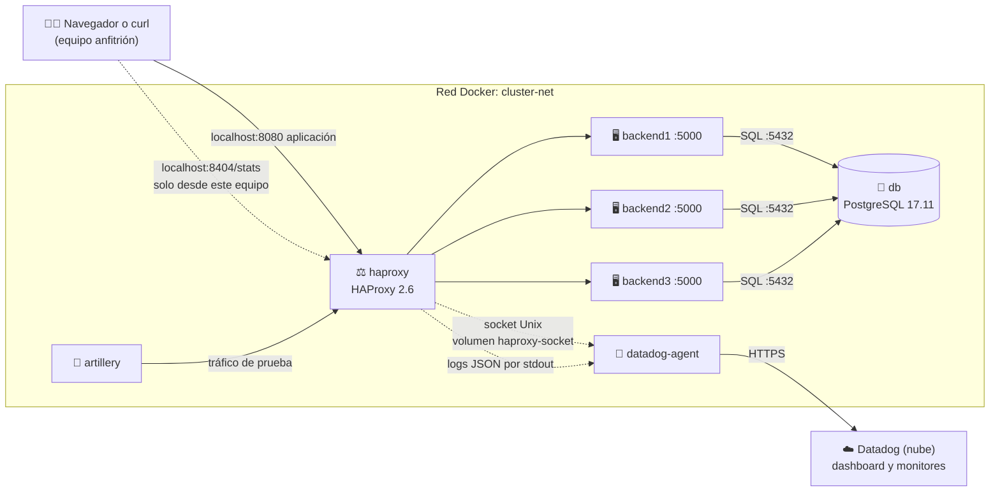

<div align="center">

# Monitoreo de clúster HAProxy con Datadog

**Proyecto 8 · Servicios Telemáticos · Ingeniería Informática**
**Universidad Autónoma de Occidente (UAO) · 2026-2**


</div>

---

## Índice

1. [Descripción y arquitectura](#1-descripción-y-arquitectura)
2. [Requisitos previos](#2-requisitos-previos)
3. [Estructura del repositorio](#3-estructura-del-repositorio)
4. [Despliegue rápido](#4-despliegue-rápido)
5. [HAProxy](#5-haproxy)
6. [Backends](#6-backends)
7. [Datadog Agent y cuenta](#7-datadog-agent-y-cuenta)
8. [Dashboard y monitores](#8-dashboard-y-monitores)
9. [Pruebas de carga](#9-pruebas-de-carga)
10. [Pruebas de punta a punta y simulación de caída](#10-pruebas-de-punta-a-punta-y-simulación-de-caída)
11. [Solución de problemas](#11-solución-de-problemas)

> [!TIP]
> **¿Solo quieres ponerlo en marcha?** Revisa los [requisitos](#2-requisitos-previos) y sigue el [despliegue rápido](#4-despliegue-rápido).

---

## Integrantes

| Código | Nombre | Rol en el proyecto |
|:---:|---|---|
| 2236320 | Manuel Betancurt Pérez | Infraestructura y HAProxy |
| 2235481 | Esteban Torres Yela | Backends y métricas |
| 2235593 | Jhon Alexander Galvis Galeano | Datadog Agent e ingesta de logs |
| 2236708 | Alan Yesid Basante Portilla | Dashboard y monitores en Datadog |
| 2235256 | Juan José Hurtado Espinosa | Pruebas de carga con Artillery |
| 2236364 | Sharon Zuray Abella Díaz | Integración Docker, pruebas de punta a punta y documentación |

## Avance por parte

| Parte | Responsable | Estado |
|---|---|:---:|
| Infraestructura y HAProxy | Manuel | ✅ Listo |
| Backends | Esteban |  ✅ Listo  |
| Datadog Agent | Jhon | ✅ Listo |
| Dashboard y monitores | Alan | ✅ Listo |
| Pruebas de carga | Juan José | ⏳ Pendiente |
| Integración, E2E y documentación | Sharon | ⏳ Pendiente |

<sub>Leyenda: ✅ Listo · 🚧 En curso · ⏳ Pendiente. Cada responsable actualiza su fila.</sub>

---

## 1. Descripción y arquitectura

<sub>👤 Responsable: Manuel Betancurt · Sharon Abella deja el diagrama final</sub>

El proyecto es la **Taquilla Sucursal**, una página para reservar sillas en teatros y escenarios de Cali, que corre en **tres backends** detrás del balanceador **HAProxy**. Todo se monitorea con **Datadog** y se prueba con carga generada por **Artillery**.

- Todo corre en **contenedores Docker** (programas empaquetados con todo lo que necesitan) orquestados con **Docker Compose**: en el equipo solo hay que instalar Docker.
- HAProxy (balanceador de carga: reparte las peticiones entre los backends) detecta si un backend se cae y deja de enviarle tráfico.

| Componente | Qué hace | Imagen |
|---|---|---|
| `haproxy` | Recibe todo el tráfico en el puerto 8080 y lo reparte entre los backends | `haproxy:2.6` (oficial) |
| `backend1` · `backend2` · `backend3` | La Taquilla: páginas web y API, con Flask + Gunicorn (la aplicación en Python y el servidor que la atiende con varios procesos) | `haproxy-telematicos-backend:2.0.0` (propia, [sección 6](#6-backends)) |
| `db` | Base de datos PostgreSQL con eventos, sillas, usuarios y reservas | `postgres:17.11` (oficial) |
| `datadog-agent` | Recoge métricas y logs y los envía a Datadog | `registry.datadoghq.com/agent:7.85.1` |
| `artillery` | Genera carga de prueba contra HAProxy | Por definir ([sección 9](#9-pruebas-de-carga)) |



**Recorrido de una petición:**
1. El navegador (o Artillery) llama a `http://localhost:8080`.
2. HAProxy escoge un backend **sano** y le pasa la petición.
3. El backend reconoce la sesión por su cookie (cualquiera de los tres puede) y consulta o reserva en PostgreSQL (`db`).
4. El backend responde; HAProxy devuelve la respuesta y escribe **una línea de log en JSON**.
5. El Datadog Agent lee los logs y las métricas y los envía a Datadog.

---

## 2. Requisitos previos

<sub>👤 Responsable: Sharon Abella · versión inicial: Manuel Betancurt</sub>

| Herramienta | Para qué | Cómo comprobar que está instalada |
|---|---|---|
| **Docker** con **Compose v2** ([Docker Desktop](https://docs.docker.com/desktop/) en Windows/macOS, [Docker Engine](https://docs.docker.com/engine/install/) en Linux) | Correr todos los servicios | `docker compose version` |
| **Git** | Descargar el proyecto | `git --version` |
| **Cuenta de Datadog** | Ver métricas, logs y alertas | Ver [sección 7](#7-datadog-agent-y-cuenta) |

---

## 3. Estructura del repositorio

<sub>👤 Responsable: Manuel Betancurt · cada integrante agrega aquí sus archivos (solo agregar líneas)</sub>

```
.
```text
├── docker-compose.yml       # Orquestación de todos los servicios (un bloque por dueño)
├── .env.example             # Plantilla de variables (copiar como .env)
├── .gitignore               # Archivos que Git no sube (incluye .env)
├── .gitattributes           # Fuerza finales de línea LF
├── README.md
├── .github/
│   └── workflows/
│       └── backends-ci.yml  # CI de los backends: pruebas y construcción de la imagen en cada PR
├── haproxy/
│   └── haproxy.cfg          # Configuración de HAProxy (montada de solo lectura)
├── backends/                # Código y Dockerfile de los backends
│   ├── app.py              # Aplicación Flask instrumentada con Prometheus y logs JSON
│   ├── gunicorn.conf.py    # Configuración de servidor de producción WSGI
│   ├── requirements.txt    # Dependencias fijas del backend (Flask, prometheus-client, gunicorn)
│   ├── requirements-dev.txt # Dependencias solo para pruebas (pytest); no entran a la imagen
│   ├── .dockerignore       # Archivos que no se copian a la imagen (pruebas y cachés)
│   ├── tests/              # Pruebas automáticas con pytest
│   └── Dockerfile          # Imagen Python 3.14-slim, usuario no root y healthcheck nativo
├── datadog/
│   ├── datadog.yaml         # Configuración general del Agent, logs y etiquetas
│   ├── conf.d/
│   │   ├── haproxy.d/
│   │   │   └── conf.yaml    # Métricas y service checks de HAProxy por socket Unix (cada 5 s)
│   │   └── http_check.d/
│   │       └── conf.yaml    # Cliente misterioso: pide /api/events por HAProxy cada 15 s
│   ├── dashboards/          # Dashboard exportado en JSON
│   └── monitors/            # Monitores exportados en JSON
├── db/
│   └── init/                # Se ejecutan una sola vez, al crear el volumen pg-data
│       ├── 01_schema.sql    # Tablas: users, events, seats y reservations
│       ├── 02_seed.sql      # Eventos, sillas y usuarios de prueba
│       └── 03_datadog_user.sh # Usuario datadog de solo lectura para el Agent
├── artillery/               # Escenarios de carga
└── docs/
    ├── diagramas/           # Diagramas de arquitectura
    └── evidencias/          # Capturas de las pruebas, una subcarpeta por parte
```

| Carpeta o archivo | Dueño |
|---|---|
| `haproxy/` | Manuel Betancurt |
| `backends/` | Esteban Torres |
| `datadog/` (excepto `dashboards/` y `monitors/`) | Jhon Galvis |
| `datadog/dashboards/` · `datadog/monitors/` | Alan Basante |
| `artillery/` | Juan José Hurtado |
| `docker-compose.yml` (integración) · `docs/diagramas/` | Sharon Abella (cada bloque de servicio lo edita su dueño) |

---


## 4. Despliegue rápido

<sub>👤 Responsable: Sharon Abella · versión inicial: Manuel Betancurt</sub>

Pasos para levantar todo el proyecto en un equipo con Docker. Los comandos son de PowerShell (en Linux o macOS: `cp` en lugar de `Copy-Item` y `curl` en lugar de `curl.exe`).

1. Descargar el proyecto y entrar a la carpeta:
   ```powershell
   git clone https://github.com/MBeta032/Monitoreo-de-Cluster-HAProxy-con-Datadog.git
   cd Monitoreo-de-Cluster-HAProxy-con-Datadog
   ```
2. Crear el archivo de variables `.env` y generar la clave de sesión:
   ```powershell
   Copy-Item .env.example .env
   docker run --rm python:3.14-slim python -c "import secrets; print(secrets.token_hex(32))"
   ```
   Debes ver: 64 letras y números. En `.env`, ponerlos en `SECRET_KEY` ([ver 6.3](#63-sesión-en-3-backends)), escribir contraseñas con solo letras y números en `POSTGRES_PASSWORD` y `DD_POSTGRES_PASSWORD`, y llenar `DD_API_KEY` y `DD_SITE` solo si se va a usar Datadog ([sección 7](#7-datadog-agent-y-cuenta)).
3. Construir y levantar todo: `docker compose up -d --build`
4. Revisar el estado: `docker compose ps`
   Debes ver: `db`, `backend1`, `backend2` y `backend3` en `(healthy)`.
5. Abrir <http://localhost:8080> e iniciar sesión con `demo@taquilla.test` / `Taquilla2026!`.
   Debes ver: la cartelera, tu nombre arriba y "Atendido por backendX" en el pie.
6. Comprobar el balanceo con 6 llamadas seguidas:
   ```powershell
   curl.exe -s http://localhost:8080/api/info
   curl.exe -s http://localhost:8080/api/info
   curl.exe -s http://localhost:8080/api/info
   curl.exe -s http://localhost:8080/api/info
   curl.exe -s http://localhost:8080/api/info
   curl.exe -s http://localhost:8080/api/info
   ```
   Debes ver: `backend1`, `backend2`, `backend3`, y otra vez en el mismo orden.

- Después de recrear los backends, ejecutar `docker compose restart haproxy` (problema conocido que se arregla en la fase de HAProxy).
- Volver a los datos iniciales (borra las reservas y las cuentas nuevas): `docker compose rm -s -f db`, luego `docker volume rm pg-data` y `docker compose up -d`. Para apagar todo: `docker compose down`.

---

## 5. HAProxy

<sub>👤 Responsable: Manuel Betancurt</sub>

### 5.1 Contrato de integración

> [!WARNING]
> Estos nombres los usan **todas** las partes del proyecto. **No se cambian sin avisar antes al grupo.**

| Elemento | Valor |
|---|---|
| Servicios en Compose | `haproxy` · `backend1` · `backend2` · `backend3` · `datadog-agent` · `artillery` (el nombre del contenedor es igual al del servicio) |
| Red de Docker | `cluster-net` |
| Aplicación (frontend `fe_web`) | puerto `8080`, publicado en el equipo anfitrión |
| Tablero de estadísticas | puerto `8404`, ruta `/stats`, publicado **solo en `127.0.0.1`** del anfitrión |
| Socket de estadísticas | `/var/lib/haproxy/admin.sock`, en el volumen `haproxy-socket` |
| Backends | puerto interno `5000` · rutas `/`, `/health`, `/metrics`, `/error` |
| Grupo de backends en HAProxy | `be_app` |
| Logs | una línea JSON por petición, por la salida estándar del contenedor (15 campos, ver 5.5) |
| Tags en Datadog | `env:lab` · `project:haproxy-telematicos` |

### 5.2 Puertos

| Puerto | Dónde | Para qué |
|:---:|---|---|
| **8080** | `http://localhost:8080` | Entrada de la aplicación: todo el tráfico pasa por aquí |
| **8404** | `http://localhost:8404/stats` | Tablero de estadísticas. Solo se abre desde el equipo donde corre Docker |
| **5000** | Solo dentro de `cluster-net` | Puerto de cada backend; no se publica al equipo anfitrión |

> [!NOTE]
> HAProxy usa el 8080 y no el 80 porque la imagen oficial, desde la versión 2.4, se ejecuta con un usuario sin privilegios (`haproxy`), que no puede abrir puertos menores a 1024.

### 5.3 Tablero de estadísticas

- **Dirección:** <http://localhost:8404/stats>. Se recarga solo cada 5 segundos.
- **Qué muestra:** por cada backend, si está `UP` (verde) o `DOWN` (rojo), sesiones, bytes y códigos de respuesta. La columna `LastChk` muestra el resultado del último health check (`L7OK/200` significa que respondió `200`).
- **Acceso:** el puerto solo se publica en `127.0.0.1`, así que otros equipos de la red no lo alcanzan. El tablero **no escribe en el log**, para que sus recargas no cuenten como tráfico.
- **Relación con Datadog:** el tablero y el socket entregan los mismos datos. El tablero muestra solo el instante actual; Datadog guarda el historial y envía alertas.

### 5.4 Socket de estadísticas (para el Datadog Agent)

| Parámetro | Valor | Por qué |
|---|---|---|
| Ruta | `/var/lib/haproxy/admin.sock` | La carpeta ya pertenece al usuario `haproxy` en la imagen; `/var/run/haproxy` no existe y Docker la crearía como root, impidiendo que HAProxy cree el socket |
| Permisos | `mode 660` | Solo el dueño y el grupo pueden abrirlo (no `666`) |
| Nivel | `level user` | Solo lectura de estadísticas: el socket no permite cambiar nada |
| Dueño y grupo | `haproxy` (uid 99, gid 99) | Es el usuario con el que corre HAProxy en la imagen |

**Para Jhon (servicio `datadog-agent`):**
- Montar el volumen `haproxy-socket` en el Agent, en la misma ruta: `/var/lib/haproxy`.
- Agregar `group_add: ["99"]` al servicio, para que el proceso del Agent pertenezca al grupo del socket.
- En `haproxy.d/conf.yaml`, usar `url: unix:///var/lib/haproxy/admin.sock`. Según la documentación de Datadog, la integración por socket es el modo antiguo (deprecated): para usarla hay que poner `use_openmetrics` y `use_prometheus` en `false`.
- Si el Agent no logra leer con `level user`, subir a `level operator` en `haproxy.cfg` y avisar al grupo.

<details>
<summary>Comprobar el socket sin el Agent</summary>

Un usuario común (no root) con el grupo 99 debe poder leer; sin el grupo, no:
```bash
# Sin el grupo: debe responder "Permission denied"
docker run --rm -v haproxy-socket:/var/lib/haproxy --user 1000 --entrypoint sh alpine/socat -c 'echo show info | socat - UNIX-CONNECT:/var/lib/haproxy/admin.sock'

# Con el grupo 99: lista el estado de los backends (deben salir en UP)
docker run --rm -v haproxy-socket:/var/lib/haproxy --user 1000 --group-add 99 --entrypoint sh alpine/socat -c 'echo show stat | socat - UNIX-CONNECT:/var/lib/haproxy/admin.sock | cut -d, -f1,2,18'
```

</details>

### 5.5 Contrato de logs (JSON)

HAProxy escribe **una línea JSON por petición** en la salida estándar del contenedor (`docker compose logs haproxy`) y el Datadog Agent la lee de ahí. Los tiempos son **números sin comillas, en milisegundos**.

| Campo | Tipo | Qué significa | Ejemplo |
|---|:---:|---|---|
| `timestamp` | número | Milisegundos desde 1970 (UTC). Es el momento en que se escribe el log, es decir, el final de la petición | `1793511346523` |
| `client_ip` | texto | IP de quien hizo la petición | `"172.18.0.1"` |
| `frontend` | texto | Por dónde entró la petición | `"fe_web"` |
| `backend` | texto | Grupo de servidores que la atendió | `"be_app"` |
| `server` | texto | Servidor que respondió (`<NOSRV>` si ninguno) | `"backend2"` |
| `method` | texto | Método HTTP (primeros 32 bytes) | `"GET"` |
| `path` | texto | Ruta pedida, sin parámetros (primeros 512 bytes) | `"/health"` |
| `status_code` | número | Código de respuesta HTTP | `200` |
| `bytes` | número | Bytes enviados al cliente | `299` |
| `queue_ms` | número | Tiempo esperando en cola dentro de HAProxy (`Tw`) | `0` |
| `connect_ms` | número | Tiempo en conectarse al backend (`Tc`) | `1` |
| `response_ms` | número | Tiempo que tardó el backend en empezar a responder (`Tr`) | `4` |
| `total_ms` | número | Tiempo total activo de la petición (`Ta`) | `6` |
| `termination_state` | texto | Cómo terminó la petición. Extra al contrato original | `"--"` |
| `retries` | texto | Reintentos de conexión. Extra al contrato original | `"0"` |

> [!NOTE]
> - Si `queue_ms`, `connect_ms` o `response_ms` valen `-1`, esa etapa no ocurrió (por ejemplo, no se pudo conectar con el backend). Al calcular latencias hay que **excluir esos valores**.
> - `termination_state`: `--` es normal; `sC` significa que el backend no logró conectar a tiempo.
> - `retries`: `"0"` es normal; `"+1"` indica una petición que HAProxy pasó a **otro** servidor (`redispatch`). Va como texto porque `+1` no es un número válido en JSON.
> - La barra de la ruta sale escapada (`\/`): es JSON válido y Datadog la lee como `/`.

<details>
<summary>Ejemplo de una línea de log</summary>

```json
{"timestamp":1793511346523,"client_ip":"172.18.0.1","frontend":"fe_web","backend":"be_app","server":"backend1","method":"GET","path":"\/","status_code":200,"bytes":299,"queue_ms":0,"connect_ms":2,"response_ms":4,"total_ms":6,"termination_state":"--","retries":"0"}
```

</details>

<details>
<summary>Por qué <code>path</code> y <code>method</code> están acotados</summary>

Son datos que controla quien hace la petición. Se **escapan** (para que una comilla en la dirección no pueda romper ni falsificar el JSON) y se **recortan** (512 y 32 bytes) para que cada línea tenga un tamaño máximo conocido: ni se corta a la mitad ni permite llenar el disco con direcciones larguísimas. El límite del mensaje de log es de 4096 bytes (`len 4096`), y HAProxy rechaza con `400` las peticiones demasiado grandes, que igual generan una línea válida.

</details>

### 5.6 Parámetros del balanceador

| Parámetro | Valor | Qué hace |
|---|---|---|
| Algoritmo | `roundrobin` | Reparte por turnos. Los 3 backends son iguales y las peticiones cortas, así que no se justifica `leastconn` |
| Health check | `GET /health`, espera `200` | HAProxy lo pregunta a cada backend |
| `inter` | `1s` | Cada cuánto revisa cada backend (y el tiempo máximo que espera el chequeo) |
| `fall` | `3` | Fallos seguidos para marcar un backend como `DOWN` |
| `rise` | `2` | Chequeos buenos seguidos para volver a `UP` |
| `option redispatch 1` | activo | Si no logra conectar con un backend, reintenta en otro desde el primer reintento |
| `timeout connect` | `2s` | Espera para conectar con un backend |
| `timeout client` / `timeout server` | `30s` | Inactividad máxima del cliente y del backend |

### 5.7 Comportamiento ante la caída de un backend (medido)

Medido con `docker stop backend1` y tráfico constante, con los backends temporales (con los reales puede variar):

| Medida | Resultado |
|---|---|
| Tiempo en marcar el backend como `DOWN` | ≈ 6 s |
| Tiempo en volver a `UP` al encenderlo | ≈ 2,3 s |
| Peticiones con error | 0 de 60 |
| Peticiones afectadas | Las que le tocaban al backend caído en esos segundos: tardan ≈ 2 s y se responden desde otro backend |

Para el monitor de "backend DOWN": no puede dar señal antes de unos 6 segundos desde la caída.

### 5.8 Backends temporales

Mientras se integran los backends reales ([sección 6](#6-backends)), el `docker-compose.yml` usa la imagen [`traefik/whoami`](https://github.com/traefik/whoami), que responde con el nombre del contenedor que atendió la petición y permite **ver el reparto de carga**. Cumplen el contrato: nombres `backend1` a `backend3`, puerto `5000` (variable `WHOAMI_PORT_NUMBER`) y responden `200` en `/health`. No tienen `/metrics` ni `/error`: esas rutas las implementan los backends reales.

---

## 6. Backends

<sub>👤 Responsable: Esteban Torres</sub>

Los backends son la **Taquilla Sucursal**: una aplicación web en Python (Flask 3.1.0 con Gunicorn 23.0.0) donde se reservan sillas, sin pagos. Los tres contenedores usan la misma imagen, `haproxy-telematicos-backend:2.0.0`, y comparten la base de datos `db`.

### 6.1 Qué hace

- Flujo: Cartelera → Zona → Silla → Iniciar sesión → Confirmar → Listo → Mis reservas.

| Evento del seed (datos iniciales, `db/init/02_seed.sql`) | Lugar | Sillas |
|---|---|---|
| Concierto Caña y Clave (venta flash) | Teatro al Aire Libre Los Cristales | 2.000 en 4 zonas: Platea, Gradería Central, Izquierda y Derecha |
| Obra: El Cuentero del Pacífico | Teatro Municipal Enrique Buenaventura | 100 |
| Noche de jazz | Teatro Jorge Isaacs | 100 |
| Cuentos de medianoche | Teatrino del Teatro Municipal | 40, ya reservadas (sale AGOTADO) |

- Usuarios **solo para pruebas**: `demo@taquilla.test` y `prueba001@taquilla.test` a `prueba200@taquilla.test`, todos con la contraseña `Taquilla2026!`.

### 6.2 Rutas

| Página (la arma Flask) | Método | Sesión | Qué hace |
|---|:---:|:---:|---|
| `/` | GET | No | Cartelera |
| `/events/<id>` | GET | No | Plano de zonas; con `?section=<zona>`, las sillas de esa zona |
| `/events/<id>/confirm?seat=<id>` | GET · POST | Sí (si no, va a `/login`) | Resumen · reserva (303 a la pantalla Listo, o 409 si alguien la tomó antes) |
| `/reservations` · `/reservations/<id>` | GET | Sí | Mis reservas · pantalla Listo (404 si la reserva es de otro) |
| `/login` · `/register` · `/logout` | GET y POST | — | Cuentas (los formularios llevan token CSRF) |
| `/health` · `/metrics` · `/error` | GET | No | Salud (200), métricas y error forzado (500) |

| API en JSON (contrato para Artillery; 503 si la base no responde) | Método | Sesión | `X-CSRF-Token` | Respuestas |
|---|:---:|:---:|:---:|---|
| `/api/info` | GET | No | No | 200 con `instance` |
| `/api/events` · `/api/events/<id>` | GET | No | No | 200 · 404 |
| `/api/events/<id>/seats` (opcional `?section=<zona>`) | GET | No | No | 200 · 404 |
| `/api/login` (JSON con `email` y `password`) | POST | No | No | 200 con el usuario y el **`csrf_token`** · 400 · 401 |
| `/api/events/<id>/seats/<seat_id>/reserve` | POST | Sí | Sí | 201 con el código (`TS-000045`) · 401 · 403 · 404 · 409 |
| `/api/reservations` | GET | Sí | No | 200 · 401 |
| `/api/logout` | POST | Sí | Sí | 200 · 403 |

- Para Artillery: `POST /api/login` una sola vez por usuario virtual (guarda la cookie y el `csrf_token`) y luego `POST .../reserve` con el encabezado `X-CSRF-Token`. Conviene golpear la API y no las páginas (una zona del concierto pesa unos 94 KB).

```powershell
Set-Content login.json '{"email":"prueba001@taquilla.test","password":"Taquilla2026!"}'
$login = curl.exe -s -c cookies.txt -H "Content-Type: application/json" --data-binary "@login.json" http://localhost:8080/api/login | ConvertFrom-Json
curl.exe -s -b cookies.txt -X POST -H "X-CSRF-Token: $($login.csrf_token)" http://localhost:8080/api/events/1/seats/12/reserve
```
Debes ver: `{"code":"TS-...","section":"Platea",...}`. Si repites el último comando, la respuesta es 409 (silla ya reservada).

### 6.3 Sesión en 3 backends

- La sesión es una **cookie firmada** (un dato que guarda el navegador y que el backend comprueba que nadie cambió). Solo lleva el id del usuario y el token CSRF, y no vive en la memoria de ningún backend.
- Los 3 backends usan la **misma `SECRET_KEY`** (la clave que firma la cookie), así que cualquiera reconoce la sesión que creó otro. Demo: inicia sesión, recarga varias veces y mira que cambia "Atendido por backendX" sin perder la sesión.
- Cada formulario y cada POST de la API llevan un **token CSRF** (un código de la sesión que una página de otro sitio no puede conocer); si falta o no coincide, la respuesta es 403. La cookie dura 2 horas, con HttpOnly y SameSite=Lax (en producción, con HTTPS, también Secure).

### 6.4 Base de datos

- Servicio `db` (PostgreSQL 17.11), solo dentro de `cluster-net`, con el volumen `pg-data` (guarda los datos aunque se borre el contenedor; para volver a los datos iniciales, ver la [sección 4](#4-despliegue-rápido)). El esquema y el seed (`db/init/`) se cargan la primera vez.
- **Reserva atómica** (todo o nada): dos consultas en una sola transacción. Un `UPDATE` aparta la silla solo si sigue libre y un `INSERT` crea la reserva; si algo falla, no se guarda ninguna de las dos. Dos personas no pueden apartar la misma silla: probado con 30 a la vez, una recibe 201 y las demás 409.
- Si la base no responde: la API da 503 en JSON, las páginas muestran "Servicio no disponible", y queda una línea de log `ERROR`.
- Conexiones: cada worker abre una por hilo (4). Con 4 workers por backend: 4 × 4 × 3 = 48, por debajo del máximo de 100 de PostgreSQL.

### 6.5 Métricas y logs

- `http_requests_total` (contador; labels `method`, `handler`, `status`) y `http_request_duration_seconds` (histograma; labels `method`, `handler`), en `/metrics`.
- `handler` es la ruta de Flask y no la URL escrita (por ejemplo `/api/events/<int:event_id>/seats/<int:seat_id>/reserve`); si ninguna coincide, vale `unmatched`. `/health` y `/metrics` no se cuentan.
- Cada petición deja una línea JSON en el log: `5xx` → `ERROR`, `4xx` → `WARNING`, el resto `INFO`. Nunca se escriben contraseñas ni tokens.
- Modo multiproceso (prometheus-client suma lo de todos los workers de Gunicorn): cada worker escribe en `/tmp/prometheus_multiproc`, y esa carpeta se vacía cada vez que arranca Gunicorn.

### 6.6 Escenarios de workers

El número de workers (procesos de Gunicorn) de cada backend se cambia en `.env`; si no se define, cada uno usa 2. Cada worker atiende con 4 hilos.

| Escenario | `BACKEND1_WORKERS` | `BACKEND2_WORKERS` | `BACKEND3_WORKERS` |
|---|:---:|:---:|:---:|
| Normal | 2 | 2 | 2 |
| Pocos workers | 1 | 1 | 1 |
| Muchos workers | 4 | 4 | 4 |
| Desigual | 1 | 2 | 4 |

```powershell
docker compose up -d backend1 backend2 backend3
docker compose restart haproxy
```
Debes ver: `Recreated` en los backends cuyo valor cambió. Con `docker top backend1` se ve un proceso maestro más uno por worker.

### 6.7 Límites

- Cada backend tiene 1 CPU y 384 MB de memoria (medido: unos 85 MB con 2 workers).
- Cada inicio de sesión gasta unos 300 ms de CPU (hash pbkdf2 con 600.000 iteraciones; no se usa scrypt porque pide 32 MB por login). Por eso, en Artillery cada usuario virtual inicia sesión una sola vez.

### 6.8 Pruebas

```powershell
cd backends
python -m pip install -r requirements.txt -r requirements-dev.txt
python -m pytest -v
```
Debes ver: `34 passed, 37 skipped` (las pruebas que usan base de datos se saltan sin `TEST_DATABASE_URL`).

Con una base de prueba (PostgreSQL temporal en el puerto 5433; esperar unos segundos después del `docker run`):
```powershell
docker run -d --name boleteria-test-db -e POSTGRES_HOST_AUTH_METHOD=trust -e POSTGRES_DB=boleteria_test -p 127.0.0.1:5433:5432 postgres:17.11
$env:TEST_DATABASE_URL = "postgresql://postgres@127.0.0.1:5433/boleteria_test"
python -m pytest -v
docker rm -f boleteria-test-db
```
Debes ver: `71 passed`. Se usa `127.0.0.1` y no `localhost`: en Windows, `localhost` intenta primero IPv6 y la conexión se queda colgada.

- CI: GitHub Actions corre las 71 pruebas con un PostgreSQL 17.11 y construye la imagen en cada Pull Request que cambie `backends/` o `db/`.

---

## 7. Datadog Agent y cuenta

<sub>👤 Responsable: Jhon Galvis</sub>

El **Datadog Agent** (un programa que corre junto a los demás contenedores) recoge métricas, logs y chequeos de HAProxy, los backends y PostgreSQL, y los envía a Datadog. Allí se ven en dashboards y disparan monitores.

### 7.1 Cuenta y variables de entorno

- Cuenta en la región US1 (`datadoghq.com`), con la **prueba gratuita de 14 días** que empezó el 6 de noviembre y **vence el 20 de noviembre** (el 12 de noviembre, Plan & Usage mostraba "8 days left"). La entrega es el **martes 17 de noviembre**.
- La API key (la clave con la que el Agent envía datos a la cuenta) se saca de **Organization Settings → API Keys**.
- Variables del `.env` (nunca se sube a GitHub):

| Variable | Para qué |
|---|---|
| `DD_API_KEY` | Clave de la organización |
| `DD_SITE` | `datadoghq.com` |
| `DD_POSTGRES_PASSWORD` | Contraseña del usuario `datadog` de PostgreSQL ([ver 7.7](#77-postgresql)); obligatoria, solo letras y números |

### 7.2 Configuración del Agent

- Servicio `datadog-agent` (Agent 7.85.1) en `cluster-net`, con `restart: unless-stopped` (se vuelve a levantar solo si se cae).
- `datadog/datadog.yaml` activa los logs y pone las etiquetas `env:lab` y `project:haproxy-telematicos` a todo lo que se envía.
- El Agent lee el socket de Docker para ver los contenedores y sus etiquetas (**Autodiscovery**: el Agent arma los checks a partir de etiquetas puestas en cada contenedor). También comparte el volumen `haproxy-socket` (grupo 99) para leer las estadísticas de HAProxy.

| Check (integración de Datadog) | Qué vigila | Dónde está la configuración | Frecuencia |
|---|---|---|---|
| `haproxy` | Estado y tráfico de HAProxy y de cada backend | `datadog/conf.d/haproxy.d/conf.yaml` | Cada 5 s |
| `openmetrics` (× 3) | `/metrics` de cada backend | Etiquetas de `backend1` a `backend3` en el compose | Cada 15 s |
| `http_check` | El cliente misterioso ([7.6](#76-cliente-misterioso-http_check)) | `datadog/conf.d/http_check.d/conf.yaml` | Cada 15 s |
| `postgres` | PostgreSQL ([7.7](#77-postgresql)) | Etiqueta del servicio `db` en el compose | Cada 15 s |

### 7.3 Integración con HAProxy

- Lee el socket Unix `/var/lib/haproxy/admin.sock` con la versión heredada de la integración (`use_openmetrics: false`), que da el service check `haproxy.backend_up` (el que usa el monitor de backend caído).
- Lee la planilla cada **5 s** (`min_collection_interval: 5`; por defecto son 15). Medido: HAProxy marca un backend `DOWN` unos 4 s después de detenerlo y el Agent lo recoge en su siguiente lectura, así que la caída se ve en Datadog en **unos 5 a 10 s**.
- Cada lectura envía 94 métricas y 4 service checks (uno por backend y uno general).

### 7.4 Métricas de los backends (OpenMetrics por Autodiscovery)

- Cada backend tiene la etiqueta `com.datadoghq.ad.checks` en el compose, con su `/metrics`, el namespace `backend` y la etiqueta `backend:backendN`. Ya no existe `datadog/conf.d/openmetrics.d/`.
- Formato (Agent 7.36 o más nuevo): el JSON va entre **comillas simples** para que YAML lo deje como texto:
  `com.datadoghq.ad.checks: '{"openmetrics": {"instances": [{"openmetrics_endpoint": "http://backend1:5000/metrics", ...}]}}'`
- Las métricas tienen los **mismos nombres y etiquetas** que antes: `backend.http_requests.count` y `backend.http_request_duration_seconds.{sum,count,bucket}`, con `backend`, `endpoint`, `handler`, `method` y `status`. Autodiscovery agrega etiquetas del contenedor (`image_name`, `short_image`, ...), que no cambian ninguna consulta.
- El primer intento de Jhon con etiquetas no quedó en el historial de Git, así que la causa más probable (no confirmada) fue el formato del JSON. Los logs por etiquetas sí funcionaban, o sea que el Agent ya leía las etiquetas.

### 7.5 Recolección de logs

- Solo se recogen los contenedores que tienen la etiqueta `com.datadoghq.ad.logs`: `haproxy`, `backend1` a `backend3` (source `python`) y `db` (source `postgresql`).
- HAProxy, la app y Gunicorn escriben **JSON con su nivel real** (`INFO`, `WARNING`, `ERROR`), así que Datadog clasifica bien cada línea.
- Los logs de HAProxy llegan con atributos separados (`backend`, `server`, `status_code`, `response_ms`, `total_ms`). Con `@total_ms` se creó la medida **HAProxy Total Latency** (en milisegundos) para ver percentiles.

### 7.6 Cliente misterioso (http_check)

Cada 15 s el Agent pide la cartelera como lo haría un usuario, aunque no haya tráfico. Sirve para detectar "la base cayó y el semáforo sigue verde": HAProxy revisa `/health`, que no usa la base, así que sigue viendo los backends sanos.

- Pide `http://haproxy:8080/api/events` (pasa por HAProxy, un backend y PostgreSQL), espera hasta 10 s y solo acepta un `200`.
- En Datadog: métricas `network.http.response_time` y `network.http.can_connect`, y service check `http.can_connect`, con la etiqueta `instance:taquilla_api_events`.
- Con la base caída, el check queda CRITICAL con el mensaje `Expected 200, got 503` (el backend espera 5 s al pool y responde 503). Al volver la base, tarda unos 15 a 30 s en pasar a OK, mientras los backends se reconectan.
- Estas peticiones aparecen en las métricas y logs de HAProxy y de los backends (unas 4 por minuto). Los logs no guardan el User-Agent (el navegador o programa que pide), así que se filtran por ruta e IP del Agent:
  - Logs de HAProxy: `service:haproxy @path:"/api/events" @client_ip:<IP del Agent>`. La IP se ve con `docker inspect -f "{{range .NetworkSettings.Networks}}{{.IPAddress}}{{end}}" datadog-agent`.
  - Métricas de los backends: el `handler:/api/events` incluye estas peticiones.

### 7.7 PostgreSQL

- Usuario **`datadog` de solo lectura** (rol `pg_monitor`), creado por `db/init/03_datadog_user.sh` con la contraseña `DD_POSTGRES_PASSWORD`. Ese script solo corre al crear `pg-data`: si la base ya existía, hay que recrear el volumen ([sección 4](#4-despliegue-rápido)).
- El check va en la etiqueta del servicio `db` con `"password": "%%env_DD_POSTGRES_PASSWORD%%"`: el Agent la reemplaza con **su propia** variable de entorno, así que la contraseña no queda en ningún archivo del repo.
- `relations` con las tablas `seats` y `reservations` activa las métricas por tabla y la de bloqueos.
- `log_min_duration_statement=250`: toda consulta que tarde más de 250 ms queda en el log de `db` (`service:db` en Log Explorer).

| Métrica | Qué dice en la venta flash |
|---|---|
| `postgresql.connections` | Conexiones abiertas (con 4 workers por backend llegan a 48) |
| `postgresql.percent_usage_connections` | Fracción del máximo de 100 conexiones en uso |
| `postgresql.commits` · `postgresql.rollbacks` | Transacciones confirmadas y deshechas por segundo |
| `postgresql.locks` | Bloqueos activos, por tabla y tipo (por ejemplo en `seats`) |
| `postgresql.deadlocks.count` | Bloqueos mutuos (deberían quedarse en 0) |

### 7.8 Eventos y pruebas de disponibilidad

- Los eventos de Docker (contenedor detenido, iniciado) llegan a **Event Management → All Events**.
- Prueba hecha por Jhon: con `docker compose stop backend2`, el service check `haproxy.backend_up` pasó a `CRITICAL` con `backend:backend2`, y HAProxy siguió atendiendo con `backend1` y `backend3`. Con `docker compose start backend2` volvió a OK.

### 7.9 Comandos de verificación

```powershell
docker compose exec -T datadog-agent agent status
```
Debes ver: `API Key valid` y los checks `haproxy`, `http_check`, `openmetrics` y `postgres` sin errores.

```powershell
docker compose exec -T datadog-agent agent configcheck
```
Debes ver: `haproxy` y `http_check` desde archivo (`Configuration provider: file`), y `postgres` y tres `openmetrics` desde contenedores (`Configuration source: container:docker://...`).

```powershell
docker compose exec -T datadog-agent agent check haproxy
docker compose exec -T datadog-agent agent check http_check
docker compose exec -T datadog-agent agent check postgres
docker compose exec -T datadog-agent agent check openmetrics
```
Debes ver: los service checks en `"status": 0` (OK). `agent check openmetrics` a veces corre solo las instancias que encuentra a tiempo; para una en particular: `--instance-filter '.openmetrics_endpoint == "http://backend2:5000/metrics"'`.

Simulacro de base caída:
```powershell
docker compose stop db
docker compose exec -T datadog-agent agent check http_check
docker compose start db
```
Debes ver: con la base apagada, `http.can_connect` en `"status": 2` con `Expected 200, got 503`, y la página <http://localhost:8080> mostrando "Servicio no disponible".

En Datadog: **Metrics Explorer** (`postgresql.connections`, `network.http.response_time`, `backend.http_requests.count`) y **Log Explorer** (`service:db`, `service:haproxy`).

---

## 8. Dashboard y monitores

<sub>👤 Responsable: Alan Basante</sub>

- **Acceso directo:** [Ver Dashboard en Datadog (Enlace público)](https://p.datadoghq.com/sb/95a7b1a2-d9f8-11f1-b57e-baea63f7b3d6-092a4c169f18801ad9dc43ee02fcb845)

Se implementó la capa de observabilidad visual y alertas tempranas en Datadog para supervisar en tiempo real la salud, el rendimiento y la disponibilidad del clúster HAProxy. Todas las definiciones se gestionan bajo el principio de **Observabilidad como Código (OaC)** mediante archivos JSON versionados en el repositorio, permitiendo un despliegue reproducible.

### 8.1 Indicadores del Dashboard
El dashboard centraliza los 4 indicadores obligatorios del clúster en una vista organizada ([`datadog/dashboards/haproxy_cluster_dashboard.json`](file:///c:/Users/Alanp/Desktop/GIT-HUB/Monitoreo-de-Cluster-HAProxy-con-Datadog/datadog/dashboards/haproxy_cluster_dashboard.json)):

1. **Peticiones por segundo (Throughput):**
   - **Métrica:** `sum:haproxy.frontend.requests.rate{project:haproxy-telematicos}`
   - **Tipo de widget:** Gráfico temporal (`timeseries`).
   - **Propósito:** Medir el caudal de solicitudes por segundo procesadas por el frontend `fe_web`.
2. **Latencia promedio de respuesta:**
   - **Métrica:** `avg:haproxy.backend.response.time{project:haproxy-telematicos}`
   - **Tipo de widget:** Gráfico temporal (`timeseries`).
   - **Propósito:** Supervisar el tiempo de respuesta (en ms) que toma el clúster `be_app` para despachar cada petición.
3. **Disponibilidad y salud de backends:**
   - **Check:** `haproxy.backend_up` agrupado por `server` y `backend`.
   - **Tipo de widget:** Estado de chequeo de servicio (`check_status`).
   - **Propósito:** Visualizar en tiempo real el semáforo operativo individual de `backend1`, `backend2` y `backend3`.
4. **Tasa de error HTTP (%):**
   - **Cálculo:** Ratio porcentual de respuestas 5xx frente al tráfico total atendido:
     $$\text{Error Rate (\%)} = \left( \frac{\sum \text{haproxy.backend.response.5xx}}{\sum \text{haproxy.frontend.requests.rate}} \right) \times 100$$
   - **Tipo de widget:** Valor numérico (`query_value`) con formato condicional: verde ($< 2\%$), advertencia preventiva en amarillo ($2\% - 5\%$) y crítico en rojo ($> 5\%$).

### 8.2 Monitores y Alertas
Se configuraron dos reglas de supervisión continua para notificar anomalías operativas:

| Monitor | Tipo | Condición de disparo | Archivo |
|---|:---:|---|---|
| **Caída de Backend** | `service check` | Se activa de forma inmediata si un servidor pasa a estado `CRITICAL` en 1 chequeo consecutivo. | [`datadog/monitors/backend_down_monitor.json`](file:///c:/Users/Alanp/Desktop/GIT-HUB/Monitoreo-de-Cluster-HAProxy-con-Datadog/datadog/monitors/backend_down_monitor.json) |
| **Tasa de Error HTTP** | `metric alert` | Evalúa el porcentaje de errores 5xx en una ventana de 5 minutos: aviso si supera el 2%, alerta crítica si supera el 5%. | [`datadog/monitors/high_error_rate_monitor.json`](file:///c:/Users/Alanp/Desktop/GIT-HUB/Monitoreo-de-Cluster-HAProxy-con-Datadog/datadog/monitors/high_error_rate_monitor.json) |

Ambos monitores incorporan notificaciones contextualizadas con variables dinámicas (`{{server.name}}`, `{{value}}%`) y mensajes diferenciados para alerta (`{{#is_alert}}`) y recuperación automática (`{{#is_recovery}}`).

### 8.3 Justificación técnica y selección de alternativas (Rúbrica)
Para satisfacer los criterios de diseño y evaluación del proyecto se sustentaron las siguientes decisiones de ingeniería:
- **Detección de caídas (Service Check vs Alerta de métrica):** Se seleccionó un `service check` nativo de HAProxy en lugar de una métrica acumulada. El service check evalúa el sondeo en intervalos de 1 segundo, detectando la caída de un contenedor en tiempo real sin el retraso que genera el cálculo de una ventana móvil.
- **Tasa de errores (Ventana ponderada vs Umbral instantáneo):** Se adoptó una ventana temporal de 5 minutos (`avg(last_5m)`) con doble umbral (Warning 2%, Critical 5%). Esto previene falsos positivos por fallas transitorias en momentos de poco tráfico y asegura alineación con estándares de confiabilidad (SLO).
- **Aprovisionamiento declarativo:** Mantener las definiciones en archivos JSON permite validar la configuración localmente, versionar cambios en Git y desplegar dashboards y monitores mediante la API de Datadog sin depender de modificaciones manuales efímeras.

### 8.4 Importación de configuraciones en Datadog
Para replicar esta infraestructura en cualquier cuenta de Datadog:
- **Dashboard:** En Datadog, acceder a **Dashboards → New Dashboard**, seleccionar el menú de opciones (tres puntos) en la esquina superior derecha, elegir **Import JSON** y cargar `datadog/dashboards/haproxy_cluster_dashboard.json`.
- **Monitores:** En **Monitors → New Monitor**, crear un monitor del tipo correspondiente, seleccionar **Edit as JSON** en la parte superior del formulario y pegar el contenido de los archivos en `datadog/monitors/`.

### 8.5 Evidencias requeridas para el informe
Para el informe IEEE y la sustentación se acotan estrictamente **dos capturas clave**:
1. **Captura 1 (Dashboard general en régimen):** Vista completa del panel con tráfico activo de Artillery donde se evidencie el funcionamiento coordinado de los 4 widgets en condiciones normales.
2. **Captura 2 (Alerta activa ante fallo):** Vista del monitor en Datadog en estado `CRITICAL` tras simular la detención de un backend (`docker compose stop backend2`).

## 9. Pruebas de carga

<sub>👤 Responsable: Juan José Hurtado</sub>

> ⏳ **Pendiente.** Escenarios de Artillery y cómo ejecutarlos.

## 10. Pruebas de punta a punta y simulación de caída

<sub>👤 Responsable: Sharon Abella</sub>

> ⏳ **Pendiente.** Paso a paso para apagar un backend, ver la alerta y comparar métricas antes, durante y después.

---

## 11. Solución de problemas

<sub>👤 Todos · solo agregar bloques</sub>

Haz clic en el mensaje de error para ver su causa y su solución. Para agregar uno, copia un bloque `<details>` completo al final de esta lista.

<details>
<summary><code>docker</code> no se reconoce como comando (Windows)</summary>

- **Causa:** la terminal se abrió antes de instalar Docker y no conoce su ruta.
- **Solución:** cerrar todas las terminales y abrir una nueva; si persiste, cerrar sesión en Windows.
- <sub>Agregado por: Manuel</sub>

</details>

<details>
<summary>Un archivo de configuración falla dentro del contenedor con caracteres raros al final de las líneas</summary>

- **Causa:** finales de línea CRLF de Windows.
- **Solución:** el repo fuerza LF con `.gitattributes`; en VS Code, configurar `Files: Eol` en `\n`.
- <sub>Agregado por: Manuel</sub>

</details>

<details>
<summary><code>warning: You appear to have cloned an empty repository</code></summary>

- **Causa:** se clonó el repo antes del primer commit.
- **Solución:** es normal; no requiere acción.
- <sub>Agregado por: Manuel</sub>

</details>

<details>
<summary>En PowerShell, <code>curl</code> no se comporta como se espera</summary>

- **Causa:** `curl` es un alias de otro comando de PowerShell.
- **Solución:** escribir `curl.exe`.
- <sub>Agregado por: Manuel</sub>

</details>

<details>
<summary>HAProxy no arranca: <code>cannot bind UNIX socket (Permission denied)</code></summary>

- **Causa:** el volumen del socket quedó a nombre de root, y HAProxy corre como usuario sin privilegios.
- **Solución:** el socket va en `/var/lib/haproxy`, que ya es del usuario `haproxy`. Si el volumen es viejo, recrearlo: `docker compose down -v` y volver a levantar.
- <sub>Agregado por: Manuel</sub>

</details>

<details>
<summary><code>haproxy -c</code> dice <code>Missing LF on last line</code></summary>

- **Causa:** el archivo de configuración no termina con un salto de línea.
- **Solución:** agregar una línea vacía al final. En VS Code, activar `Files: Insert Final Newline`.
- <sub>Agregado por: Manuel</sub>

</details>

<details>
<summary><code>haproxy -c</code> dice <code>could not resolve address 'backend1'</code></summary>

- **Causa:** se validó desde un contenedor suelto, que no está en la red de los backends.
- **Solución:** prender los backends (`docker compose up -d`) y validar con `--network cluster-net`.
- <sub>Agregado por: Manuel</sub>

</details>

<details>
<summary><code>log-format expects only one argument</code></summary>

- **Causa:** el `log-format` quedó partido en varias líneas, o con otra directiva pegada al final.
- **Solución:** debe ser una sola línea entre comillas simples, y `default_backend` en la línea siguiente.
- <sub>Agregado por: Manuel</sub>

</details>

<details>
<summary>El tablero <code>localhost:8404</code> no abre desde otro equipo</summary>

- **Causa:** el puerto solo se publica en `127.0.0.1` a propósito.
- **Solución:** abrirlo desde el equipo donde corre Docker.
- <sub>Agregado por: Manuel</sub>

</details>

<details>
<summary>Backends en estado (unhealthy) o HAProxy muestra servidores en DOWN</summary>

- **Causa:** la aplicación Python falló al iniciar dentro del contenedor, la respuesta de `/health` superó el tiempo límite del healthcheck (`timeout`), o el servidor Gunicorn no quedó escuchando en el puerto interno 5000.
- **Solución:**
  1. Verificar los registros del backend para identificar fallos de sintaxis o de inicio en Python:
     ```bash
     docker compose logs backend1
     ```
  2. Ejecutar la verificación manual del endpoint de salud mediante Python nativo dentro del contenedor:
     ```bash
     docker exec backend1 python -c "import urllib.request; print(urllib.request.urlopen('http://localhost:5000/health').getcode())"
     ```
  3. Si la respuesta es `200`, confirmar que los contenedores compartan la red `cluster-net` y reconstruir las imágenes con:
     ```bash
     docker compose up -d --build
     ```
- <sub>Agregado por: Esteban</sub>

</details>

<details>
<summary>Comando <code>curl</code> no encontrado dentro del contenedor al verificar métricas</summary>

- **Causa:** se intentó ejecutar `docker exec backend1 curl ...` dentro de la instancia, pero la imagen base `python:3.14-slim` no incluye herramientas de red adicionales para mantener el contenedor liviano y seguro.
- **Solución:**
  1. Utilizar el módulo nativo de Python `urllib.request` para consultar los endpoints internamente desde la terminal:
     ```bash
     docker exec backend1 python -c "import urllib.request; print(urllib.request.urlopen('http://localhost:5000/metrics').read().decode('utf-8'))"
     ```
  2. Alternativamente, realizar las consultas desde el equipo anfitrión ingresando desde el navegador a `http://localhost:8080/metrics`.
- <sub>Agregado por: Esteban</sub>

</details>

<details>
<summary>Logs del backend salen en texto plano en lugar de JSON estructurado</summary>

- **Causa:** el archivo `backends/gunicorn.conf.py` tenía configurado `accesslog = '-'`, provocando que Gunicorn emitiera registros de acceso predeterminados en formato de texto plano (estilo Nginx/Apache) por `stdout`, ocultando los logs JSON estructurados generados por Flask en `app.py` e incluyendo peticiones operativas como `/health`.
- **Solución:**
  1. Editar `backends/gunicorn.conf.py` y cambiar la opción a `accesslog = None` para que solo la aplicación gestione la salida estándar.
  2. Reconstruir y desplegar los contenedores:
     ```bash
     docker compose up -d --build
     ```
  3. Generar tráfico y verificar que la salida contenga únicamente el objeto JSON esperado:
     ```bash
     docker logs backend1 --tail 5
     ```
- <sub>Agregado por: Esteban</sub>

</details>


<details>
<summary>OpenMetrics no aparece en Datadog Agent</summary>

- **Causa:** durante las pruebas, el Agent reconocía los contenedores Docker, pero no cargaba la integración OpenMetrics mediante etiquetas de Autodiscovery.
- **Solución:** se configuraron los tres backends directamente en `datadog/conf.d/openmetrics.d/conf.yaml` y se montó el archivo en el contenedor del Agent. Después se comprobó con `agent status` que las tres instancias estaban en estado OK.
- <sub>Agregado por: Jhon</sub>

</details>

<details>
<summary>HAProxy recopila métricas, pero no genera service checks</summary>

- **Causa:** las opciones `enable_service_check` y `collect_status_metrics` estaban desactivadas por defecto.
- **Solución:** se habilitaron ambas opciones en `datadog/conf.d/haproxy.d/conf.yaml`. Con esto se obtuvieron cuatro service checks `haproxy.backend_up` y las métricas de disponibilidad.
- <sub>Agregado por: Jhon</sub>

</details>

<details>
<summary>Datadog muestra "The log file tailer could not be made, falling back to socket"</summary>

- **Causa:** el Agent no pudo acceder directamente al archivo de logs del contenedor y utilizó el socket Docker.
- **Solución:** se verificó mediante `agent status` que los cuatro servicios tenían estado OK y enviaban registros. No fue necesario modificar la configuración.
- <sub>Agregado por: Jhon</sub>

</details>

<details>
<summary>Datadog clasifica mensajes INFO y NOTICE como Error</summary>

- **Causa probable:** los mensajes de arranque de HAProxy y Gunicorn se escriben en `stderr`, que Datadog puede clasificar como Error.
- **Solución:** se comprobó que eran mensajes informativos y no errores HTTP. Para consultar fallos reales se recomienda utilizar el atributo `status_code` de los logs JSON.
- <sub>Agregado por: Jhon</sub>

</details>

<details>
<summary>OpenMetrics muestra contadores incompletos o cero muestras</summary>

- **Causa probable:** Gunicorn utiliza dos workers que mantienen sus contadores de Prometheus de forma independiente.
- **Solución pendiente:** se propuso al responsable de los backends utilizar un worker con cuatro threads o configurar Prometheus en modo multiproceso. El Agent ya recopila métricas de los tres servidores, pero falta validar su exactitud después de este ajuste.
- <sub>Agregado por: Jhon</sub>

</details>

<details>
<summary><code>datadog-agent</code> en <code>Exited (1)</code> o reiniciándose (<code>Restarting</code>)</summary>

- **Causa:** casi siempre falta `DD_API_KEY` o `DD_SITE` en `.env`, o la clave no es válida.
- **Cómo verlo:** `docker compose logs datadog-agent --tail 20`.
- **Solución:** llenar las dos variables en `.env` ([ver 7.1](#71-cuenta-y-variables-de-entorno)) y ejecutar `docker compose up -d datadog-agent`. Debes ver `API Key valid` en `docker compose exec -T datadog-agent agent status`.
- <sub>Agregado por: Manuel</sub>

</details>
