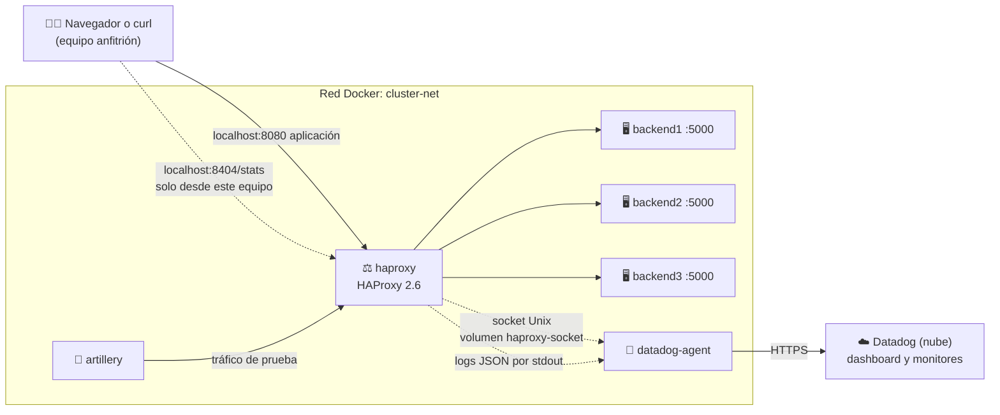

<div align="center">

# Monitoreo de clúster HAProxy con Datadog

**Proyecto 8 · Servicios Telemáticos · Ingeniería Informática**
**Universidad Autónoma de Occidente (UAO) · 2026-2**


</div>

---

## Índice

1. [Descripción y arquitectura](#1-descripción-y-arquitectura)
2. [Requisitos previos](#2-requisitos-previos)
3. [Estructura del repositorio](#3-estructura-del-repositorio)
4. [Despliegue rápido](#4-despliegue-rápido)
5. [HAProxy](#5-haproxy)
6. [Backends](#6-backends)
7. [Datadog Agent y cuenta](#7-datadog-agent-y-cuenta)
8. [Dashboard y monitores](#8-dashboard-y-monitores)
9. [Pruebas de carga](#9-pruebas-de-carga)
10. [Pruebas de punta a punta y simulación de caída](#10-pruebas-de-punta-a-punta-y-simulación-de-caída)
11. [Solución de problemas](#11-solución-de-problemas)

> [!TIP]
> **¿Solo quieres ponerlo en marcha?** Revisa los [requisitos](#2-requisitos-previos) y sigue el [despliegue rápido](#4-despliegue-rápido).

---

## Integrantes

| Código | Nombre | Rol en el proyecto |
|:---:|---|---|
| 2236320 | Manuel Betancurt Pérez | Infraestructura y HAProxy |
| 2235481 | Esteban Torres Yela | Backends y métricas |
| 2235593 | Jhon Alexander Galvis Galeano | Datadog Agent e ingesta de logs |
| 2236708 | Alan Yesid Basante Portilla | Dashboard y monitores en Datadog |
| 2235256 | Juan José Hurtado Espinosa | Pruebas de carga con Artillery |
| 2236364 | Sharon Zuray Abella Díaz | Integración Docker, pruebas de punta a punta y documentación |

## Avance por parte

| Parte | Responsable | Estado |
|---|---|:---:|
| Infraestructura y HAProxy | Manuel | ✅ Listo |
| Backends | Esteban |  ✅ Listo  |
| Datadog Agent | Jhon | ✅ Listo |
| Dashboard y monitores | Alan | ✅ Listo |
| Pruebas de carga | Juan José | ⏳ Pendiente |
| Integración, E2E y documentación | Sharon | ⏳ Pendiente |

<sub>Leyenda: ✅ Listo · 🚧 En curso · ⏳ Pendiente. Cada responsable actualiza su fila.</sub>

---

## 1. Descripción y arquitectura

<sub>👤 Responsable: Manuel Betancurt · Sharon Abella deja el diagrama final</sub>

El proyecto monta un **clúster de tres servidores web** (backends) detrás de un **balanceador de carga HAProxy 2.6**. HAProxy recibe todas las peticiones de los usuarios y las reparte entre los tres backends; si uno se cae, lo detecta y deja de enviarle tráfico.

El **Datadog Agent** recoge las métricas de HAProxy (por su socket de estadísticas), sus logs y los de los backends, y los envía a **Datadog**, donde se ven en un dashboard y se configuran alertas. **Artillery** genera tráfico de prueba (normal, pico y errores) para observar cómo reacciona el sistema.

Todo corre en **contenedores Docker** orquestados con **Docker Compose**: no hay que instalar nada de esto en el equipo, solo Docker.

| Componente | Qué hace | Imagen |
|---|---|---|
| `haproxy` | Balanceador de carga: recibe el tráfico en el puerto 8080 y lo reparte | `haproxy:2.6` (oficial) |
| `backend1` · `backend2` · `backend3` | Servidores web que atienden las peticiones | Temporal: `traefik/whoami` ([ver 5.8](#58-backends-temporales)) |
| `datadog-agent` | Recoge métricas y logs y los envía a Datadog | `datadog/agent:7` |
| `artillery` | Genera carga de prueba contra HAProxy | Por definir ([sección 9](#9-pruebas-de-carga)) |



**Recorrido de una petición:**
1. El usuario (o Artillery) llama al puerto **8080**.
2. HAProxy escoge un backend **sano** y le pasa la petición.
3. El backend responde y HAProxy le devuelve la respuesta al usuario.
4. HAProxy escribe **una línea de log en JSON** con los datos de esa petición.
5. El Datadog Agent lee ese log, consulta las métricas por el **socket** y envía todo a Datadog.

---

## 2. Requisitos previos

<sub>👤 Responsable: Sharon Abella · versión inicial: Manuel Betancurt</sub>

| Herramienta | Para qué | Cómo comprobar que está instalada |
|---|---|---|
| **Docker** con **Compose v2** ([Docker Desktop](https://docs.docker.com/desktop/) en Windows/macOS, [Docker Engine](https://docs.docker.com/engine/install/) en Linux) | Correr todos los servicios | `docker compose version` |
| **Git** | Descargar el proyecto | `git --version` |
| **Cuenta de Datadog** | Ver métricas, logs y alertas | Ver [sección 7](#7-datadog-agent-y-cuenta) |

---

## 3. Estructura del repositorio

<sub>👤 Responsable: Manuel Betancurt · cada integrante agrega aquí sus archivos (solo agregar líneas)</sub>

```
.
```text
├── docker-compose.yml       # Orquestación de todos los servicios (un bloque por dueño)
├── .env.example             # Plantilla de variables (copiar como .env)
├── .gitignore               # Archivos que Git no sube (incluye .env)
├── .gitattributes           # Fuerza finales de línea LF
├── README.md
├── .github/
│   └── workflows/
│       └── backends-ci.yml  # CI de los backends: pruebas y construcción de la imagen en cada PR
├── haproxy/
│   └── haproxy.cfg          # Configuración de HAProxy (montada de solo lectura)
├── backends/                # Código y Dockerfile de los backends
│   ├── app.py              # Aplicación Flask instrumentada con Prometheus y logs JSON
│   ├── gunicorn.conf.py    # Configuración de servidor de producción WSGI
│   ├── requirements.txt    # Dependencias fijas del backend (Flask, prometheus-client, gunicorn)
│   ├── requirements-dev.txt # Dependencias solo para pruebas (pytest); no entran a la imagen
│   ├── .dockerignore       # Archivos que no se copian a la imagen (pruebas y cachés)
│   ├── tests/              # Pruebas automáticas con pytest
│   └── Dockerfile          # Imagen Python 3.14-slim, usuario no root y healthcheck nativo
├── datadog/
│   ├── datadog.yaml         # Configuración general del Agent, logs y etiquetas
│   ├── conf.d/
│   │   ├── haproxy.d/
│   │   │   └── conf.yaml    # Métricas y service checks de HAProxy por socket Unix
│   │   └── openmetrics.d/
│   │       └── conf.yaml    # Métricas HTTP de los tres backends
│   ├── dashboards/          # Dashboard exportado en JSON
│   └── monitors/            # Monitores exportados en JSON
├── artillery/               # Escenarios de carga
└── docs/
    ├── diagramas/           # Diagramas de arquitectura
    └── evidencias/          # Capturas de las pruebas, una subcarpeta por parte
```

| Carpeta o archivo | Dueño |
|---|---|
| `haproxy/` | Manuel Betancurt |
| `backends/` | Esteban Torres |
| `datadog/` (excepto `dashboards/` y `monitors/`) | Jhon Galvis |
| `datadog/dashboards/` · `datadog/monitors/` | Alan Basante |
| `artillery/` | Juan José Hurtado |
| `docker-compose.yml` (integración) · `docs/diagramas/` | Sharon Abella (cada bloque de servicio lo edita su dueño) |

---


## 4. Despliegue rápido

<sub>👤 Responsable: Sharon Abella · versión inicial: Manuel Betancurt</sub>

Los comandos se escriben en una terminal: **PowerShell** en Windows, **Terminal** en macOS o Linux.

**1. Descargar el proyecto y entrar a la carpeta**
```bash
git clone https://github.com/MBeta032/Monitoreo-de-Cluster-HAProxy-con-Datadog.git
cd Monitoreo-de-Cluster-HAProxy-con-Datadog
```

**2. Crear el archivo de variables** a partir de la plantilla y llenarlo ([ver sección 7](#7-datadog-agent-y-cuenta)). Solo es necesario cuando el Datadog Agent esté incluido; HAProxy y los backends arrancan sin él.
```bash
cp .env.example .env              # en PowerShell: Copy-Item .env.example .env
```

**3. Levantar todos los servicios** en segundo plano
```bash
docker compose up -d
```

**4. Verificar** que todos los contenedores estén en estado `Up`
```bash
docker compose ps
```

Para apagar todo: `docker compose down`

<details>
<summary>Comprobar que HAProxy reparte la carga</summary>

Hacer 6 peticiones seguidas:
```bash
# Windows (PowerShell): curl es un alias de otro comando, hay que escribir curl.exe
1..6 | ForEach-Object { curl.exe -s http://localhost:8080/ | Select-String "^Name" }

# Linux o macOS
for i in $(seq 6); do curl -s http://localhost:8080/ | grep '^Name'; done
```
Con los backends temporales debe salir `Name: backend1`, `backend2`, `backend3`, y otra vez 1, 2, 3.

Tablero de estadísticas: abrir <http://localhost:8404/stats> y comprobar que los 3 backends están en verde (`UP`).

Último log, en JSON:
```bash
docker compose logs --no-log-prefix haproxy --tail 1
```

</details>

---

## 5. HAProxy

<sub>👤 Responsable: Manuel Betancurt</sub>

### 5.1 Contrato de integración

> [!WARNING]
> Estos nombres los usan **todas** las partes del proyecto. **No se cambian sin avisar antes al grupo.**

| Elemento | Valor |
|---|---|
| Servicios en Compose | `haproxy` · `backend1` · `backend2` · `backend3` · `datadog-agent` · `artillery` (el nombre del contenedor es igual al del servicio) |
| Red de Docker | `cluster-net` |
| Aplicación (frontend `fe_web`) | puerto `8080`, publicado en el equipo anfitrión |
| Tablero de estadísticas | puerto `8404`, ruta `/stats`, publicado **solo en `127.0.0.1`** del anfitrión |
| Socket de estadísticas | `/var/lib/haproxy/admin.sock`, en el volumen `haproxy-socket` |
| Backends | puerto interno `5000` · rutas `/`, `/health`, `/metrics`, `/error` |
| Grupo de backends en HAProxy | `be_app` |
| Logs | una línea JSON por petición, por la salida estándar del contenedor (15 campos, ver 5.5) |
| Tags en Datadog | `env:lab` · `project:haproxy-telematicos` |

### 5.2 Puertos

| Puerto | Dónde | Para qué |
|:---:|---|---|
| **8080** | `http://localhost:8080` | Entrada de la aplicación: todo el tráfico pasa por aquí |
| **8404** | `http://localhost:8404/stats` | Tablero de estadísticas. Solo se abre desde el equipo donde corre Docker |
| **5000** | Solo dentro de `cluster-net` | Puerto de cada backend; no se publica al equipo anfitrión |

> [!NOTE]
> HAProxy usa el 8080 y no el 80 porque la imagen oficial, desde la versión 2.4, se ejecuta con un usuario sin privilegios (`haproxy`), que no puede abrir puertos menores a 1024.

### 5.3 Tablero de estadísticas

- **Dirección:** <http://localhost:8404/stats>. Se recarga solo cada 5 segundos.
- **Qué muestra:** por cada backend, si está `UP` (verde) o `DOWN` (rojo), sesiones, bytes y códigos de respuesta. La columna `LastChk` muestra el resultado del último health check (`L7OK/200` significa que respondió `200`).
- **Acceso:** el puerto solo se publica en `127.0.0.1`, así que otros equipos de la red no lo alcanzan. El tablero **no escribe en el log**, para que sus recargas no cuenten como tráfico.
- **Relación con Datadog:** el tablero y el socket entregan los mismos datos. El tablero muestra solo el instante actual; Datadog guarda el historial y envía alertas.

### 5.4 Socket de estadísticas (para el Datadog Agent)

| Parámetro | Valor | Por qué |
|---|---|---|
| Ruta | `/var/lib/haproxy/admin.sock` | La carpeta ya pertenece al usuario `haproxy` en la imagen; `/var/run/haproxy` no existe y Docker la crearía como root, impidiendo que HAProxy cree el socket |
| Permisos | `mode 660` | Solo el dueño y el grupo pueden abrirlo (no `666`) |
| Nivel | `level user` | Solo lectura de estadísticas: el socket no permite cambiar nada |
| Dueño y grupo | `haproxy` (uid 99, gid 99) | Es el usuario con el que corre HAProxy en la imagen |

**Para Jhon (servicio `datadog-agent`):**
- Montar el volumen `haproxy-socket` en el Agent, en la misma ruta: `/var/lib/haproxy`.
- Agregar `group_add: ["99"]` al servicio, para que el proceso del Agent pertenezca al grupo del socket.
- En `haproxy.d/conf.yaml`, usar `url: unix:///var/lib/haproxy/admin.sock`. Según la documentación de Datadog, la integración por socket es el modo antiguo (deprecated): para usarla hay que poner `use_openmetrics` y `use_prometheus` en `false`.
- Si el Agent no logra leer con `level user`, subir a `level operator` en `haproxy.cfg` y avisar al grupo.

<details>
<summary>Comprobar el socket sin el Agent</summary>

Un usuario común (no root) con el grupo 99 debe poder leer; sin el grupo, no:
```bash
# Sin el grupo: debe responder "Permission denied"
docker run --rm -v haproxy-socket:/var/lib/haproxy --user 1000 --entrypoint sh alpine/socat -c 'echo show info | socat - UNIX-CONNECT:/var/lib/haproxy/admin.sock'

# Con el grupo 99: lista el estado de los backends (deben salir en UP)
docker run --rm -v haproxy-socket:/var/lib/haproxy --user 1000 --group-add 99 --entrypoint sh alpine/socat -c 'echo show stat | socat - UNIX-CONNECT:/var/lib/haproxy/admin.sock | cut -d, -f1,2,18'
```

</details>

### 5.5 Contrato de logs (JSON)

HAProxy escribe **una línea JSON por petición** en la salida estándar del contenedor (`docker compose logs haproxy`) y el Datadog Agent la lee de ahí. Los tiempos son **números sin comillas, en milisegundos**.

| Campo | Tipo | Qué significa | Ejemplo |
|---|:---:|---|---|
| `timestamp` | número | Milisegundos desde 1970 (UTC). Es el momento en que se escribe el log, es decir, el final de la petición | `1793511346523` |
| `client_ip` | texto | IP de quien hizo la petición | `"172.18.0.1"` |
| `frontend` | texto | Por dónde entró la petición | `"fe_web"` |
| `backend` | texto | Grupo de servidores que la atendió | `"be_app"` |
| `server` | texto | Servidor que respondió (`<NOSRV>` si ninguno) | `"backend2"` |
| `method` | texto | Método HTTP (primeros 32 bytes) | `"GET"` |
| `path` | texto | Ruta pedida, sin parámetros (primeros 512 bytes) | `"/health"` |
| `status_code` | número | Código de respuesta HTTP | `200` |
| `bytes` | número | Bytes enviados al cliente | `299` |
| `queue_ms` | número | Tiempo esperando en cola dentro de HAProxy (`Tw`) | `0` |
| `connect_ms` | número | Tiempo en conectarse al backend (`Tc`) | `1` |
| `response_ms` | número | Tiempo que tardó el backend en empezar a responder (`Tr`) | `4` |
| `total_ms` | número | Tiempo total activo de la petición (`Ta`) | `6` |
| `termination_state` | texto | Cómo terminó la petición. Extra al contrato original | `"--"` |
| `retries` | texto | Reintentos de conexión. Extra al contrato original | `"0"` |

> [!NOTE]
> - Si `queue_ms`, `connect_ms` o `response_ms` valen `-1`, esa etapa no ocurrió (por ejemplo, no se pudo conectar con el backend). Al calcular latencias hay que **excluir esos valores**.
> - `termination_state`: `--` es normal; `sC` significa que el backend no logró conectar a tiempo.
> - `retries`: `"0"` es normal; `"+1"` indica una petición que HAProxy pasó a **otro** servidor (`redispatch`). Va como texto porque `+1` no es un número válido en JSON.
> - La barra de la ruta sale escapada (`\/`): es JSON válido y Datadog la lee como `/`.

<details>
<summary>Ejemplo de una línea de log</summary>

```json
{"timestamp":1793511346523,"client_ip":"172.18.0.1","frontend":"fe_web","backend":"be_app","server":"backend1","method":"GET","path":"\/","status_code":200,"bytes":299,"queue_ms":0,"connect_ms":2,"response_ms":4,"total_ms":6,"termination_state":"--","retries":"0"}
```

</details>

<details>
<summary>Por qué <code>path</code> y <code>method</code> están acotados</summary>

Son datos que controla quien hace la petición. Se **escapan** (para que una comilla en la dirección no pueda romper ni falsificar el JSON) y se **recortan** (512 y 32 bytes) para que cada línea tenga un tamaño máximo conocido: ni se corta a la mitad ni permite llenar el disco con direcciones larguísimas. El límite del mensaje de log es de 4096 bytes (`len 4096`), y HAProxy rechaza con `400` las peticiones demasiado grandes, que igual generan una línea válida.

</details>

### 5.6 Parámetros del balanceador

| Parámetro | Valor | Qué hace |
|---|---|---|
| Algoritmo | `roundrobin` | Reparte por turnos. Los 3 backends son iguales y las peticiones cortas, así que no se justifica `leastconn` |
| Health check | `GET /health`, espera `200` | HAProxy lo pregunta a cada backend |
| `inter` | `1s` | Cada cuánto revisa cada backend (y el tiempo máximo que espera el chequeo) |
| `fall` | `3` | Fallos seguidos para marcar un backend como `DOWN` |
| `rise` | `2` | Chequeos buenos seguidos para volver a `UP` |
| `option redispatch 1` | activo | Si no logra conectar con un backend, reintenta en otro desde el primer reintento |
| `timeout connect` | `2s` | Espera para conectar con un backend |
| `timeout client` / `timeout server` | `30s` | Inactividad máxima del cliente y del backend |

### 5.7 Comportamiento ante la caída de un backend (medido)

Medido con `docker stop backend1` y tráfico constante, con los backends temporales (con los reales puede variar):

| Medida | Resultado |
|---|---|
| Tiempo en marcar el backend como `DOWN` | ≈ 6 s |
| Tiempo en volver a `UP` al encenderlo | ≈ 2,3 s |
| Peticiones con error | 0 de 60 |
| Peticiones afectadas | Las que le tocaban al backend caído en esos segundos: tardan ≈ 2 s y se responden desde otro backend |

Para el monitor de "backend DOWN": no puede dar señal antes de unos 6 segundos desde la caída.

### 5.8 Backends temporales

Mientras se integran los backends reales ([sección 6](#6-backends)), el `docker-compose.yml` usa la imagen [`traefik/whoami`](https://github.com/traefik/whoami), que responde con el nombre del contenedor que atendió la petición y permite **ver el reparto de carga**. Cumplen el contrato: nombres `backend1` a `backend3`, puerto `5000` (variable `WHOAMI_PORT_NUMBER`) y responden `200` en `/health`. No tienen `/metrics` ni `/error`: esas rutas las implementan los backends reales.

---

## 6. Backends

<sub>👤 Responsable: Esteban Torres</sub>

Los backends son una aplicación en Python (**Flask 3.1.0** servida por **Gunicorn 23.0.0**, con métricas de **prometheus-client 0.21.1**) sobre `python:3.14-slim`, con usuario no root y healthcheck propio. Los tres contenedores (`backend1`, `backend2`, `backend3`) usan **la misma imagen**, `haproxy-telematicos-backend:1.0.0`, y se diferencian por la variable `INSTANCE_NAME`.

El puerto `5000` de los backends no se publica en el equipo: desde afuera se llega a ellos por HAProxy (`http://localhost:8080`), que reparte cada petición a uno de los tres.

### 6.1 Rutas

| Ruta | Método | Qué hace | Respuesta |
|---|:---:|---|:---:|
| `/` | `GET` | JSON con el nombre de la instancia que respondió (`instance`) | `200` |
| `/health` | `GET` | Chequeo de salud para HAProxy y Docker | `200` |
| `/metrics` | `GET` | Métricas HTTP en formato Prometheus | `200` |
| `/error` | `GET` | Error forzado para probar el monitoreo | `500` |

`/health` y `/metrics` **no se cuentan** en las métricas ni dejan línea en el log, para que los chequeos no se mezclen con el tráfico real.

### 6.2 Cómo forzar errores

Desde PowerShell (en Linux o macOS se escribe `curl` en lugar de `curl.exe`):

```powershell
# Error 500: deja una línea de log con level ERROR
curl.exe -i http://localhost:8080/error

# Error 404 (ruta que no existe): deja una línea con level WARNING y se cuenta con handler="unmatched"
curl.exe -i http://localhost:8080/no-existe
```

### 6.3 Métricas (`/metrics`)

| Métrica | Tipo | Labels |
|---|---|---|
| `http_requests_total` | Contador | `method`, `handler`, `status` |
| `http_request_duration_seconds` | Histograma (segundos) | `method`, `handler` |

- **`handler`** guarda la **ruta de Flask que coincidió** (por ejemplo `/` o `/error`), no la URL escrita por el usuario. Así, cuando haya rutas con IDs, todas las peticiones a una misma ruta quedan en una sola serie. Si ninguna ruta coincide (404), el valor es `unmatched`.
- El Datadog Agent las lee con OpenMetrics y namespace `backend` ([ver 7.4](#74-métricas-de-los-backends-con-openmetrics)).

Ejemplo real de la salida:

```text
# HELP http_requests_total Total de peticiones HTTP atendidas
# TYPE http_requests_total counter
http_requests_total{handler="/",method="GET",status="200"} 2.0
http_request_duration_seconds_bucket{handler="/",le="0.005",method="GET"} 2.0
http_request_duration_seconds_sum{handler="/",method="GET"} 0.0002646446228027344
http_request_duration_seconds_count{handler="/",method="GET"} 2.0
```

**Por qué se usa el modo multiproceso.** Gunicorn atiende con varios *workers*, que son procesos separados. En el modo normal, prometheus-client guarda los contadores en la memoria de cada worker, y `/metrics` devuelve solo los del worker que atendió esa consulta: el contador "sube y baja" entre consultas. En el [modo multiproceso](https://prometheus.github.io/client_python/multiprocess/) cada worker escribe sus valores en archivos y `/metrics` los suma todos:

- La carpeta es `/tmp/prometheus_multiproc` (variable `PROMETHEUS_MULTIPROC_DIR`, definida en el `Dockerfile`).
- `gunicorn.conf.py` la **vacía cada vez que arranca Gunicorn** (hook `on_starting`). Esto importa porque con `restart: unless-stopped` el contenedor se reinicia sin recrearse y quedarían los archivos anteriores.
- Cuando un worker termina, el hook `child_exit` avisa a prometheus-client (`mark_process_dead`). Sus archivos se conservan, así que **el contador no baja** si un worker se reinicia.

Para ver las métricas de **un** backend en particular (por `localhost:8080` cada consulta cae en un backend distinto):

```powershell
docker exec backend1 python -c "import urllib.request; print(urllib.request.urlopen('http://localhost:5000/metrics').read().decode())"
```

### 6.4 Logs en JSON

Cada petición (menos `/health` y `/metrics`) deja **una línea JSON** en la salida estándar (`stdout`). El nivel depende del resultado: `5xx` → `ERROR`, `4xx` → `WARNING`, el resto → `INFO`.

| Campo | Contenido |
|---|---|
| `timestamp` | Momento del log, en milisegundos |
| `level` | `INFO`, `WARNING` o `ERROR` |
| `message` | Resumen de la petición |
| `instance` | Backend que respondió |
| `method` · `path` · `status_code` | Método, ruta real pedida y código de respuesta |
| `duration_ms` | Tiempo de atención en milisegundos |
| `client_ip` | IP de quien hizo la petición (normalmente HAProxy) |

Líneas reales copiadas de `docker compose logs`:

```json
{"timestamp": 1794458443426, "level": "INFO", "message": "Peticion procesada GET / - 200", "instance": "backend1", "method": "GET", "path": "/", "status_code": 200, "duration_ms": 0.14, "client_ip": "172.18.0.5"}
{"timestamp": 1794458443484, "level": "ERROR", "message": "Peticion procesada GET /error - 500", "instance": "backend2", "method": "GET", "path": "/error", "status_code": 500, "duration_ms": 0.18, "client_ip": "172.18.0.5"}
```

Los mensajes de **Gunicorn** también salen en JSON por `stdout`, con su nivel real (configurados con `logconfig_dict` en `gunicorn.conf.py`). Así, Datadog ya no marca como Error los mensajes de arranque, pero sí ve como `ERROR` o `CRITICAL` los problemas reales, por ejemplo un worker que se cae o un *worker timeout*. El *access log* de Gunicorn está apagado.

```json
{"timestamp": 1794457915539, "level": "INFO", "message": "Booting worker with pid: 7", "instance": "backend1"}
```

### 6.5 Construir la imagen

```powershell
docker compose build backend1 backend2 backend3
docker images haproxy-telematicos-backend
```

Compose muestra `Built` tres veces (una por servicio), pero queda **una sola imagen**: `haproxy-telematicos-backend:1.0.0`. Para reconstruir y aplicar cambios del código: `docker compose up -d --build`.

### 6.6 Escenarios de workers

El número de workers de Gunicorn de cada backend se cambia en el archivo `.env` (plantilla en `.env.example`). Si una variable no está definida, ese backend usa **2**. Cada worker atiende con 4 *threads* en todos los escenarios, así que lo único que cambia es la cantidad de workers.

| Escenario | `BACKEND1_WORKERS` | `BACKEND2_WORKERS` | `BACKEND3_WORKERS` |
|---|:---:|:---:|:---:|
| Normal | 2 | 2 | 2 |
| Pocos workers | 1 | 1 | 1 |
| Muchos workers | 4 | 4 | 4 |
| Desigual | 1 | 2 | 4 |

1. Editar los tres valores en `.env`.
2. Aplicar el cambio (Compose recrea solo los backends cuyo valor cambió):
   ```powershell
   docker compose up -d backend1 backend2 backend3
   ```
3. Comprobar cuántos workers arrancó cada backend. `docker top` muestra un proceso maestro más un proceso por worker:
   ```powershell
   docker top backend1
   docker compose logs backend1 | Select-String "Booting worker"
   ```

### 6.7 Límites de CPU y memoria

Cada backend tiene un límite de **1 CPU** y **384 MB** de memoria (`deploy.resources.limits` en `docker-compose.yml`; Compose v2 los aplica sin Swarm) y `restart: unless-stopped`. Medido en este equipo: unos **61 MB** por backend con 2 workers y unos **103 MB** con 4 workers bajo tráfico.

```powershell
docker stats --no-stream backend1 backend2 backend3
```

Si un backend se queda sin memoria, el sistema puede matar a uno de sus workers; en ese caso Gunicorn deja en el log una línea `ERROR` con `Worker (pid:...) was sent SIGKILL! Perhaps out of memory?`.

### 6.8 Pruebas automáticas

Las pruebas usan pytest y el cliente de pruebas de Flask, sin Docker. Verifican las rutas, el nivel `ERROR` del log de `/error` y las métricas (que `/` se cuente, que `/health` no y que una ruta inventada quede como `unmatched`). pytest está en `requirements-dev.txt` y **no entra a la imagen**.

```powershell
cd backends
python -m pip install -r requirements.txt -r requirements-dev.txt
python -m pytest -v
```

Se usa `python -m pytest` (y no solo `pytest`) para que Python encuentre `app.py` desde la carpeta `backends`. Las mismas pruebas, más la construcción de la imagen, corren solas en GitHub Actions (`.github/workflows/backends-ci.yml`) en cada Pull Request hacia `develop` o `main` que cambie `backends/`.
---

## 7. Datadog Agent y cuenta

<sub>👤 Responsable: Jhon Galvis</sub>

### 7.1 Cuenta y variables de entorno
Para realizar el monitoreo se creó una cuenta de Datadog en la región US1 (`datadoghq.com`). La cuenta se encuentra en período de prueba gratuito y su fecha exacta de vencimiento es el martes 17 de Noviembre.

La API key se obtiene desde **Organization Settings → API Keys**. Esta clave permite que el Agent envíe la información a Datadog.
Para configurar las credenciales, se copia `.env.example` como `.env` y se completan las siguientes variables:

- `DD_API_KEY`: clave de API de la organización.
- `DD_SITE`: `datadoghq.com`.
El archivo `.env` está excluido mediante `.gitignore` para evitar publicar credenciales en GitHub.

### 7.2 Configuración de Datadog Agent
Se integró Datadog Agent 7.85.1 como un servicio adicional de Docker Compose, identificado como `datadog-agent`, dentro de la red `cluster-net`.
La configuración general se encuentra en `datadog/datadog.yaml`. Allí se habilita la recolección de logs y se establecen las etiquetas `env:lab` y `project:haproxy-telematicos`.
El Agent utiliza el socket Docker para detectar contenedores y eventos. También comparte el volumen `haproxy-socket`, con acceso mediante el grupo 99, para consultar las estadísticas de HAProxy.

### 7.3 Integración con HAProxy
La configuración se encuentra en `datadog/conf.d/haproxy.d/conf.yaml`.
Se utiliza el socket Unix `/var/lib/haproxy/admin.sock` mediante la integración heredada de HAProxy, con `use_openmetrics` y `use_prometheus` desactivados.
Se habilitaron las opciones `enable_service_check` y `collect_status_metrics` para recopilar estadísticas de disponibilidad. También se configuró `disable_legacy_service_tag` para utilizar la etiqueta actual `haproxy_service`.
La integración se verificó mediante `agent status` y `agent check haproxy`. Se obtuvieron 94 muestras de métricas y cuatro service checks por ejecución, incluidos los estados individuales de los tres backends.

### 7.4 Métricas de los backends con OpenMetrics
Las métricas HTTP se recolectan desde los endpoints `/metrics` de `backend1`, `backend2` y `backend3`, por el puerto interno 5000.
La configuración se encuentra en `datadog/conf.d/openmetrics.d/conf.yaml`, donde se definieron tres instancias utilizando el namespace `backend`.
Se confirmó la recepción de las siguientes métricas:
- `backend.http_requests.count`
- `backend.http_request_duration_seconds.sum`
- `backend.http_request_duration_seconds.count`
- `backend.http_request_duration_seconds.bucket`

Las métricas incluyen la etiqueta `backend`, que permite distinguir cada servidor.

Se intentó inicialmente utilizar Autodiscovery mediante etiquetas Docker para OpenMetrics, pero no se cargó la integración. Por este motivo se utilizó un archivo de configuración montado en el Agent, comprobando su funcionamiento con las tres instancias en estado OK.

### 7.5 Recolección de logs
Se configuró la recolección selectiva de logs mediante etiquetas Docker `com.datadoghq.ad.logs` en HAProxy y los tres backends.
Los registros se identifican con los servicios `haproxy`, `backend1`, `backend2` y `backend3`.
Se comprobó en Log Explorer que los registros JSON de HAProxy se reciben con atributos separados, entre ellos `backend`, `server`, `status_code`, `response_ms` y `total_ms`.
A partir del atributo numérico `@total_ms` se creó la medida **HAProxy Total Latency**, en milisegundos, para analizar la latencia de las peticiones y calcular percentiles.
Los mensajes informativos de arranque que aparecen como Error pueden provenir de la salida estándar de error. Para distinguir errores HTTP reales se recomienda consultar el atributo `status_code`.

### 7.6 Eventos y pruebas de disponibilidad
Se confirmó la recepción de eventos Docker en Event Explorer.
Para comprobar la detección de fallos se detuvo temporalmente `backend2` mediante `docker compose stop backend2`.
La integración generó el service check `haproxy.backend_up` con estado `CRITICAL` (`status: 2`) y etiqueta `backend:backend2`. Al mismo tiempo, HAProxy continuó atendiendo las peticiones mediante `backend1` y `backend3`.
Posteriormente se restauró el contenedor mediante `docker compose start backend2` y se confirmó que los tres servidores regresaron al estado OK (`status: 0`).
La creación de dashboards y monitores de alertas corresponde al integrante responsable de esa parte.

### 7.7 Comandos de verificación
- `docker compose ps`: comprobar el estado de los contenedores.
- `docker compose exec -T datadog-agent agent status`: verificar las integraciones y el envío de información.
- `docker compose exec -T datadog-agent agent check haproxy`: consultar métricas y service checks de HAProxy.
- `docker compose exec -T datadog-agent agent check openmetrics`: comprobar las tres instancias de OpenMetrics.

Las métricas se consultan en **Metrics Explorer**, los registros en **Log Explorer** y los eventos de contenedores en **Event Management → All Events**.


## 8. Dashboard y monitores

<sub>👤 Responsable: Alan Basante</sub>

- **Acceso directo:** [Ver Dashboard en Datadog (Enlace público)](https://p.datadoghq.com/sb/95a7b1a2-d9f8-11f1-b57e-baea63f7b3d6-092a4c169f18801ad9dc43ee02fcb845)

Se implementó la capa de observabilidad visual y alertas tempranas en Datadog para supervisar en tiempo real la salud, el rendimiento y la disponibilidad del clúster HAProxy. Todas las definiciones se gestionan bajo el principio de **Observabilidad como Código (OaC)** mediante archivos JSON versionados en el repositorio, permitiendo un despliegue reproducible.

### 8.1 Indicadores del Dashboard
El dashboard centraliza los 4 indicadores obligatorios del clúster en una vista organizada ([`datadog/dashboards/haproxy_cluster_dashboard.json`](file:///c:/Users/Alanp/Desktop/GIT-HUB/Monitoreo-de-Cluster-HAProxy-con-Datadog/datadog/dashboards/haproxy_cluster_dashboard.json)):

1. **Peticiones por segundo (Throughput):**
   - **Métrica:** `sum:haproxy.frontend.requests.rate{project:haproxy-telematicos}`
   - **Tipo de widget:** Gráfico temporal (`timeseries`).
   - **Propósito:** Medir el caudal de solicitudes por segundo procesadas por el frontend `fe_web`.
2. **Latencia promedio de respuesta:**
   - **Métrica:** `avg:haproxy.backend.response.time{project:haproxy-telematicos}`
   - **Tipo de widget:** Gráfico temporal (`timeseries`).
   - **Propósito:** Supervisar el tiempo de respuesta (en ms) que toma el clúster `be_app` para despachar cada petición.
3. **Disponibilidad y salud de backends:**
   - **Check:** `haproxy.backend_up` agrupado por `server` y `backend`.
   - **Tipo de widget:** Estado de chequeo de servicio (`check_status`).
   - **Propósito:** Visualizar en tiempo real el semáforo operativo individual de `backend1`, `backend2` y `backend3`.
4. **Tasa de error HTTP (%):**
   - **Cálculo:** Ratio porcentual de respuestas 5xx frente al tráfico total atendido:
     $$\text{Error Rate (\%)} = \left( \frac{\sum \text{haproxy.backend.response.5xx}}{\sum \text{haproxy.frontend.requests.rate}} \right) \times 100$$
   - **Tipo de widget:** Valor numérico (`query_value`) con formato condicional: verde ($< 2\%$), advertencia preventiva en amarillo ($2\% - 5\%$) y crítico en rojo ($> 5\%$).

### 8.2 Monitores y Alertas
Se configuraron dos reglas de supervisión continua para notificar anomalías operativas:

| Monitor | Tipo | Condición de disparo | Archivo |
|---|:---:|---|---|
| **Caída de Backend** | `service check` | Se activa de forma inmediata si un servidor pasa a estado `CRITICAL` en 1 chequeo consecutivo. | [`datadog/monitors/backend_down_monitor.json`](file:///c:/Users/Alanp/Desktop/GIT-HUB/Monitoreo-de-Cluster-HAProxy-con-Datadog/datadog/monitors/backend_down_monitor.json) |
| **Tasa de Error HTTP** | `metric alert` | Evalúa el porcentaje de errores 5xx en una ventana de 5 minutos: aviso si supera el 2%, alerta crítica si supera el 5%. | [`datadog/monitors/high_error_rate_monitor.json`](file:///c:/Users/Alanp/Desktop/GIT-HUB/Monitoreo-de-Cluster-HAProxy-con-Datadog/datadog/monitors/high_error_rate_monitor.json) |

Ambos monitores incorporan notificaciones contextualizadas con variables dinámicas (`{{server.name}}`, `{{value}}%`) y mensajes diferenciados para alerta (`{{#is_alert}}`) y recuperación automática (`{{#is_recovery}}`).

### 8.3 Justificación técnica y selección de alternativas (Rúbrica)
Para satisfacer los criterios de diseño y evaluación del proyecto se sustentaron las siguientes decisiones de ingeniería:
- **Detección de caídas (Service Check vs Alerta de métrica):** Se seleccionó un `service check` nativo de HAProxy en lugar de una métrica acumulada. El service check evalúa el sondeo en intervalos de 1 segundo, detectando la caída de un contenedor en tiempo real sin el retraso que genera el cálculo de una ventana móvil.
- **Tasa de errores (Ventana ponderada vs Umbral instantáneo):** Se adoptó una ventana temporal de 5 minutos (`avg(last_5m)`) con doble umbral (Warning 2%, Critical 5%). Esto previene falsos positivos por fallas transitorias en momentos de poco tráfico y asegura alineación con estándares de confiabilidad (SLO).
- **Aprovisionamiento declarativo:** Mantener las definiciones en archivos JSON permite validar la configuración localmente, versionar cambios en Git y desplegar dashboards y monitores mediante la API de Datadog sin depender de modificaciones manuales efímeras.

### 8.4 Importación de configuraciones en Datadog
Para replicar esta infraestructura en cualquier cuenta de Datadog:
- **Dashboard:** En Datadog, acceder a **Dashboards → New Dashboard**, seleccionar el menú de opciones (tres puntos) en la esquina superior derecha, elegir **Import JSON** y cargar `datadog/dashboards/haproxy_cluster_dashboard.json`.
- **Monitores:** En **Monitors → New Monitor**, crear un monitor del tipo correspondiente, seleccionar **Edit as JSON** en la parte superior del formulario y pegar el contenido de los archivos en `datadog/monitors/`.

### 8.5 Evidencias requeridas para el informe
Para el informe IEEE y la sustentación se acotan estrictamente **dos capturas clave**:
1. **Captura 1 (Dashboard general en régimen):** Vista completa del panel con tráfico activo de Artillery donde se evidencie el funcionamiento coordinado de los 4 widgets en condiciones normales.
2. **Captura 2 (Alerta activa ante fallo):** Vista del monitor en Datadog en estado `CRITICAL` tras simular la detención de un backend (`docker compose stop backend2`).

## 9. Pruebas de carga

<sub>👤 Responsable: Juan José Hurtado</sub>

> ⏳ **Pendiente.** Escenarios de Artillery y cómo ejecutarlos.

## 10. Pruebas de punta a punta y simulación de caída

<sub>👤 Responsable: Sharon Abella</sub>

> ⏳ **Pendiente.** Paso a paso para apagar un backend, ver la alerta y comparar métricas antes, durante y después.

---

## 11. Solución de problemas

<sub>👤 Todos · solo agregar bloques</sub>

Haz clic en el mensaje de error para ver su causa y su solución. Para agregar uno, copia un bloque `<details>` completo al final de esta lista.

<details>
<summary><code>docker</code> no se reconoce como comando (Windows)</summary>

- **Causa:** la terminal se abrió antes de instalar Docker y no conoce su ruta.
- **Solución:** cerrar todas las terminales y abrir una nueva; si persiste, cerrar sesión en Windows.
- <sub>Agregado por: Manuel</sub>

</details>

<details>
<summary>Un archivo de configuración falla dentro del contenedor con caracteres raros al final de las líneas</summary>

- **Causa:** finales de línea CRLF de Windows.
- **Solución:** el repo fuerza LF con `.gitattributes`; en VS Code, configurar `Files: Eol` en `\n`.
- <sub>Agregado por: Manuel</sub>

</details>

<details>
<summary><code>warning: You appear to have cloned an empty repository</code></summary>

- **Causa:** se clonó el repo antes del primer commit.
- **Solución:** es normal; no requiere acción.
- <sub>Agregado por: Manuel</sub>

</details>

<details>
<summary>En PowerShell, <code>curl</code> no se comporta como se espera</summary>

- **Causa:** `curl` es un alias de otro comando de PowerShell.
- **Solución:** escribir `curl.exe`.
- <sub>Agregado por: Manuel</sub>

</details>

<details>
<summary>HAProxy no arranca: <code>cannot bind UNIX socket (Permission denied)</code></summary>

- **Causa:** el volumen del socket quedó a nombre de root, y HAProxy corre como usuario sin privilegios.
- **Solución:** el socket va en `/var/lib/haproxy`, que ya es del usuario `haproxy`. Si el volumen es viejo, recrearlo: `docker compose down -v` y volver a levantar.
- <sub>Agregado por: Manuel</sub>

</details>

<details>
<summary><code>haproxy -c</code> dice <code>Missing LF on last line</code></summary>

- **Causa:** el archivo de configuración no termina con un salto de línea.
- **Solución:** agregar una línea vacía al final. En VS Code, activar `Files: Insert Final Newline`.
- <sub>Agregado por: Manuel</sub>

</details>

<details>
<summary><code>haproxy -c</code> dice <code>could not resolve address 'backend1'</code></summary>

- **Causa:** se validó desde un contenedor suelto, que no está en la red de los backends.
- **Solución:** prender los backends (`docker compose up -d`) y validar con `--network cluster-net`.
- <sub>Agregado por: Manuel</sub>

</details>

<details>
<summary><code>log-format expects only one argument</code></summary>

- **Causa:** el `log-format` quedó partido en varias líneas, o con otra directiva pegada al final.
- **Solución:** debe ser una sola línea entre comillas simples, y `default_backend` en la línea siguiente.
- <sub>Agregado por: Manuel</sub>

</details>

<details>
<summary>El tablero <code>localhost:8404</code> no abre desde otro equipo</summary>

- **Causa:** el puerto solo se publica en `127.0.0.1` a propósito.
- **Solución:** abrirlo desde el equipo donde corre Docker.
- <sub>Agregado por: Manuel</sub>

</details>

<details>
<summary>Backends en estado (unhealthy) o HAProxy muestra servidores en DOWN</summary>

- **Causa:** la aplicación Python falló al iniciar dentro del contenedor, la respuesta de `/health` superó el tiempo límite del healthcheck (`timeout`), o el servidor Gunicorn no quedó escuchando en el puerto interno 5000.
- **Solución:**
  1. Verificar los registros del backend para identificar fallos de sintaxis o de inicio en Python:
     ```bash
     docker compose logs backend1
     ```
  2. Ejecutar la verificación manual del endpoint de salud mediante Python nativo dentro del contenedor:
     ```bash
     docker exec backend1 python -c "import urllib.request; print(urllib.request.urlopen('http://localhost:5000/health').getcode())"
     ```
  3. Si la respuesta es `200`, confirmar que los contenedores compartan la red `cluster-net` y reconstruir las imágenes con:
     ```bash
     docker compose up -d --build
     ```
- <sub>Agregado por: Esteban</sub>

</details>

<details>
<summary>Comando <code>curl</code> no encontrado dentro del contenedor al verificar métricas</summary>

- **Causa:** se intentó ejecutar `docker exec backend1 curl ...` dentro de la instancia, pero la imagen base `python:3.14-slim` no incluye herramientas de red adicionales para mantener el contenedor liviano y seguro.
- **Solución:**
  1. Utilizar el módulo nativo de Python `urllib.request` para consultar los endpoints internamente desde la terminal:
     ```bash
     docker exec backend1 python -c "import urllib.request; print(urllib.request.urlopen('http://localhost:5000/metrics').read().decode('utf-8'))"
     ```
  2. Alternativamente, realizar las consultas desde el equipo anfitrión ingresando desde el navegador a `http://localhost:8080/metrics`.
- <sub>Agregado por: Esteban</sub>

</details>

<details>
<summary>Logs del backend salen en texto plano en lugar de JSON estructurado</summary>

- **Causa:** el archivo `backends/gunicorn.conf.py` tenía configurado `accesslog = '-'`, provocando que Gunicorn emitiera registros de acceso predeterminados en formato de texto plano (estilo Nginx/Apache) por `stdout`, ocultando los logs JSON estructurados generados por Flask en `app.py` e incluyendo peticiones operativas como `/health`.
- **Solución:**
  1. Editar `backends/gunicorn.conf.py` y cambiar la opción a `accesslog = None` para que solo la aplicación gestione la salida estándar.
  2. Reconstruir y desplegar los contenedores:
     ```bash
     docker compose up -d --build
     ```
  3. Generar tráfico y verificar que la salida contenga únicamente el objeto JSON esperado:
     ```bash
     docker logs backend1 --tail 5
     ```
- <sub>Agregado por: Esteban</sub>

</details>


<details>
<summary>OpenMetrics no aparece en Datadog Agent</summary>

- **Causa:** durante las pruebas, el Agent reconocía los contenedores Docker, pero no cargaba la integración OpenMetrics mediante etiquetas de Autodiscovery.
- **Solución:** se configuraron los tres backends directamente en `datadog/conf.d/openmetrics.d/conf.yaml` y se montó el archivo en el contenedor del Agent. Después se comprobó con `agent status` que las tres instancias estaban en estado OK.
- <sub>Agregado por: Jhon</sub>

</details>

<details>
<summary>HAProxy recopila métricas, pero no genera service checks</summary>

- **Causa:** las opciones `enable_service_check` y `collect_status_metrics` estaban desactivadas por defecto.
- **Solución:** se habilitaron ambas opciones en `datadog/conf.d/haproxy.d/conf.yaml`. Con esto se obtuvieron cuatro service checks `haproxy.backend_up` y las métricas de disponibilidad.
- <sub>Agregado por: Jhon</sub>

</details>

<details>
<summary>Datadog muestra "The log file tailer could not be made, falling back to socket"</summary>

- **Causa:** el Agent no pudo acceder directamente al archivo de logs del contenedor y utilizó el socket Docker.
- **Solución:** se verificó mediante `agent status` que los cuatro servicios tenían estado OK y enviaban registros. No fue necesario modificar la configuración.
- <sub>Agregado por: Jhon</sub>

</details>

<details>
<summary>Datadog clasifica mensajes INFO y NOTICE como Error</summary>

- **Causa probable:** los mensajes de arranque de HAProxy y Gunicorn se escriben en `stderr`, que Datadog puede clasificar como Error.
- **Solución:** se comprobó que eran mensajes informativos y no errores HTTP. Para consultar fallos reales se recomienda utilizar el atributo `status_code` de los logs JSON.
- <sub>Agregado por: Jhon</sub>

</details>

<details>
<summary>OpenMetrics muestra contadores incompletos o cero muestras</summary>

- **Causa probable:** Gunicorn utiliza dos workers que mantienen sus contadores de Prometheus de forma independiente.
- **Solución pendiente:** se propuso al responsable de los backends utilizar un worker con cuatro threads o configurar Prometheus en modo multiproceso. El Agent ya recopila métricas de los tres servidores, pero falta validar su exactitud después de este ajuste.
- <sub>Agregado por: Jhon</sub>

</details>

