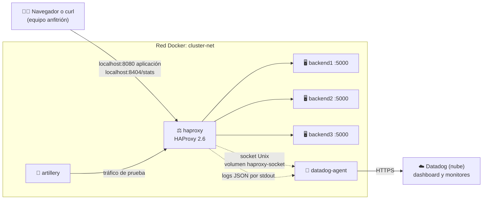

<div align="center">

# Monitoreo de clúster HAProxy con Datadog

**Proyecto 8 · Servicios Telemáticos · Ingeniería Informática**
**Universidad Autónoma de Occidente (UAO) · 2026-2**


</div>

---

## Índice

1. [Descripción y arquitectura](#1-descripción-y-arquitectura)
2. [Requisitos previos](#2-requisitos-previos)
3. [Estructura del repositorio](#3-estructura-del-repositorio)
4. [Despliegue rápido](#4-despliegue-rápido)
5. [HAProxy](#5-haproxy)
6. [Backends](#6-backends)
7. [Datadog Agent y cuenta](#7-datadog-agent-y-cuenta)
8. [Dashboard y monitores](#8-dashboard-y-monitores)
9. [Pruebas de carga](#9-pruebas-de-carga)
10. [Pruebas de punta a punta y simulación de caída](#10-pruebas-de-punta-a-punta-y-simulación-de-caída)
11. [Solución de problemas](#11-solución-de-problemas)

> [!TIP]
> **¿Solo quieres ponerlo en marcha?** Revisa los [requisitos](#2-requisitos-previos) y sigue el [despliegue rápido](#4-despliegue-rápido).

---

## Integrantes

| Código | Nombre | Rol en el proyecto |
|:---:|---|---|
| 2236320 | Manuel Betancurt Pérez | Infraestructura y HAProxy |
| 2235481 | Esteban Torres Yela | Backends y métricas |
| 2235593 | Jhon Alexander Galvis Galeano | Datadog Agent e ingesta de logs |
| 2236708 | Alan Yesid Basante Portilla | Dashboard y monitores en Datadog |
| 2235256 | Juan José Hurtado Espinosa | Pruebas de carga con Artillery |
| 2236364 | Sharon Zuray Abella Díaz | Integración Docker, pruebas de punta a punta y documentación |

## Avance por parte

| Parte | Responsable | Estado |
|---|---|:---:|
| Infraestructura y HAProxy | Manuel | 🚧 En curso |
| Backends | Esteban | ⏳ Pendiente |
| Datadog Agent | Jhon | ⏳ Pendiente |
| Dashboard y monitores | Alan | ⏳ Pendiente |
| Pruebas de carga | Juan José | ⏳ Pendiente |
| Integración, E2E y documentación | Sharon | ⏳ Pendiente |

<sub>Leyenda: ✅ Listo · 🚧 En curso · ⏳ Pendiente. Cada responsable actualiza su fila.</sub>

## Reglas de trabajo del grupo

> [!IMPORTANT]
> - **Cada carpeta y cada bloque del `docker-compose.yml` tiene un dueño** (ver [sección 3](#3-estructura-del-repositorio)). Solo el dueño los edita; si necesitas un cambio en algo de otro, pídeselo.
> - **Nada entra a `main` sin un Pull Request** revisado por otro integrante.
> - **El contrato de integración** ([sección 5.1](#51-contrato-de-integración)) no se cambia sin avisar antes al grupo.
> - En las **secciones 3 y 11** de este README solo se agregan líneas; no se borran las de otros.


---

## 1. Descripción y arquitectura

<sub>👤 Responsable: Manuel Betancurt · Sharon Abella deja el diagrama final</sub>

El proyecto monta un **clúster de tres servidores web** (backends) detrás de un **balanceador de carga HAProxy 2.6**. HAProxy recibe todas las peticiones de los usuarios y las reparte entre los tres backends; si uno se cae, lo detecta y deja de enviarle tráfico.

El **Datadog Agent** recoge las métricas de HAProxy (por su socket de estadísticas), sus logs y los de los backends, y los envía a **Datadog**, donde se ven en un dashboard y se configuran alertas. **Artillery** genera tráfico de prueba (normal, pico y errores) para observar cómo reacciona el sistema.

Todo corre en **contenedores Docker** orquestados con **Docker Compose**: no hay que instalar nada de esto en el equipo, solo Docker.

| Componente | Qué hace | Imagen |
|---|---|---|
| `haproxy` | Balanceador de carga: recibe el tráfico en el puerto 8080 y lo reparte | `haproxy:2.6` (oficial) |
| `backend1` · `backend2` · `backend3` | Servidores web que atienden las peticiones | Temporal: `traefik/whoami` ([ver 5.6](#56-backends-temporales)) |
| `datadog-agent` | Recoge métricas y logs y los envía a Datadog | `datadog/agent:7` |
| `artillery` | Genera carga de prueba contra HAProxy | Por definir ([sección 9](#9-pruebas-de-carga)) |



**Recorrido de una petición:**
1. El usuario (o Artillery) llama al puerto **8080**.
2. HAProxy escoge un backend **sano** y le pasa la petición.
3. El backend responde y HAProxy le devuelve la respuesta al usuario.
4. HAProxy escribe **una línea de log en JSON** con los datos de esa petición.
5. El Datadog Agent lee ese log, consulta las métricas por el **socket** y envía todo a Datadog.

---

## 2. Requisitos previos

<sub>👤 Responsable: Sharon Abella · versión inicial: Manuel Betancurt</sub>

| Herramienta | Para qué | Cómo comprobar que está instalada |
|---|---|---|
| **Docker** con **Compose v2** ([Docker Desktop](https://docs.docker.com/desktop/) en Windows/macOS, [Docker Engine](https://docs.docker.com/engine/install/) en Linux) | Correr todos los servicios | `docker compose version` |
| **Git** | Descargar el proyecto | `git --version` |
| **Cuenta de Datadog** | Ver métricas, logs y alertas | Ver [sección 7](#7-datadog-agent-y-cuenta) |

---

## 3. Estructura del repositorio

<sub>👤 Responsable: Manuel Betancurt · cada integrante agrega aquí sus archivos (solo agregar líneas)</sub>

```
.
├── docker-compose.yml       # Orquestación de todos los servicios (un bloque por dueño)
├── .env.example             # Plantilla de variables (copiar como .env)
├── .gitignore               # Archivos que Git no sube (incluye .env)
├── .gitattributes           # Fuerza finales de línea LF
├── README.md
├── haproxy/                 # Configuración de HAProxy
├── backends/                # Código y Dockerfile de los backends
├── datadog/
│   ├── conf.d/haproxy.d/    # Integración HAProxy del Agent (conf.yaml)
│   ├── dashboards/          # Dashboard exportado en JSON
│   └── monitors/            # Monitores exportados en JSON
├── artillery/               # Escenarios de carga
└── docs/
    ├── diagramas/           # Diagramas de arquitectura
    └── evidencias/          # Capturas de las pruebas, una subcarpeta por parte
```

| Carpeta o archivo | Dueño |
|---|---|
| `haproxy/` · `docs/evidencias/haproxy/` | Manuel Betancurt |
| `backends/` | Esteban Torres |
| `datadog/` (excepto `dashboards/` y `monitors/`) | Jhon Galvis |
| `datadog/dashboards/` · `datadog/monitors/` | Alan Basante |
| `artillery/` | Juan José Hurtado |
| `docker-compose.yml` (integración) · `docs/diagramas/` | Sharon Abella (cada bloque de servicio lo edita su dueño) |

---

## 4. Despliegue rápido

<sub>👤 Responsable: Sharon Abella · versión inicial: Manuel Betancurt</sub>

Los comandos se escriben en una terminal: **PowerShell** en Windows, **Terminal** en macOS o Linux.

**1. Descargar el proyecto y entrar a la carpeta**
```bash
git clone https://github.com/MBeta032/Monitoreo-de-Cluster-HAProxy-con-Datadog.git
cd Monitoreo-de-Cluster-HAProxy-con-Datadog
```

**2. Crear el archivo de variables** a partir de la plantilla y llenarlo ([ver sección 7](#7-datadog-agent-y-cuenta))
```bash
cp .env.example .env              # en PowerShell: Copy-Item .env.example .env
```

**3. Levantar todos los servicios** en segundo plano
```bash
docker compose up -d
```

**4. Verificar** que todos los contenedores estén en estado `Up`
```bash
docker compose ps
```

Para apagar todo: `docker compose down`

---

## 5. HAProxy

<sub>👤 Responsable: Manuel Betancurt</sub>

### 5.1 Contrato de integración

> [!WARNING]
> Estos nombres los usan **todas** las partes del proyecto. **No se cambian sin avisar antes al grupo.**

| Elemento | Valor |
|---|---|
| Servicios en Compose | `haproxy` · `backend1` · `backend2` · `backend3` · `datadog-agent` · `artillery` |
| Red de Docker | `cluster-net` |
| Puerto de la aplicación (frontend `fe_web`) | `8080`, publicado en el equipo anfitrión |
| Página de estadísticas | puerto `8404`, ruta `/stats` |
| Socket de estadísticas | `/var/run/haproxy/admin.sock`, en el volumen `haproxy-socket` |
| Backends | puerto interno `5000` · rutas `/`, `/health`, `/metrics`, `/error` |
| Grupo de backends en HAProxy | `be_app` |
| Tags en Datadog | `env:lab` · `project:haproxy-telematicos` |

### 5.2 Puertos

| Puerto | Dónde | Para qué |
|:---:|---|---|
| **8080** | `http://localhost:8080` | Entrada de la aplicación: todo el tráfico pasa por aquí |
| **8404** | `http://localhost:8404/stats` | Página de estadísticas de HAProxy |
| **5000** | Solo dentro de `cluster-net` | Puerto de cada backend; no se publica al equipo anfitrión |

> [!NOTE]
> HAProxy usa el 8080 y no el 80 porque la imagen oficial, desde la versión 2.4, se ejecuta con un usuario sin privilegios, que no puede abrir puertos menores a 1024.

### 5.3 Página de estadísticas

> 🚧 Llega con el Pull Request de la rama `feature/haproxy`.

### 5.4 Socket de estadísticas

> 🚧 Llega con el Pull Request de la rama `feature/haproxy`.

### 5.5 Contrato de logs (JSON)

HAProxy escribe **una línea JSON por petición** en la salida estándar del contenedor (se ve con `docker compose logs haproxy`) y el Datadog Agent la lee de ahí. Los **tiempos son números sin comillas, en milisegundos**, para que Datadog pueda calcular promedios y percentiles.

<details>
<summary><b>Ver los 13 campos del log</b></summary>

| Campo | Tipo | Qué significa | Ejemplo |
|---|:---:|---|---|
| `timestamp` | texto | Fecha y hora de la petición | `"2026-11-02T15:04:05-05:00"` |
| `client_ip` | texto | IP de quien hizo la petición | `"172.18.0.1"` |
| `frontend` | texto | Por dónde entró la petición | `"fe_web"` |
| `backend` | texto | Grupo de servidores que la atendió | `"be_app"` |
| `server` | texto | Servidor exacto que respondió | `"backend2"` |
| `method` | texto | Método HTTP | `"GET"` |
| `path` | texto | Ruta pedida | `"/health"` |
| `status_code` | número | Código de respuesta HTTP | `200` |
| `bytes` | número | Bytes enviados al cliente | `512` |
| `queue_ms` | número | Tiempo esperando en cola dentro de HAProxy (`Tw`) | `0` |
| `connect_ms` | número | Tiempo en conectarse al backend (`Tc`) | `1` |
| `response_ms` | número | Tiempo que tardó el backend en empezar a responder (`Tr`) | `4` |
| `total_ms` | número | Tiempo total de la petición (`Ta`) | `6` |

</details>

> [!NOTE]
> Si un tiempo vale `-1`, esa etapa no ocurrió (por ejemplo, no se pudo conectar con el backend). Al calcular latencias hay que excluir esos valores.

### 5.6 Backends temporales

Mientras se integran los backends reales ([sección 6](#6-backends)), el `docker-compose.yml` usa la imagen [`traefik/whoami`](https://github.com/traefik/whoami), que responde con el nombre del contenedor que atendió la petición y permite **ver el reparto de carga**. Cumplen el contrato: nombres `backend1` a `backend3`, puerto `5000` (variable `WHOAMI_PORT_NUMBER`) y responden `200` en `/health`.

---

## 6. Backends

<sub>👤 Responsable: Esteban Torres</sub>

> ⏳ **Pendiente.** Cómo están construidos los backends, sus rutas (`/`, `/health`, `/metrics`, `/error`) y cómo forzar errores.

## 7. Datadog Agent y cuenta

<sub>👤 Responsable: Jhon Galvis</sub>

> ⏳ **Pendiente.** Cómo obtener la API key, valor de `DD_SITE`, fecha de vencimiento de la cuenta de prueba y configuración del Agent.

## 8. Dashboard y monitores

<sub>👤 Responsable: Alan Basante</sub>

> ⏳ **Pendiente.** URL del dashboard, guía de alertas y cómo importar los JSON de `datadog/`.

## 9. Pruebas de carga

<sub>👤 Responsable: Juan José Hurtado</sub>

> ⏳ **Pendiente.** Escenarios de Artillery y cómo ejecutarlos.

## 10. Pruebas de punta a punta y simulación de caída

<sub>👤 Responsable: Sharon Abella</sub>

> ⏳ **Pendiente.** Paso a paso para apagar un backend, ver la alerta y comparar métricas antes, durante y después.

---

## 11. Solución de problemas

<sub>👤 Todos · solo agregar filas</sub>

| Problema | Causa | Solución | Agregado por |
|---|---|---|---|
| `docker` no se reconoce como comando (Windows) | La terminal se abrió antes de instalar Docker y no conoce su ruta | Cerrar todas las terminales y abrir una nueva; si persiste, cerrar sesión en Windows | Manuel |
| Un archivo de configuración falla dentro del contenedor con caracteres raros al final de las líneas | Finales de línea CRLF de Windows | El repo fuerza LF con `.gitattributes`; en VS Code, configurar `Files: Eol` en `\n` | Manuel |
| `warning: You appear to have cloned an empty repository` | Se clonó el repo antes del primer commit | Es normal; no requiere acción | Manuel |