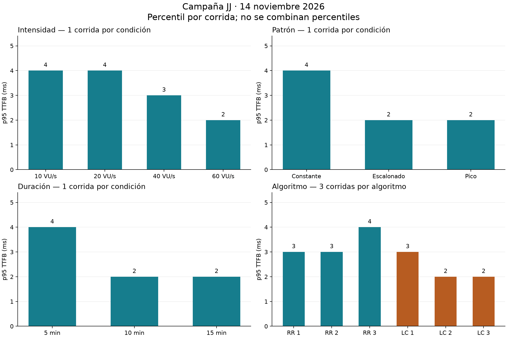

# Pruebas de carga — campaña JJ del 14 de noviembre de 2026

Fuente: JSON reales de Artillery y metadatos del ejecutor. Los algoritmos se identifican mediante las huellas SHA-256 de las configuraciones locales registradas. Esas huellas no certifican por sí solas la configuración efectiva del proceso HAProxy en ejecución.

## Método

Un GET `/` por usuario virtual, dirigido a `http://haproxy:8080`. La tasa configurada representa usuarios nuevos por segundo, no concurrencia fija. Se varía un factor por grupo; las comparaciones de intensidad, patrón y duración tienen una sola corrida por condición. Para algoritmos se hicieron tres corridas consecutivas de Round Robin y luego tres de Least Connections: 20 VU/s, 300 segundos y carga constante. El orden no fue aleatorizado.

Las seis repeticiones tienen las mismas huellas del escenario, Compose y Gunicorn, y el mismo plan de carga. No se registraron huellas históricas de la imagen construida de los backends ni del estado de recursos del equipo; no se afirma equivalencia total del entorno.

## Resultados

### Intensidad

| Condición | Solicitudes | Respuestas 2xx | Media ms | p50 ms | p95 ms | p99 ms | 4xx | 5xx | VU fallidos |
| --- | --- | --- | --- | --- | --- | --- | --- | --- | --- |
| 10 VU/s | 3000 | 3000 | 3.1 | 3 | 4 | 7.9 | 0 | 0 | 0 |
| 20 VU/s | 6000 | 6000 | 2.3 | 2 | 4 | 10.9 | 0 | 0 | 0 |
| 40 VU/s | 12000 | 12000 | 1.6 | 2 | 3 | 4 | 0 | 0 | 0 |
| 60 VU/s | 18000 | 18000 | 1.5 | 1 | 2 | 3 | 0 | 0 | 0 |

### Patrón

| Condición | Solicitudes | Respuestas 2xx | Media ms | p50 ms | p95 ms | p99 ms | 4xx | 5xx | VU fallidos |
| --- | --- | --- | --- | --- | --- | --- | --- | --- | --- |
| Constante | 6000 | 6000 | 2.3 | 2 | 4 | 10.9 | 0 | 0 | 0 |
| Escalonado | 3328 | 3328 | 1.5 | 1 | 2 | 2 | 0 | 0 | 0 |
| Pico | 1728 | 1728 | 1.5 | 1 | 2 | 4 | 0 | 0 | 0 |

### Duración

| Condición | Solicitudes | Respuestas 2xx | Media ms | p50 ms | p95 ms | p99 ms | 4xx | 5xx | VU fallidos |
| --- | --- | --- | --- | --- | --- | --- | --- | --- | --- |
| 5 min | 6000 | 6000 | 2.3 | 2 | 4 | 10.9 | 0 | 0 | 0 |
| 10 min | 12000 | 12000 | 1.5 | 1 | 2 | 3 | 0 | 0 | 0 |
| 15 min | 18000 | 18000 | 1.4 | 1 | 2 | 3 | 0 | 0 | 0 |

### Algoritmo

| Condición | Solicitudes | Respuestas 2xx | Media ms | p50 ms | p95 ms | p99 ms | 4xx | 5xx | VU fallidos |
| --- | --- | --- | --- | --- | --- | --- | --- | --- | --- |
| RR 1 | 6000 | 6000 | 1.6 | 2 | 3 | 4 | 0 | 0 | 0 |
| RR 2 | 6000 | 6000 | 1.6 | 2 | 3 | 4 | 0 | 0 | 0 |
| RR 3 | 6000 | 6000 | 2.1 | 2 | 4 | 7.9 | 0 | 0 | 0 |
| LC 1 | 6000 | 6000 | 1.6 | 2 | 3 | 4 | 0 | 0 | 0 |
| LC 2 | 6000 | 6000 | 1.6 | 2 | 2 | 3 | 0 | 0 | 0 |
| LC 3 | 6000 | 6000 | 1.6 | 2 | 2 | 3 | 0 | 0 | 0 |

## Interpretación y límites

- En las seis corridas comparativas se registraron 36.000 solicitudes, 36.000 respuestas HTTP 200 y cero usuarios fallidos. Round Robin obtuvo p95 de 3, 3 y 4 ms; Least Connections de 3, 2 y 2 ms. Son percentiles de cada corrida, no un percentil global de las 18.000 solicitudes por algoritmo.
- Least Connections tuvo un p95 menor en dos repeticiones y el mismo valor en otra. La diferencia absoluta de 1–2 ms, la carga ligera, tres repeticiones y el orden fijo no permiten afirmar superioridad general ni atribuir causalidad exclusivamente al algoritmo.
- Hasta 60 VU/s durante 300 s no se observaron fallos de usuarios ni respuestas 5xx en las corridas seleccionadas. Esto no determina la capacidad máxima ni demuestra saturación.
- A 20 VU/s, las ejecuciones de 5, 10 y 15 minutos no mostraron deterioro del p95 agregado. Un agregado no descarta picos breves de latencia.
- Los patrones no generan el mismo volumen: constante 6.000; escalonado 3.328; pico 1.728. Se comparte máximo de 20 VU/s y duración de 300 s, pero no carga media. El escalonado usa 66 s a 4, 66 s a 12, 100 s a 20 y 68 s a 4 VU/s. El pico usa 133 s a 4, 33 s a 20 y 134 s a 4 VU/s.
- `http.response_time` es tiempo hasta el primer byte (TTFB), en ms; no es tiempo completo de descarga. No se confunde con duración de sesión del usuario ni con tiempo de procesamiento del backend.
- El CSV conserva la tasa reportada por Artillery y la media calculada como solicitudes / ((lastMetricAt − firstMetricAt) / 1000). La ventana de métricas no equivale a la duración de fases. La discrepancia de tasas requiere interpretar ambas definiciones; no implica automáticamente fallo.
- Las corridas antiguas de calibración, errores forzados, recuperación y humo se conservan, pero no se mezclan con estas condiciones. Los 195 HTTP 500 de la prueba de errores no se atribuyen a esta campaña.
- No se recibieron exportaciones o capturas de Datadog para este informe. No se deducen CPU, memoria, reparto por backend ni exactitud de OpenMetrics a partir de Artillery. El README del proyecto registra una limitación pendiente de contadores Prometheus con dos workers.

## Trazabilidad y ventanas para Datadog

Cada fila del CSV identifica el JSON de origen. `trazabilidad.json` conserva sus hashes y los de los metadatos revisados. Una misma corrida base aparece en varios grupos, pero en el CSV se guarda una sola vez. Los horarios siguientes son del ejecutor (incluyen preparación y cierre), en Colombia UTC−05:00. El CSV también contiene la ventana exacta de métricas en epoch ms.

| Corrida | Inicio Colombia | Fin Colombia | ID |
| --- | --- | --- | --- |
| RR 1 | 2026-11-14 13:23:19 | 2026-11-14 13:28:29 | normal-constante-20vu-300s-20261114T182319104832Z-2903f136 |
| RR 2 | 2026-11-14 13:28:30 | 2026-11-14 13:33:37 | normal-constante-20vu-300s-20261114T182830273499Z-f99b0918 |
| RR 3 | 2026-11-14 13:33:38 | 2026-11-14 13:38:46 | normal-constante-20vu-300s-20261114T183338572298Z-e760d098 |
| LC 1 | 2026-11-14 13:46:20 | 2026-11-14 13:51:28 | normal-constante-20vu-300s-20261114T184620734623Z-6cb95610 |
| LC 2 | 2026-11-14 13:51:29 | 2026-11-14 13:56:36 | normal-constante-20vu-300s-20261114T185129261670Z-8e3ff9fe |
| LC 3 | 2026-11-14 13:56:37 | 2026-11-14 14:01:43 | normal-constante-20vu-300s-20261114T185637080493Z-aef019d1 |

## Pendientes para entrega

- Restaurar `balance roundrobin`, validar y aplicar la configuración; comprobar que el diff de HAProxy quede vacío.
- Incorporar evidencias de Datadog para los intervalos documentados, con zona horaria visible y unidades.
- Revisar el diff de Compose y guardar en Git únicamente cambios de JJ y evidencias seleccionadas. Excluir `.env`, respaldos, entornos virtuales y archivos temporales.
- Integrar el enlace al manual de carga en la sección 9 del README. Si la rúbrica exige tres repeticiones de todas las condiciones, las de intensidad, patrón y duración todavía tienen una sola; las tres repeticiones se completaron únicamente por algoritmo.

## Referencias de interpretación

- [Métricas HTTP de Artillery](https://www.artillery.io/docs/reference/engines/http)
- [Prometheus Python: modo multiproceso](https://prometheus.github.io/client_python/multiprocess/)
