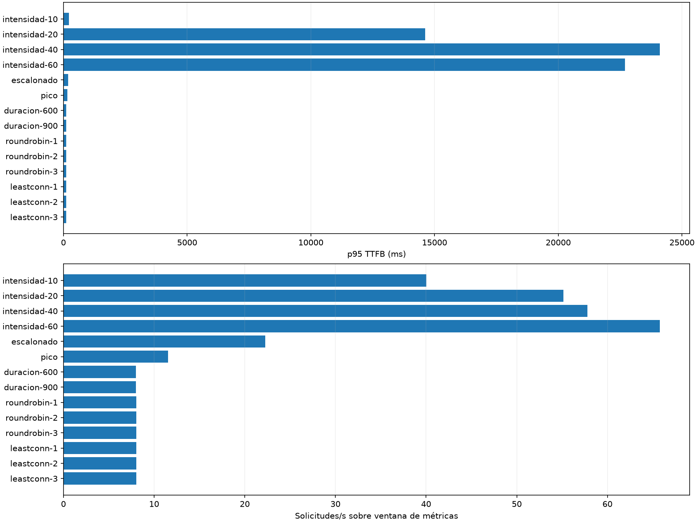

# Campaña de taquilla

Estado de ejecución: **completada**.

Esta campaña corresponde a la aplicación con PostgreSQL. No mezclar con la campaña histórica del backend simple.

Perfil: un inicio de sesión por VU, cartelera, sillas y mis reservas. Son cuatro peticiones por flujo completo; un VU que falla puede enviar menos. La reserva real y el CSRF se validan en una prueba funcional separada de un usuario. El perfil de rendimiento es de consultas autenticadas; no mide una mezcla de compras ni la contención de reservas.

| Corrida | Algoritmo | VU/s | Fases s | Solicitudes | RPS ventana | Media ms | p50 | p95 | p99 | 4xx | 5xx | VU fallidos | Flujos OK |
|---|---|---|---|---|---|---|---|---|---|---|---|---|---|
| intensidad-10 | roundrobin | 10 | 300 | 12000 | 40.031 | 51 | 8.900 | 228.200 | 399.500 | 0 | 0 | 0 | 3000 |
| intensidad-20 | roundrobin | 20 | 300 | 17200 | 55.125 | 4802.700 | 3464.100 | 14621.800 | 18220 | 0 | 3634 | 3650 | 2350 |
| intensidad-40 | roundrobin | 40 | 300 | 18415 | 57.771 | 4969.800 | 1 | 24107.700 | 28862.300 | 0 | 10603 | 11625 | 375 |
| intensidad-60 | roundrobin | 60 | 300 | 21447 | 65.785 | 3018.400 | 0 | 22703.700 | 30040.300 | 0 | 15132 | 17975 | 25 |
| escalonado | roundrobin | 10 | 300 | 6656 | 22.248 | 43.700 | 8.900 | 186.800 | 308 | 0 | 0 | 0 | 1664 |
| pico | roundrobin | 10 | 300 | 3456 | 11.552 | 41.200 | 8.900 | 156 | 383.800 | 0 | 0 | 0 | 864 |
| duracion-600 | roundrobin | 2 | 600 | 4799 | 8.010 | 31.900 | 8.900 | 113.300 | 141.200 | 0 | 0 | 1 | 1199 |
| duracion-900 | roundrobin | 2 | 900 | 7200 | 8.008 | 30.900 | 8.900 | 111.100 | 127.800 | 0 | 0 | 0 | 1800 |
| roundrobin-1 | roundrobin | 2 | 300 | 2400 | 8.022 | 30.500 | 7.900 | 106.700 | 127.800 | 0 | 0 | 0 | 600 |
| roundrobin-2 | roundrobin | 2 | 300 | 2400 | 8.019 | 31 | 8.900 | 111.100 | 133 | 0 | 0 | 0 | 600 |
| roundrobin-3 | roundrobin | 2 | 300 | 2400 | 8.023 | 30.400 | 8.900 | 106.700 | 125.200 | 0 | 0 | 1 | 599 |
| leastconn-1 | leastconn | 2 | 300 | 2400 | 8.022 | 30.500 | 8.900 | 108.900 | 127.800 | 0 | 0 | 0 | 600 |
| leastconn-2 | leastconn | 2 | 300 | 2400 | 8.022 | 30.300 | 7.900 | 108.900 | 127.800 | 0 | 0 | 0 | 600 |
| leastconn-3 | leastconn | 2 | 300 | 2400 | 8.023 | 31.600 | 8.900 | 111.100 | 162.400 | 0 | 0 | 0 | 600 |

## Lectura de los resultados

Se observaron errores o usuarios fallidos en: intensidad-20, intensidad-40, intensidad-60. Correlacionar las ventanas con CPU, colas y latencias antes de atribuir la causa a saturación.

roundrobin: p95 por repetición = 106.7, 111.1, 106.7 ms. No constituye un percentil combinado ni una prueba de superioridad general.

leastconn: p95 por repetición = 108.9, 108.9, 111.1 ms. No constituye un percentil combinado ni una prueba de superioridad general.

## Evidencia y límites

- Latencia HTTP de Artillery: TTFB en ms. No se promedian percentiles para presentar un percentil global.
- RPS ventana = solicitudes / ventana de métricas. El CSV conserva también la tasa reportada por Artillery.
- Las intensidades son tasas de llegada de VU. Los fallos bajo carga se conservan como resultados, no se descartan.
- Patrones: referencia constante a 10 VU/s; escalonado y pico tienen máximo 10 VU/s y base 2. Sus volúmenes difieren.
- Duración y algoritmos usan la tasa base del manifiesto. Se mantienen las mismas consultas y workers.
- Orden fijo y equipo compartido: no atribuir diferencias pequeñas exclusivamente al algoritmo.
- El inicio de sesión puede dominar el coste. Para afirmar saturación correlacionar errores/latencia con CPU, memoria y colas.
- La campaña anterior se conserva como histórica. Los ensayos de proporciones de operaciones, pausas, contención y workers se coordinan con Gargamel.
- Pendiente incorporar capturas/exportaciones del dashboard en las ventanas indicadas abajo.

## Ventanas UTC para Datadog

| Corrida | Inicio UTC | Fin UTC |
|---|---|---|
| intensidad-10 | 2026-11-15T02:14:27.691326+00:00 | 2026-11-15T02:19:34.560715+00:00 |
| intensidad-20 | 2026-11-15T02:19:35.368303+00:00 | 2026-11-15T02:24:58.264873+00:00 |
| intensidad-40 | 2026-11-15T02:24:59.003176+00:00 | 2026-11-15T02:30:23.739575+00:00 |
| intensidad-60 | 2026-11-15T02:30:30.513457+00:00 | 2026-11-15T02:36:03.345407+00:00 |
| escalonado | 2026-11-15T02:36:30.249109+00:00 | 2026-11-15T02:41:40.829926+00:00 |
| pico | 2026-11-15T02:41:41.642655+00:00 | 2026-11-15T02:46:48.167200+00:00 |
| duracion-600 | 2026-11-15T02:46:48.978125+00:00 | 2026-11-15T02:56:53.640809+00:00 |
| duracion-900 | 2026-11-15T02:56:54.446504+00:00 | 2026-11-15T03:11:59.615438+00:00 |
| roundrobin-1 | 2026-11-15T03:12:00.432415+00:00 | 2026-11-15T03:17:12.810477+00:00 |
| roundrobin-2 | 2026-11-15T03:17:13.619183+00:00 | 2026-11-15T03:22:18.088517+00:00 |
| roundrobin-3 | 2026-11-15T03:22:18.986538+00:00 | 2026-11-15T03:27:31.390074+00:00 |
| leastconn-1 | 2026-11-15T03:27:37.406302+00:00 | 2026-11-15T03:32:42.570247+00:00 |
| leastconn-2 | 2026-11-15T03:32:43.357409+00:00 | 2026-11-15T03:37:51.886436+00:00 |
| leastconn-3 | 2026-11-15T03:37:52.674664+00:00 | 2026-11-15T03:42:57.138995+00:00 |

