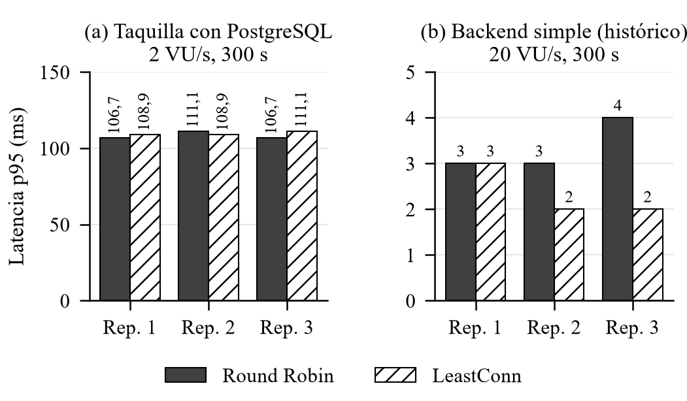
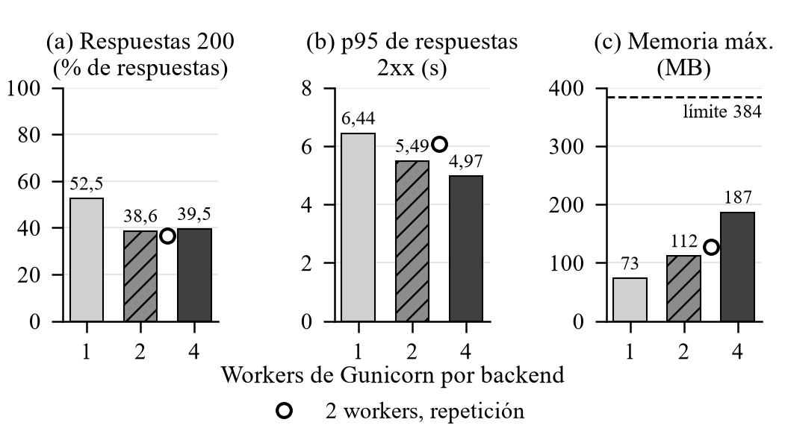

# Matrices de decisión · Proyecto 8

Evaluación y selección de alternativas para el clúster HAProxy + Datadog de la "Taquilla Sucursal". Cada número sale de un archivo crudo del repo o de documentación oficial con URL. Lo que no se midió dice **estimado**.

- Libro de cálculo con fórmulas: [`matriz-decision.xlsx`](matriz-decision.xlsx). Tiene una hoja por matriz, una de sensibilidad, una de restricciones y una de fuentes. Celdas azules: datos crudos o puntajes con su fuente en un comentario. Celdas negras: fórmulas. Pesos en amarillo.
- Tablas cortas para el informe: [`tablas-informe.md`](tablas-informe.md).
- Figuras (8,9 cm, 300 dpi, escala de grises): [`fig-rr-vs-leastconn.png`](fig-rr-vs-leastconn.png) y [`fig-workers.png`](fig-workers.png).
- Muestra de logs con la que se midió el tamaño por línea: [`muestra-logs-haproxy-20261116.txt`](muestra-logs-haproxy-20261116.txt).

## 0. Método común

**Qué se decide con matriz y qué no.** HAProxy y Datadog los impone el cliente (PDF del Proyecto 8), así que no se puntúan: van como restricción en la sección 1. Las matrices se hacen solo sobre decisiones donde había opción y hay datos: algoritmo de balanceo, workers de Gunicorn, formato de logs y forma en que el Agent lee a HAProxy.

**Escala.** De 1 a 5, donde 5 es lo mejor. El puntaje ponderado es `SUMPRODUCT(pesos; puntajes)` y los pesos suman 100 %.

**Reglas de puntaje** (iguales en las cuatro matrices):

| Tipo de criterio | Regla | Ejemplo |
|---|---|---|
| Medido, menor es mejor (latencia, bytes) | 5 al mejor; se resta 1 punto por cada 10 % que la alternativa quede por encima del mejor; mínimo 1 | p95 de 108,9 ms frente a 106,7 ms: 2,1 % peor, sigue en 5 |
| Medido, mayor es mejor (éxito, throughput) | 5 al mejor; se resta 1 punto por cada 10 % por debajo; mínimo 1 | 38,6 % de respuestas 200 frente a 52,5 %: 26 % peor, queda en 2 |
| Recurso con límite duro (memoria, conexiones, CPU) | Fracción del límite: 5 si < 20 %, 4 si < 40 %, 3 si < 60 %, 2 si < 80 %, 1 si más | 186,6 MB de 384 MB = 48,6 %, queda en 3 |
| Cualitativo (documentación o juicio) | Puntaje en celda azul con la frase de la fuente en un comentario. Si no se midió, dice "estimado" | `leastconn ... not very well suited for ... HTTP` [1] |

La regla del 10 % evita premiar diferencias que caben en el ruido de una sola máquina: dos corridas iguales de 2 workers difirieron 10,5 % en el p95 de respuestas 2xx (ver matriz 2).

**Pesos.** Asignación directa, y cada peso se justifica con un requisito del PDF, la rúbrica o una restricción del equipo (12 GB de RAM, VM de Docker de 4,74 GiB, demo hoy antes de las 7:00 p. m.). Los pesos se fijaron antes de leer los totales y **no se ajustaron** cuando una matriz dio una alternativa distinta a la implementada.

**Sensibilidad.** Se cambia el peso de un criterio (x) y los demás se reescalan para seguir sumando 100 %. Con d = puntaje(A) − puntaje(B), D = Σ w·d y R = (D − w·d)/(1 − w), las dos alternativas empatan en x\* = R/(R − d). Si x\* no cae entre 0 % y 100 %, ese criterio no voltea la decisión. La hoja `Sensibilidad` calcula x\* con fórmulas.

## 1. Restricciones del cliente (no se puntúan)

| Componente | Requisito del PDF que cubre | Por qué encaja (evidencia) |
|---|---|---|
| HAProxy 2.6 | Balanceador con al menos 3 backends HTTP, estadísticas, socket Unix y logging estructurado | Health check `inter 1s fall 3`: marca DOWN a los 5 a 6 s (E3). Socket Unix `level user`, solo lectura [8]. `log-format` propio en JSON [2] |
| Datadog (Agent 7.85.1) | Agent con `haproxy.d/conf.yaml`, logs, dashboard con 4 indicadores y al menos 2 monitores | Integración HAProxy por socket [4]; JSON parseado sin pipeline [5]; 3 monitores con correo; `[Triggered]` a 60 s de detener `backend1` (E3) |
| Docker Compose | Nada instalado en el host; `DD_API_KEY` en `.env`; configuraciones montadas | 7 servicios, volumen `haproxy-socket` compartido, límite de 1 CPU y 384 MB por backend |
| Artillery 2.0.34 | Escenarios normal, pico y errores en un contenedor aparte | Perfil `tools`; métricas por DogStatsD al Agent para la correlación (README §10.5) |

## 2. Matriz 1 · Algoritmo de balanceo (Round Robin frente a LeastConn)

**Datos.** Campaña de Juan José sobre la Taquilla con PostgreSQL (E1): 3 corridas de 300 s por algoritmo a 2 VU/s, cada VU hace login, cartelera, sillas y mis reservas. Orden fijo (primero RR y luego LC), un solo equipo. Los p95 no se promedian: se resume con la mediana de los tres p95.

| Criterio | Cómo se mide | Peso | Por qué ese peso | RR | LC | Puntaje RR | Puntaje LC |
|---|---|---:|---|---:|---:|---:|---:|
| C1 Latencia p95 | ms, TTFB de Artillery, mediana de 3 p95 (E1) | 25 % | El PDF pide latencia en el dashboard; es lo que siente el usuario | 106,7 | 108,9 | 5 | 5 |
| C2 Flujos completos | Flujos OK / VU creados, Artillery (E1) | 20 % | Rúbrica: prototipo sin fallas; monitor de 5xx | 99,94 % (1.799/1.800) | 100 % (1.800/1.800) | 5 | 5 |
| C3 Throughput | req/s en la ventana de métricas, media de 3 corridas (E1) | 10 % | La tasa de llegada es fija, así que casi no discrimina | 8,021 | 8,022 | 5 | 5 |
| C4 Adecuación a HTTP de sesiones cortas | Manual de HAProxy 2.6, `balance` [1] | 15 % | La Taquilla es HTTP con peticiones cortas (p50 de unos 9 ms) | "smoothest and fairest" | "not very well suited for ... HTTP" | 5 | 3 |
| C5 Comportamiento con backends saturados | RR medido: entre 10 y 20 VU/s cae a 39,17 % de flujos completos (E2). LC no se probó; [1] dice que considera la cola "to minimize queuing" | 15 % | Riesgo real del cliente: picos de venta | Medido | **Estimado** | 3 | 4 |
| C6 Reparto verificable en Datadog | Reparto tras recuperar un backend: 31/34/34 % (E3) | 5 % | Es verificación, no desempeño | 31/34/34 % | **Estimado** | 5 | 4 |
| C7 Riesgo de cambio antes de la demo | P3 y la prueba de errores ya están medidas con RR (E3) | 10 % | Rúbrica: modelo sin fallas; demo hoy | Ninguno | Repetir P3 y errores (**estimado**) | 5 | 3 |
| **Total** | | **100 %** | | | | **4,70** | **4,30** |

**Resultado.** Gana **Round Robin** (4,70 frente a 4,30; ventaja de 8,5 %). **Coincide** con lo implementado (`balance roundrobin`).

**Sensibilidad.** Solo C5 voltea el resultado: LeastConn gana si el comportamiento en saturación pasa de 15 % a **39,3 %** del peso (24 puntos más). C1, C2 y C3 están empatados en puntaje y C4, C6 y C7 favorecen a RR, así que ninguno lo voltea. Cambiar un solo puntaje en 1 punto mueve como mucho 0,25 y no alcanza a cerrar la diferencia de 0,40.

**Reflexión.** Con carga normal los dos algoritmos son iguales: 106,7 frente a 108,9 ms de p95 es una diferencia de 2 %, menor que la que hubo entre repeticiones del mismo RR (106,7 a 111,1 ms), y en el backend simple histórico LC tuvo 1 ms menos (E6, Fig. a y b). La decisión la mueven la documentación de HAProxy, que recomienda RR para HTTP corto, y el riesgo de rehacer P3 horas antes de la demo. El hueco honesto es que LeastConn nunca se midió en saturación, justo donde podría ganar. Mejora futura: repetir la intensidad de 20 VU/s con LeastConn en orden aleatorio.

## 3. Matriz 2 · Workers de Gunicorn por backend (1, 2 o 4)

**Datos.** Experimentos de Sharon (E4 y E5): rampa de 2 a 12 VU/s durante 6 min, backends con 1 CPU y 384 MB, 4 hilos por worker. Una corrida por configuración y una repetición de 2 workers que no se puntúa pero sirve para ver la variabilidad. **Las tres corridas saturaron la CPU** (cerca de 1 núcleo en la fase alta) y tuvieron entre 47 % y 61 % de respuestas 503, así que la matriz compara bajo sobrecarga y no en operación normal.

| Criterio | Cómo se mide | Peso | Por qué ese peso | 1 | 2 | 4 | P1 | P2 | P4 |
|---|---|---:|---|---:|---:|---:|---:|---:|---:|
| C1 Respuestas exitosas | HTTP 200 / respuestas, Artillery (E4) | 25 % | Rúbrica: sin fallas; monitor de error > 5 % | 52,5 % | 38,6 % | 39,5 % | 5 | 2 | 3 |
| C2 Flujos completos | VU completados / creados (E4) | 10 % | Operación de negocio terminada; se cruza con C1, por eso pesa menos | 61,1 % | 56,3 % | 53,1 % | 5 | 4 | 4 |
| C3 p95 de respuestas 2xx | ms, Artillery `http.response_time.2xx` (E4). No se usa el p95 global porque los 503 rápidos lo bajan | 20 % | El PDF pide latencia | 6.439,7 | 5.487,5 | 4.965,3 | 2 | 4 | 5 |
| C4 Memoria máxima | Mayor promedio por fase y backend / 384 MB, Datadog (E5) | 15 % | Equipo de 12 GB con VM de 4,74 GiB, stack, Artillery y grabación | 73,2 MB (19,1 %) | 111,7 MB (29,1 %) | 186,6 MB (48,6 %) | 5 | 4 | 3 |
| C5 Conexiones a PostgreSQL | % del máximo de 100, Datadog (E5) | 10 % | Cada worker abre su propio pool | 13 % | 25 % | 49 % | 5 | 4 | 3 |
| C6 CPU con carga baja | Promedio de los 3 backends en la fase baja / 1 núcleo (E5) | 10 % | Costo fijo del proceso; en la fase alta los tres llegan a 1 núcleo y no distinguen | 24,2 % | 25,2 % | 58,1 % | 4 | 4 | 3 |
| C7 Ajuste a la recomendación | \|workers − (2 × núcleos + 1)\| con 1 núcleo [6] | 10 % | Punto de partida del fabricante | 1 (dist. 2) | 2 (dist. 1) | 4 (dist. 1) | 3 | 4 | 4 |
| **Total** | | **100 %** | | | | | **4,10** | **3,50** | **3,60** |

**Resultado.** Gana **1 worker** (4,10), luego 4 workers (3,60) y al final 2 workers (3,50). **No coincide** con lo implementado (`WEB_CONCURRENCY` por defecto 2).

**Sensibilidad.**
- 1 worker frente a 4 workers: gana 4 workers si el p95 de respuestas 2xx (C3) pasa de 20 % a **31,4 %**, o si el ajuste a la recomendación (C7) pasa de 10 % a 40 %. Si C1 baja a 0 %, quedan empatados.
- 1 worker frente a 2 workers (lo implementado): 2 workers gana solo si C1 baja de 25 % a **6,3 %**, si C3 sube a **38,5 %** o si C7 sube a 43,7 %.
- Variabilidad medida: la repetición de 2 workers dio 36,6 % de respuestas 200 (frente a 38,6 %) y p95 de 2xx de 6.064,7 ms (frente a 5.487,5 ms, +10,5 %). El p95 global pasó de 3.072,4 a 4.147,4 ms (+35 %). La ventaja de 1 worker en C1 (14 puntos porcentuales) es más grande que esa variación; la de 4 workers en latencia no lo es tanto.

**Reflexión.** Bajo sobrecarga, con 1 CPU por contenedor, más procesos compiten por el mismo núcleo: 1 worker entregó más respuestas 200 y gastó menos memoria y conexiones, mientras 4 workers bajaron la latencia de las respuestas que sí salieron. Se mantienen 2 workers por tres razones, sin mover pesos: (1) todo P1 a P5, la caída, los errores y la campaña de Juan José se midieron con 2 workers, y cambiarlo horas antes de la demo invalida esa evidencia; (2) con carga normal (2 VU/s) 2 workers dio 0 errores 5xx y p95 de 106,7 a 111,1 ms (E1), y no hay datos de 1 worker en ese régimen; (3) la documentación de Gunicorn indica que los workers aíslan fallos [6], y con 1 worker un proceso colgado deja al backend sin atender. Mejora futura: repetir 1, 2 y 4 workers con 3 corridas cada uno por debajo de la saturación (por ejemplo 8 VU/s) y probar 1 worker con más hilos.

## 4. Matriz 3 · Formato de logs de HAProxy (JSON frente a syslog texto)

**Datos.** El PDF acepta "JSON o syslog", así que las dos pasan el filtro. Tamaño de JSON **medido** a las 15:15 con `docker compose logs haproxy`: 272 líneas, mediana 273 B, media 274,5 B, máximo 290 B. Tamaño de syslog **estimado**: las mismas 272 peticiones reescritas con el formato exacto de `option httplog` [2] y cabecera RFC 3164 dan una mediana de 165 B (132 B sin cabecera).

| Criterio | Cómo se mide | Peso | Por qué ese peso | JSON | syslog | P JSON | P syslog |
|---|---|---:|---|---:|---:|---:|---:|
| C1 Parseo en Datadog sin pipeline | Doc. oficial: "Datadog automatically parses JSON-formatted logs" [5]; el texto necesita Grok | 30 % | PDF: logs a Datadog; P4 Log Management | Automático (implementado) | Pipeline de integración (**estimado**, no verificado) | 5 | 4 |
| C2 Campos con nombre para facetas | Campos con nombre por línea (fórmula en la hoja) | 20 % | El dashboard filtra por `@server` y mide tiempos | 15 | Posicionales (**estimado**) | 5 | 4 |
| C3 Tamaño por línea | Bytes, mediana | 15 % | Disco y RAM del equipo; volumen de ingesta | 273 (medido) | 165 (**estimado**) | 1 | 5 |
| C4 Coherencia con el resto del stack | Backends y Gunicorn ya escriben JSON con nivel (README §7) | 10 % | P4: una sola forma de consultar | Igual | Distinto | 5 | 3 |
| C5 Robustez ante entradas del cliente | Escape `json(utf8s)` y recorte `bytes(0,512)` frente a codificación de no imprimibles [2] | 10 % | Sin fallas: una comilla no debe romper el log | Implementado | **Estimado** | 5 | 4 |
| C6 Esfuerzo de configuración | Directivas en `haproxy.cfg` | 10 % | Costo de una sola vez | 3 | 1 | 3 | 5 |
| C7 Legibilidad humana en consola | Lectura directa en `docker compose logs` | 5 % | No lo pide el PDF: se explora en Datadog | Verboso | Compacto | 3 | 4 |
| **Total** | | **100 %** | | | | **4,10** | **4,15** |

**Resultado.** **Empate técnico** con syslog arriba por 0,05 puntos (1,2 %). **No coincide** con lo implementado (JSON).

**Sensibilidad.** Es la matriz más frágil: basta bajar el peso del tamaño de 15 % a **13,9 %** (1,1 puntos) o subir el parseo de 30 % a 33,3 % para que gane JSON. Lo mismo pasa con un solo puntaje: si el pipeline de integración no reconoce el formato y syslog baja a 3 en C1, gana JSON por 4,10 frente a 3,85.

**Reflexión.** La única ventaja grande de syslog es el tamaño: unos 108 B menos por línea, cerca de 40 % (por ejemplo, 12.000 peticiones en 5 min serían 3,3 MB en JSON frente a 2,0 MB en texto, **estimado**). Las ventajas de JSON están verificadas en el prototipo (parseo sin pipeline, 15 campos con nombre, mismo formato que los backends). Las de syslog en parseo y facetas son estimadas. Se mantiene JSON porque el empate está dentro del error de esas estimaciones y cambiarlo obligaría a rehacer las consultas del dashboard y de Log Explorer antes de la demo. Mejora futura: si el volumen crece, medir el costo de ingesta y probar `option httplog` con el pipeline de integración de Datadog durante 10 minutos.

## 5. Matriz 4 · Cómo lee el Datadog Agent a HAProxy

**Datos.** Documentación oficial de Datadog [4] y de HAProxy [3] [8], y la prueba P3 de Sharon (E3). Se verificó que la imagen `haproxy:2.6` (2.6.35) trae el exportador Prometheus compilado: `haproxy -vv` muestra `USE_PROMEX=1` y `Built with the Prometheus exporter as a service`.

| Criterio | Cómo se mide | Peso | Por qué ese peso | Socket Unix | Stats HTTP 8404 | Prometheus | P S | P H | P P |
|---|---|---:|---|---|---|---|---:|---:|---:|
| C1 Requisito literal del PDF | "haproxy.cfg montado con socket Unix; socket compartido por volumen" | 30 % | Requisito explícito del cliente | Sí | No | No | 5 | 1 | 1 |
| C2 Service check para el monitor de backend caído | `haproxy.backend_up`: "Converts the HAProxy status page into service checks" [4] | 20 % | PDF: monitor de backend DOWN; P3 medido con él | Sí | Sí | Otra métrica (**estimado**) | 5 | 5 | 3 |
| C3 Exposición de red | Puertos TCP que HAProxy abre para el Agent | 15 % | Menos superficie, menos riesgo | 0 | 1 | 1 | 5 | 3 | 3 |
| C4 Recomendación del proveedor | Datadog: Prometheus "(recommended)"; stats y socket quedan "as a reference for legacy users" [4] | 15 % | Soporte futuro del Agent | Heredado | Heredado | Recomendado | 2 | 2 | 5 |
| C5 Costo de generar métricas | "a PROMEX dump is 5x slower and 20x more verbose than a CSV export" [3] | 10 % | Equipo de 12 GB; lectura cada 5 s | CSV | CSV | 5x, 20x | 5 | 5 | 2 |
| C6 Riesgo de cambio antes de la demo | Cambios de configuración, monitores y dashboard | 10 % | Demo hoy | Ninguno | Cambiar `url` (**estimado**) | Regla nueva y monitores nuevos (**estimado**) | 5 | 4 | 2 |
| **Total** | | **100 %** | | | | | **4,55** | **2,95** | **2,50** |

**Resultado.** Gana **socket Unix** (4,55; ventaja de 1,60 puntos, 35 %). **Coincide** con lo implementado.

**Sensibilidad.** Frente a stats HTTP, ningún cambio de un solo peso voltea la decisión. Frente a Prometheus, solo C4 lo hace: el peso de la recomendación del proveedor tendría que pasar de 15 % a **49,5 %**. Aun quitando el requisito del PDF (C1 en 0 % y el resto reescalado), el socket sigue primero: 4,36 frente a 3,79 y 3,14.

**Reflexión.** La matriz confirma el socket, pero no por costumbre: además del requisito, da el service check que usa el monitor de caída (medido en P3: DOWN en HAProxy a 5 s y `[Triggered]` a 60 s), no abre puertos y genera las métricas en CSV, que es más barato. El costo es que Datadog considera este modo heredado y recomienda Prometheus. Si el requisito del socket desapareciera, la migración a OpenMetrics V2 sería directa porque el exportador ya viene en la imagen. Mejora futura: probar OpenMetrics V2 en paralelo y rehacer el monitor de caída sobre la métrica de estado de los servidores.

## 6. Decisiones menores (sin matriz)

**Aplicación de los backends.** Se pasó de una API simple a la Taquilla con PostgreSQL. La API simple aguantó hasta 60 VU/s durante 300 s con 18.000 respuestas 200 y 0 errores (E6), así que no ponía a prueba los monitores. La Taquilla, con login, sesión, CSRF y reservas, se degrada entre 10 y 20 VU/s (a 20 VU/s solo 39,17 % de flujos completos y 3.634 respuestas 5xx, E2) y además permite probar contención real: 50 reservas simultáneas sobre la misma silla dejaron 1 respuesta 201 y 49 respuestas 409 (README §10.12; Registro §5.5.2). Eso da fallas realistas para el dashboard y las alertas.

**Intervalo de recolección del check de HAProxy.** Datadog usa 15 s por defecto [7]; el proyecto usa 5 s (`min_collection_interval: 5`). En P3, HAProxy marcó el backend DOWN a los 5 s y el monitor pasó a `[Triggered]` 60 s después de la orden (E3). El tiempo de alerta lo domina la evaluación del monitor, no la lectura: pasar de 15 a 5 s recorta como mucho unos 10 s de esos 60 s, a cambio de 3 veces más lecturas del socket (**estimado**). Se deja en 5 s porque el costo es bajo (CSV por socket) y la caída se ve antes en el dashboard.

## 7. Fuentes

| Id | Fuente | URL o ruta |
|---|---|---|
| [1] | HAProxy 2.6 Configuration Manual, §4.2 `balance` | https://docs.haproxy.org/2.6/configuration.html#4.2-balance |
| [2] | HAProxy 2.6 Configuration Manual, §8.2.3 HTTP log format y §8.2.6 Custom log format | https://docs.haproxy.org/2.6/configuration.html#8.2.3 |
| [3] | HAProxy, PROMEX README (exportador Prometheus) | https://github.com/haproxy/haproxy/blob/v2.6.0/addons/promex/README |
| [4] | Datadog Docs, HAProxy integration | https://docs.datadoghq.com/integrations/haproxy/ |
| [5] | Datadog Docs, Log pipelines (preprocesamiento JSON) | https://docs.datadoghq.com/logs/log_configuration/pipelines/ |
| [6] | Gunicorn Docs, Design: How Many Workers? (repositorio oficial de la documentación) | https://github.com/benoitc/gunicorn/blob/master/docs/content/design.md |
| [7] | Datadog Docs, Writing a custom Agent check (`min_collection_interval`, 15 s por defecto) | https://docs.datadoghq.com/developers/custom_checks/write_agent_check/ |
| [8] | HAProxy 2.6 Management Guide, comandos del socket Unix | https://docs.haproxy.org/2.6/management.html#9.3 |
| E1 | Campaña Taquilla de Juan José, RR frente a LC | `docs/evidencias/taquilla-20261115T021421969646Z/20261115T041213186994Z/resumen.csv` |
| E2 | Cierre verificado de la campaña (intensidad) | `docs/evidencias/taquilla-20261115T021421969646Z/cierre-verificado.md` |
| E3 | Caída y recuperación de `backend1` (Sharon) | README §10.8 y §10.10; `docs/evidencias/pruebas/Registro-de-pruebas.md` §4 |
| E4 | Artillery, experimentos de workers (Sharon) | `docs/evidencias/pruebas/04-experimentos/resultados/1worker.txt`, `2workers.txt`, `2workersRE.txt`, `4workers.txt` |
| E5 | Datadog vía `analizar_datadog.py`, experimentos de workers | `reportes_datadog/workers-*.html`; Registro §5.3.3 y §5.3.4 |
| E6 | Campaña histórica del backend simple | `docs/evidencias/carga-jj-20261114/resumen_campana.csv` |

Nota de trazabilidad: el Registro §5.3 no menciona la repetición de 2 workers (`2workersRE.txt`). Sus cifras de 1, 2 y 4 workers coinciden con los archivos crudos.
